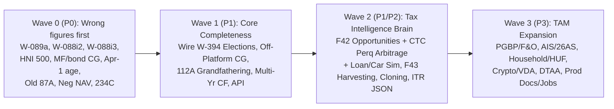

# WealthLens Tax v2 — Master Product Requirements Document (PRD v2.0)
## Senior CA Live Audit + Exhaustive Proactive Tax Strategy & Opportunity Engine ("Tax Intelligence Brain")

> **Date:** 2026-11-28
> **Authors:** Senior Principal Product Manager × Senior Chartered Accountant (India)
> **Scope:** Exhaustive line-by-line audit of all **248 shipped rules** in `taxengine` (TY 2025-26 Income-tax Act, 1961 & TY 2026-27 Income-tax Act, 2025) + `taxplanning` (57 REST routes) + `portfolio` bridge.
> **Source of the figures:** Every rupee cap, percentage, monthly perquisite value and year span in Part B is read from `backend/src/main/resources/rulepacks/timeline/law/rules/*.json` (about 60 rules re-checked in the 2026-11-28 review, all matching). Any lock-in, clawback or unmodelled section not in the repository's Gazette copies is marked **`[NEEDS GAZETTE VERIFICATION]`**; a statement with no source is marked **`[UNSOURCED]`**.
>
> **Review, 2026-11-28 (corrections applied):** Part A restated against the code (BUG-01 narrowed, BUG-02 an unanswered ruling, BUG-04 already W-089e, BUG-03 widened to bonds); the untracked items placed in `../BACKLOG.md` as W-436 – W-439, and W-088i3 re-placed (lost from tracking at W-435); the LTA rule ids and G3.11's total corrected; F18 and F36 marked existing; W-126d and W-131i described as their rows state; Wave 0 led by the three parked rows that can give a wrong figure (D-781 A); §4.4 added for what the review found missing.

---

## 1. Product Vision & Why v2.0 Is Truly Best-in-Class

Most Indian tax apps only know 80C, 80D, and HRA — which makes them **nearly useless in `NEW_TAX_REGIME`**, the default regime (s.115BAC(1A) / s.202(1); `RATE-SLAB-NEW-TAX-REGIME`). *(How many salaried taxpayers use it: `[UNSOURCED]` — no figure is cited here.)*

A **Senior CA advising a ₹15L–₹2Cr+ Indian taxpayer** knows that the biggest legal tax savings — especially in the **New Tax Regime** — come from **four combined pillars**:
1. **CTC-to-Perquisite & Allowance Arbitrage (Works in BOTH New & Old Regimes!):** Converting taxable Special Allowance into **Company-Leased Car + Fuel + Chauffeur (Driver)**, **Company-Leased Accommodation**, **Employer NPS (14% in New Regime!)**, **Meal Vouchers (₹200/meal in TY 2026-27 — BOTH regimes!)**, **Telephone/Broadband & Laptop/Tablet/Mobile**, **Conveyance / Disabled Transport**, and **Employer Asset Buyback at WDV**.
2. **Life-Event & Multi-Year Financing Levers:** **Home Loan** (Self-Occupied ₹2L/yr + 5-yr completion window + 5-yr pre-construction 1/5th spread + Co-owner ₹2L×2 multiplier + Let-Out unlimited interest vs rent + 80C principal), **Education Loan** (80E unlimited interest for 8 years), **Health Insurance** (80D up to ₹1L/yr + multi-year spread), **LTA** (2 journeys / 4-yr block), and **Retirement/Separation Timing** (Gratuity ₹20L, Leave Encashment ₹25L, Commuted Pension).
3. **Portfolio & Capital Gains Intelligence (Works in BOTH Regimes!):** **₹1.25L Tax-Free LTCG Harvesting**, **STCL/LTCL Tax-Loss Harvesting** (without wasting LTCL below ₹1.25L!), **Hold-N-Days-for-LTCG** alerts, **s.54F/s.86** (and s.54/s.54EC) reinvestment, and **112A Grandfathering**.
4. **Zero-Outlay Structural Elections & Cliff Optimization:** **Regime Switch** (including detecting when a *bundle* of Old-Regime levers flips the optimal regime), **House Election** (`W-394`), **Set-Off Order Election** (`W-394`), **87A/s.156 Rebate Cliff** (₹12L New / ₹5L Old), and **Surcharge Marginal-Relief Cliffs** (₹50L / ₹1Cr / ₹2Cr / ₹5Cr).

### Non-Negotiable Architecture Invariants
- **Facts, not rules (`CLAUDE.md` §4):** Zero caps, percentages, perquisite rates, city lists, or year spans hardcoded in Java. Everything is read from the locked tax-year `RulePack`.
- **Measured, never approximated (`01-PRD.md` F33.1):** Every rupee of `measuredTaxSaved` is computed by running the real `TaxCalculator` pipeline on a counterfactual `EngineInputs` — automatically capturing slab jumps, 87A rebate cliffs, surcharge marginal relief (100%+ effective rate zones!), and 4% cess.
- **Show ALL + Group Conflicts + Optimal Bundle:** Never hide an opportunity because the user is currently in New Regime or hasn't bought a house yet. Show **every** legally applicable lever, organize competing levers into **"This or That" Conflict Groups (G1–G9)**, **rank all levers** by configurable priority, and compute the **Optimal Non-Conflicting Action Bundle** verified by one final combined `TaxCalculator` run.
- **Strict Separation of Statutory Tax vs Financial Projection:** Any loan amortization or CTC-conversion assumption (e.g., 8.5% loan rate, ₹3.5L car lease cost) is explicitly marked **Illustrative Financial Math** and lives in `taxplanning`, keeping `taxengine` 100% pure single-year statutory law.

---

## 2. Part A — Wave 0: Live Senior CA Defects to Close First

The audit's scenarios named five defects. The review re-read each against the code (no test was run for it): two are genuine and untracked (BUG-01, BUG-03), one is a stale guard (BUG-05), one is an earlier ruling never answered (BUG-02), and one is already a tracked parked row (BUG-04). The "CA-01" scenario and its figures are in no file in the repository.

| ID | Sev | Defect (re-read against the code, 2026-11-28) | Exact Code Citation | Fix |
|---|---|---|---|---|
| **BUG-01** → `W-436` | **P0** | **A high earner's deferment relief can answer HTTP 500:** `recomputeOn` builds its store with `NodeContext.forRun(pack, regime, other, withheld)` (`:210`), whose recomputation throws (`NodeContext.java:114-119`). When the inputs *without* the income arising after an instalment date still exceed a surcharge threshold, `ThresholdLadderCeiling` asks for U (`:37`) and `SurchargeNode` calls `ctx.recomputed(TAX_AFTERREBATE, ...)`. **Read from the code, not run.** Meera is *not* reached by this reading: without her ₹5,50,000 gain her income (₹45,75,000 basic less the standard deduction) is below ₹50,00,000, so no threshold is crossed (`Fixtures.java:112-116`). | `backend/src/main/java/com/thiru/wealthlens/taxengine/pipeline/PipelineRunner.java:208-219`, `.../node/SurchargeNode.java:316`, `.../rules/relief/ThresholdLadderCeiling.java:37` | Let `recomputeOn` re-enter for U, bounded to one level; a test that fails first, on salary alone above ₹50,00,000 plus a gain after 15 June. |
| **BUG-02** → `W-439` | **Owner ruling** | **The 1-April birthday was flagged and never answered:** `DECISIONS.md:1237` took age as completed years at `taxYearEnd()` "by calendar reckoning, flagged for OQ-1", but OQ-1 is rule-pack sign-off (closed by D-163). `Period.between(dob, taxYearEnd)` gives `1966-04-01` age 59 in TY 2025-26. Whether that is wrong turns on a source not yet read: **"CBDT Circular 28/2016" is in no source file here `[UNSOURCED]`**, and the "₹21,300 overcharge" has no test or file behind it. | `.../pipeline/NodeContext.java:370`, `.../node/AdvanceTaxNode.java:104`, `.../node/HealthInsuranceDeduction.java:336` | Read the primary source, then rule; compute age in one place either way; 31 March / 1 April / 2 April cases. Severity set after the ruling. |
| **BUG-03** → `W-437` | **P0** | **A mutual-fund, bond or gold-bond sale is refused:** `CapitalGainsAdapter.java:75` passes `AssetType.name()`; `AssetType` holds `MUTUAL_FUND`, `BOND`, `GOLD_BOND` (`AssetType.java:4-10`), but `RS-CG-TERM` covers only `EQUITY` and `LAND_OR_BUILDING`, so `IllegalArgumentException` (400) refuses the whole draft. Mutual-fund trades are live (D-826). | `.../node/CapitalGainsTerm.java:63`, `.../taxplanning/portfolio/CapitalGainsAdapter.java:75` | Gazette-sourced `RS-CG-TERM` & `RS-CG-PART` rows for each kind; first decide which fact classifies a fund (equity share, s.50AA's specified fund) and which module publishes it. |
| **BUG-04** = `W-089e` | **P1** (already tracked) | **Old-regime rebate with special-rate tax is refused by design:** the parked row `W-089e` (board `K`) covers it. `IllegalStateException` reaches the caller as a 500, not a 400 — a deliberate refusal reported as a server fault. | `.../node/RebateNode.java:111-114` | Unpark `W-089e`; read s.87A, s.112A(6), 2025 s.156(1), s.198(7) in the primary copies first. |
| **BUG-05** → `W-438` | **P2** | **A negative annual value is refused on a finished item's name:** the guard says it "waits on set-off (W-081)", and W-081 is finished (D-217 – D-219). A 400, not a 500. | `.../node/HousePropertyNode.java:195-198` | Read 2025 s.21 – s.22 / 1961 s.23 – s.24 on a negative annual value and its standard deduction, then compute or refuse with a sourced reason. `[NEEDS GAZETTE VERIFICATION]` for the PRD's "30% floored at ₹0". |

*Plus two CA verification items:* **CA-02** (explicit CA warning / Gazette re-check on New Regime let-out HP loss destruction at `.../node/SetOffNode.java:181-189`) and **CA-08** (verify s.234C(1) proviso / s.425(4) when 100% of Q4 CG tax is paid by Mar 15 while minor salary tax remains unpaid).

---

## 3. Part B — Complete Gazette-Verified Opportunity Catalogue (All 9 Groups, Every Modelled Lever)

Every rule below is verified `SOURCE_CHECKED` in `backend/src/main/resources/rulepacks/timeline/law/rules/*.json`.

### Group G1 — Regime Choice & Structural Elections *(Zero Cash Outlay)*
| # | Lever | RuleId(s) | 1961 / 2025 Act | Statutory Rule & Windows | Regimes | Conflict / Notes |
|---|---|---|---|---|---|---|
| **G1.1** | **Regime Election (New vs Old)** | `RATE-SLAB-NEW-TAX-REGIME` vs `RATE-SLAB-FIRST-SCHEDULE*` | s.115BAC(1A) vs First Sch. / s.202(1) vs First Sch. | Default `NEW_TAX_REGIME`; opt-out to `FIRST_SCHEDULE_RATES` by return due date (`s.139(1)`/`s.263(1)`). Annual choice for non-business assessees. | `MUTUALLY_EXCLUSIVE` | Master switch; unlocks all Old-only levers |
| **G1.2** | **87A / s.156 Rebate Cliff Targeting** | `REBATE-NEW-TAX-REGIME`, `-EXCESS`, `REBATE-RESIDENT-INDIVIDUAL` | s.87A / s.156(1)–(3) | **New:** 100% of slab tax up to **₹60,000** for TI ≤ **₹12,00,000** + marginal relief above ₹12L (slab tax only). **Old:** up to **₹12,500** for TI ≤ **₹5,00,000**. | Regime-specific | Reducing TI just above ₹12L/₹5L via deductions/perquisites yields extreme marginal savings |
| **G1.3** | **Optimal Self-Occupied House Election** | `HP-OWN-RESIDENCE` + `HouseElection` | s.23(2),(4)(a) / s.21(6),(7)(a) | Elect cheapest **2** of 3+ non-let houses as nil-AV self-occupied. | **BOTH** | Wire `W-394` into `TaxCalculator` |
| **G1.4** | **Optimal Inter-Head Set-Off Order** | `SETOFF-ACROSS-HEADS` + `SetOffOrderElection` | s.71 / s.109(1) | Elect loss absorption order (e.g., 30% slab before 12.5% LTCG). | Old (HP) / **BOTH** (OS) | Wire `W-394` into `TaxCalculator` |

---

### Group G2 — Housing Strategy: Rent vs Company-Leased Accommodation vs Home Loan
| # | Lever | RuleId(s) | 1961 / 2025 Act | Max Annual Benefit | Min/Max Years, Windows & Lock-ins | Regimes | "This or That" Conflicts |
|---|---|---|---|---|---|---|---|
| **G2.1** | **Company-Leased / Rent-Free Accommodation (CTC Arbitrage!)** | `PERQ-ACCOM-LEASED`, `PERQ-ACCOM-OWNED`, `PERQ-ACCOM-FURNITURE` | s.17(2)(i)–(ii) + r.3(1) / s.17(1)(a)–(b) + r.15(2) | **Leased:** taxable at `min(lease rent, 10% of salary)`. **Owned:** **10% / 7.5% / 5%** of salary by city population (>40L / >15L / else). Furniture: +10% of cost. *Excess rent over 10% of salary is tax-free!* | Annual (while employed) | **BOTH** (**works in New Regime!**) | `MUTUALLY_EXCLUSIVE` with HRA (`G2.2`) & 80GG (`G2.3`). Best New-Regime housing lever when rent > 10% of salary! |
| **G2.2** | **House Rent Allowance (HRA)** | `SAL-HOUSE-RENT-ALLOWANCE`, `SAL-HOUSE-RENT-LANDLORD-PAN` | s.10(13A)+r.2A / Sch. III Sl. 11+r.279 | Least of: HRA received; Rent − 10% Salary; **50%** metro (**4 cities** TY25; **8 cities** incl. Bengaluru, Hyderabad, Pune, Ahmedabad TY26) / **40%** non-metro. Landlord PAN if rent > **₹1,00,000**. | Annual, per occupation period | **Old only** | `MUTUALLY_EXCLUSIVE` with `G2.1` & `G2.3` (80GG). **CAN coexist** with Home Loan (`G2.4`/`G2.6`) on bona fide tenancy! |
| **G2.3** | **Rent Paid without HRA (80GG / s.134)** | `DED-RENT-PAID` | s.80GG+r.11B / s.134+r.65 | Least of: Rent − 10% TI; **₹5,000/month** (₹60k/yr); **25%** of TI. Form 10BA / Form 31. | Monthly / annual | **Old only** | `MUTUALLY_EXCLUSIVE` with HRA (`G2.2`), Company Accommodation (`G2.1`), and owning a self-occupied house at work city or elsewhere. |
| **G2.4** | **Home Loan Interest — Self-Occupied** | `HP-OWN-RESIDENCE-INTEREST`, `-CAP`, `-HIGHER-LIMIT` | s.24(b) provisos / s.22(2),(4),(5) | **₹2,00,000/yr** aggregate across up to 2 own residences (**₹30,000/yr** if repair/renewal or missed 5-yr window). **Per co-owner** individually (`s.26(2)`/`s.24(2)` → **₹4L** for co-owning couple!). | **Completion window:** within **5 years** from end of borrowing tax year (`completionYearsAfterBorrowingYear: 5`). **Tenure:** no statutory min/max tenure — deductible every year interest is payable. | **Old only** | `NO_DOUBLE_DIP_SAME_RUPEE` with 80EE/80EEA (`G2.8`). |
| **G2.5** | **Home Loan Pre-Construction Interest (1/5th Spread)** | `HP-PRE-CONSTRUCTION`, `HP-OWN-RESIDENCE-PRE-CONSTRUCTION` | s.24(b) Expl. / s.22(1)(c),(3) | **1/5th (20%) per year** of prior-period interest (inside ₹2L cap for self-occupied; uncapped for let-out). | **Exact 5 tax years** (`TaxYearSpan: succeedingYears = 4`: completion year + 4 succeeding years). | Let-out: **BOTH**. Self-occ: **Old** (TY25), **BOTH** (TY26)! | Cannot include interest already claimed under another provision. |
| **G2.6** | **Home Loan Interest — Let-Out Property** | `HP-INTEREST`, `HP-STANDARD-DEDUCTION`, `SETOFF-HOUSE-PROPERTY`, `SETOFF-CARRIED-HOUSE-PROPERTY` | ss.24(a)–(b), 71(3A), 71B / ss.22(1)(a)–(b), 109(1)(b), 110 | **30%** flat deduction on NAV + **100% of interest (no cap)** against rent. Net HP loss offsets Salary up to **₹2,00,000/yr** (Old); excess carried forward. | **Carry-forward:** **8 succeeding tax years** against HP income (`requiresReturnFiledInTime: false`). | Interest vs Rent: **BOTH**. ₹2L inter-head set-off: **Old only**. (CA-02 New Regime CF warning.) | Trade-off vs `G2.4`: Let-out works in **New Regime** against rental income! |
| **G2.7** | **Home Loan Principal Repayment (80C / Sch. XV)** | `DED-SCHEDULE-XV` (`HOUSE_PURCHASE_PAYMENT`) | s.80C(2)(xviii) / s.123 Sch. XV | Up to **₹1,50,000/yr** shared ceiling. | **5-yr transfer clawback** (s.80C(5)): **`[NEEDS GAZETTE VERIFICATION]`**. | **Old only** | `SHARED_CEILING` with all 26 Schedule XV items (`G4.1`). |
| **G2.8** | **80EE / 80EEA First-Time Home Loan** | `DED-HOUSE-LOAN-EARLIER`, `DED-HOUSE-LOAN` | s.80EE / s.130; s.80EEA / s.131 | 80EE: **₹50,000/yr**; 80EEA: **₹1,50,000/yr** (over & above s.24(b)/s.22(2)). | **`RETROSPECTIVE_CHECK` ONLY:** Sanction windows closed (`2016–17` for 80EE; `2019–22` for 80EEA). | **Old only** | 80EE ↔ 80EEA `MUTUALLY_EXCLUSIVE`; `NO_DOUBLE_DIP_SAME_RUPEE` with `G2.4`. |

---

### Group G3 — CTC Restructuring: Car, Driver (Chauffeur), Allowances, Perquisites & Employer Funds
> **Senior CA Breakthrough:** Almost ALL perquisite arbitrage levers in **G3-A, G3-B, G3-C** work in **BOTH `NEW_TAX_REGIME` AND `FIRST_SCHEDULE_RATES`**!

#### G3-A. Motor Car, Chauffeur (Driver), Fuel & Conveyance Arbitrage *(BOTH Regimes!)*
| # | Lever | RuleId(s) | 1961 / 2025 Act | Taxable Perquisite Value (TY 25-26 → TY 26-27) | Tax Arbitrage & CA Edge Cases | Regimes |
|---|---|---|---|---|---|---|
| **G3.1** | **Company-Owned / Leased Car + Employer Pays Fuel/Maint + Chauffeur (Mixed Use)** | `PERQ-CAR-PATH-PARTLY`, `PERQ-CAR-PARTLY-SMALL/LARGE/ELECTRIC`, `PERQ-CAR-CHAUFFEUR` | s.17(2)(iii)+r.3(2) Table II / s.17(1)(c)+r.15(3) Table II | **TY25:** Small (≤1600cc) **₹1,800/mo**, Large (>1600cc) **₹2,400/mo**, Chauffeur **+₹900/mo** (₹32.4k–₹39.6k/yr). **TY26:** Small/Electric **₹5,000/mo**, Large **₹7,000/mo**, Chauffeur **+₹3,000/mo** (₹96k–₹1.2L/yr). | **Massive arbitrage:** Any actual lease + fuel + maintenance + driver cost *above* Table II flat value is **100% tax-free**! **Trap 1:** Only **1st car** gets Table II rate; 2nd+ car is taxed as wholly private (`10% cost + 100% running`). **Trap 2:** Non-specified employees (monetary salary ≤ ₹4L, `PERQ-SPECIFIED-EMPLOYEE`) pay **₹0**! | **BOTH** |
| **G3.2** | **Company Car + Employee Pays Private Running (+ Chauffeur)** | `PERQ-CAR-PATH-OWNRUN`, `PERQ-CAR-OWNRUN-SMALL/LARGE/ELECTRIC`, `PERQ-CAR-CHAUFFEUR` | Same | **TY25:** Small **₹600/mo**, Large **₹900/mo**, Chauffeur **+₹900/mo**. **TY26:** Small/Electric **₹2,000/mo**, Large **₹3,000/mo**, Chauffeur **+₹3,000/mo**. | Best when employee drives mostly privately and pays own fuel, while company leases the car out of CTC. | **BOTH** |
| **G3.3** | **Employee's Own Car + Employer Reimburses Fuel/Maint/Driver (Mixed Use)** | `PERQ-CAR-PATH-EMPLOYEE`, `PERQ-CAR-EMPLOYEE` | s.17(2)(iv)+r.3(2) / s.17(1)(f)+r.15(3) | Taxable = `Actual reimbursement − Table II official-use amount` (**₹1,800/₹2,400 + ₹900/mo** in TY25; **₹5,000/₹7,000 + ₹3,000/mo** in TY26 — **OR** actual official share if logbook + certificate kept!). | Tax-free up to **₹32.4k–₹39.6k/yr (TY25)** → **₹96k–₹1.2L/yr (TY26)** on your own car! Note: Taxable for *all* employees (no ₹4L specified-employee exemption). | **BOTH** |
| **G3.4** | **Wholly Official Car / Own Two-Wheeler Conveyance** | `PERQ-CAR-PATH-OFFICIAL`, `PERQ-CAR-CONVEYANCE` | Same | Wholly official (with logbook + employer certificate): **₹0 taxable**. Own other conveyance (2-wheeler): reimbursement minus **₹900/mo (TY25)** / **₹3,000/mo (TY26)**. | Missing logbook/certificate causes refusal/full taxation! | **BOTH** |

#### G3-B. Workplace Perquisites, Gadgets, Meals, Gifts, Loans & Asset Buyback *(BOTH Regimes!)*
| # | Lever | RuleId(s) | 1961 / 2025 Act | Statutory Tax-Free Limit (TY 25-26 → TY 26-27) | Regimes | Notes |
|---|---|---|---|---|---|---|
| **G3.5** | **Meal Vouchers / Food at Work** | `PERQ-MEAL-VOUCHER`, `PERQ-MEAL-AT-WORK`, `-TEA-SNACKS`, `-REMOTE` | r.3(7)(iii) / r.15(5) Table IV Sl. 3 | **TY25:** **₹50/meal** (vouchers Old only; at-work Both). **TY26:** **₹200/meal** (**BOTH regimes!** — e.g., 2 meals × 22 days × 12 mos ≈ **₹1,05,600/yr tax-free**). Tea/snacks & remote site = ₹0. | TY25 vouchers: Old; **TY26: BOTH** | Huge TY 2026-27 New-Regime CTC unlock! |
| **G3.6** | **Telephone / Broadband + Laptop / Tablet / Mobile Phone** | `PERQ-TELEPHONE`, `PERQ-ASSET-USE-EXCLUDED` | r.3(7)(vii),(ix) / r.15(5) Table IV Sl. 7, 9 | Telephone/broadband: **100% exempt (₹0)**. Excluded movable assets: **TY25** `LAPTOP_OR_COMPUTER`; **TY26** adds **`TABLET`, `MOBILE_PHONE`** = **₹0 taxable**. | **BOTH** | Zero-friction FBP component |
| **G3.7** | **Employer Asset Transfer (Buyback at Depreciated WDV)** | `PERQ-ASSET-TRANSFER-ELECTRONIC`, `-CAR`, `-OTHER` | r.3(7)(viii) / r.15(5) Table IV Sl. 8 | Depreciation per completed year of use: **Electronics/Computers 50% WDV**, **Motor Car 20% WDV**, **Other Assets 10% SLM**. Paying WDV = **₹0 perquisite**. | **BOTH** | E.g., 3-yr-old company laptop bought at 12.5% of cost = ₹0 tax |
| **G3.8** | **Employer Gifts, Petty Loans, Official Credit Card, Club, Free Education** | `PERQ-GIFT`, `PERQ-LOAN-PETTY`, `PERQ-CREDIT-CARD-OFFICIAL`, `PERQ-CLUB-*`, `PERQ-EDUCATION-FREE` | r.3(5),(7) / r.15(4)–(5) | **Gift:** ₹5k → **₹15,000**. **Petty interest-free loan:** ₹20k → **₹2,00,000**. **Free education (employer inst.):** ₹1k → **₹3,000/child/mo**. Official credit card & uniform/business health club = **₹0**. | **BOTH** | All limits substantially raised in TY 2026-27! |

#### G3-C. Statutory Salary Allowances & Employer Retirement Funds
| # | Lever | RuleId(s) | 1961 / 2025 Act | Max Annual Benefit (TY 25-26 → TY 26-27) | Min/Max Years & Liquidity | Regimes | Conflicts / Traps |
|---|---|---|---|---|---|---|---|
| **G3.9** | **Employer NPS (Corporate NPS)** | `DED-NPS-EMPLOYER-NEW-TAX-REGIME`, `-OTHER`, `-GOVT`, `PERQ-EMPLOYER-CONTRIBUTION` | s.80CCD(2), s.17(2)(vii) / s.124(1)–(2), s.17(1)(h) | Private: **14% of Basic+DA (New)** / **10% (Old)**. Govt: **14% (Both)**. **Hard Trap:** Employer PF + NPS + Superannuation > **₹7,50,000/yr** is taxed as perquisite + annual accretion (`PERQ-EMPLOYER-ACCRETION`)! | **Gazette PFRDA 2025 Regs (`CG-DL-E-16122025-268548`):** Non-govt exit after **15 yrs** or age 60 (min 20% annuity; ≤₹8L 100% lump sum); partial withdrawal 25% of own contrib after **3 yrs**. | **BOTH** (**#1 New Regime deduction!**) | `SHARED_CEILING` ₹7.5L employer contrib cap with EPF & Superannuation |
| **G3.10** | **Conveyance & Disabled Transport Allowances** | `SAL-ALW-CONVEYANCE`, `SAL-ALW-TRANSPORT-DISABLED` | s.10(14)+r.2BB / Sch. III Sl. 12–13+r.280 | **Conveyance:** actual official spend incurred. **Disabled Transport:** **₹3,200/mo (TY25)** → **₹15,000/mo** (other cities ₹8k/mo) + DA thereon (**TY26**, adds `ORTHOPAEDIC_UPPER_EXTREMITIES`). | Monthly / annual | **BOTH** | — |
| **G3.11** | **Children Education, Hostel & Uniform Allowances** | `SAL-ALW-CHILDREN-EDUCATION`, `SAL-ALW-HOSTEL`, `SAL-ALW-UNIFORM` | Same | **TY25 → TY26:** CEA ₹100 → **₹3,000/child/mo** (max 2 = **₹72k/yr**); Hostel ₹300 → **₹9,000/child/mo** (max 2 = **₹2.16L/yr**); Uniform: actual incurred. | Monthly / annual | **Old only** | Huge TY26 Old-Regime unlock (**₹2.88L/yr** for 2 children with both allowances: ₹72k CEA + ₹2.16L hostel) |
| **G3.12** | **Leave Travel Concession (LTA)** | `SAL-LEAVE-TRAVEL-CONCESSION`, `SAL-LEAVE-TRAVEL-JOURNEYS`, `SAL-LEAVE-TRAVEL-CHILDREN`, `SAL-LEAVE-TRAVEL-DISTANCE-RATE` | s.10(5)+r.2B / Sch. III Sl. 8+r.278 | Actual domestic fare (TY26 adds **₹30/km** when no rail/public transport). Max 2 surviving children (post-Oct-1998). | **2 journeys per 4-calendar-year block** (current block **2026–2029**; 1 carry-over into year 1 of next block). | **Old only** | — |
| **G3.13** | **Standard Deduction & Professional Tax & Agniveer** | `SAL-STANDARD-DEDUCTION-*`, `SAL-TAX-ON-EMPLOYMENT`, `DED-AGNIVEER-*` | s.16(ia),(iii), 80CCH / s.19, 125 | Std Ded: **₹75k (New)** / **₹50k (Old)** auto. Prof Tax: actual (Old). Agniveer: 100% (Govt Both; Own Old). | Annual | Std Ded & Govt Agniveer: **BOTH** | — |

---

### Group G4 — Personal Retirement & Long-Term Savings
| # | Lever | RuleId(s) | 1961 / 2025 Act | Max Annual Benefit | Lock-in & Traps | Regimes |
|---|---|---|---|---|---|---|
| **G4.1** | **Schedule XV / Section 80C (26 Contributors)** | `DED-SCHEDULE-XV`, `DED-PREMIUM-SHARE` | ss.80C, 80CCC, 80CCD(1), 80CCE / s.123 Sch. XV | **₹1,50,000/yr** aggregate (EPF, VPF, PPF, ELSS, LIC, Home Loan Principal, Tuition Fees, SCSS, 5-yr FD, SSY, Employee NPS ≤10% salary). LIC capped at 10%/15%/20% of sum assured. | **Trap 1:** VPF/EPF employee contrib > **₹2.5L/yr** (₹5L if no employer contrib) makes excess interest taxable (`OS-PF-TAXABLE-INTEREST`). **Trap 2:** ULIP > ₹2.5L / Non-ULIP > ₹5L loses 10(10D) tax-free maturity (`OS-LIFE-POLICY-PREMIUM`). **Instrument lock-ins (ELSS 3y, FD 5y, PPF 15y, SSY 21y):** `[NEEDS GAZETTE VERIFICATION]`. | **Old only** |
| **G4.2** | **Own NPS + Minor NPS (NPS Vatsalya)** | `DED-NPS-OWN` | s.80CCD(1B) + FA 2025 s.17(a) / s.124(3)–(5),(10) | **₹50,000/yr** over & above ₹1.5L Schedule XV (shared across own + minor account). | PFRDA 2025 Regs (`CG-DL-E-16122025-268548`). `NO_DOUBLE_DIP_SAME_RUPEE` with G4.1 (claimed under s.124(3) first). | **Old only** |

---

### Group G5 — Health, Disability & Protection
| # | Lever | RuleId(s) | 1961 / 2025 Act | Max Annual Benefit | Tenure / Rules & Conflicts | Regimes |
|---|---|---|---|---|---|---|
| **G5.1** | **Health Insurance & Medical — Self/Family (80D)** | `DED-HEALTH-FAMILY*`, `-CHECKUP`, `-SPREAD` | s.80D / s.126 | **₹25,000** (<60) or **₹50,000** (senior ≥60); includes **₹5,000** preventive check-up (cash OK; premiums non-cash). Multi-year lump-sum spread `1/N` per year (`DED-HEALTH-SPREAD`). | Medical expenditure (up to ₹50k) **ONLY** for an **uninsured** senior (`MUTUALLY_EXCLUSIVE` with health insurance on that person). | **Old only** |
| **G5.2** | **Health Insurance & Medical — Parents (80D)** | `DED-HEALTH-PARENTS*` | s.80D / s.126 | Separate **₹25,000** (<60) or **₹50,000** (senior ≥60). Combined G5.1+G5.2 up to **₹1,00,000/yr**. | Shares ₹5,000 check-up sub-cap with G5.1. | **Old only** |
| **G5.3** | **Specified Disease / Disability (Fact-Based)** | `DED-SPECIFIED-DISEASE*` (80DDB), `DED-DISABLED-DEPENDANT*` (80DD), `DED-DISABILITY*` (80U) | ss.80DDB, 80DD, 80U / ss.128, 127, 154 | 80DDB: **₹40k / ₹1L** (senior). 80DD: **₹75k / ₹1.25L** (Fixed TY25; **"up to" actual TY26!**). 80U: **₹75k / ₹1.25L** fixed. | `MUTUALLY_EXCLUSIVE`: dependant claiming 80U cannot be claimed under 80DD. | **Old only** |

---

### Group G6 — Education & Purpose Loans
| # | Lever | RuleId(s) | 1961 / 2025 Act | Max Annual Benefit | Min/Max Years & Actionability | Regimes |
|---|---|---|---|---|---|---|
| **G6.1** | **Higher Education Loan Interest** | `DED-EDUCATION-LOAN` | s.80E / s.129 | **100% of interest paid — NO monetary ceiling!** (Self, spouse, children, legal ward). | **`PROSPECTIVE_ACTION`** (no sanction cutoff). **Max 8 tax years** (`succeedingYears: 7`: initial payment year + 7 succeeding years, or until paid in full). | **Old only** |
| **G6.2** | **Electric Vehicle Loan Interest** | `DED-ELECTRIC-VEHICLE-LOAN` | s.80EEB / s.132 | **₹1,50,000/yr** interest. | **`RETROSPECTIVE_CHECK` ONLY:** Sanction window closed (`2019-04-01`–`2023-03-31`). | **Old only** |

---

### Group G7 — Capital Gains & Portfolio Strategy *(BOTH Regimes!)*
| # | Lever | RuleId(s) | 1961 / 2025 Act | Max Benefit & Windows | CA Edge Cases | Regimes |
|---|---|---|---|---|---|---|
| **G7.1** | **₹1,25,000 Tax-Free LTCG Harvesting (`F43`)** | `RATE-CG-LONG-LISTED-EQUITY` | s.112A(2) / s.198(2) | **₹1,25,000/yr** at **0%** (saves **₹16,250/yr** at 12.5%+4% cess, more with surcharge). Resets every April 1; holding > **12 months**. | Must execute before March 31; account for brokerage + STT (`brokercharges` engine!). | **BOTH** |
| **G7.2** | **Tax-Loss Harvesting (`F43`)** | `SETOFF-WITHIN-CAPITAL-GAINS`, `SETOFF-CARRIED-CAPITAL-GAINS` | ss.70(2)–(3), 74, 80 / ss.108(2), 111, 121 | Offsets STCG (20%+cess) or LTCG (12.5%+cess); excess carries forward **8 years** (**requires timely return!**). | **Edge Case:** Never harvest LTCL that merely wipes out 0%-taxed LTCG ≤ ₹1.25L! Remember STCL offsets STCG+LTCG; LTCL offsets LTCG only. | **BOTH** |
| **G7.3** | **Hold-N-Days-for-LTCG Alert (`F43`)** | `CG-TERM-LISTED-SECURITY`, `CG-TERM-LAND-BUILDING` | s.2(42A) / s.2(101) | Cuts listed-equity tax from **20% → 12.5%** + unlocks ₹1.25L exemption (>12m equity; >24m land/building). | Uses `TaxCalculator.termIfSold`'s exact `longTermFrom` date. | **BOTH** |
| **G7.4** | **Residential House Reinvestment (s.54F / s.86)** | `CG-EXEMPT-RESIDENTIAL-HOUSE` | s.54F(1) / s.86(1),(5),(8) | Exempts LTCG proportionally up to **₹10 Cr** new house cost. **Windows:** Buy **12m before / 24m after**; Construct **36m after**. Bar: ≤1 other house owned, 0 other houses acquired. | Currently `EQUITY` only (`W-088i4` widens); CGAS deposit (`W-088i2`) & charge-backs (`W-088i3`, re-placed 2026-11-28) — both parked rows that can give a wrong figure (D-781 A); the charge-back period `[NEEDS GAZETTE VERIFICATION]`. | **BOTH** |
| **G7.5** | **s.54 (House→House) & s.54EC (₹50L Bonds)** | *Planned (Wave 1)* | s.54, s.54EC / s.82, s.85 `[NEEDS GAZETTE VERIFICATION]` | s.54EC: up to ₹50L within 6m, 5-yr lock-in `[NEEDS GAZETTE VERIFICATION]`. | Complementary / `MUTUALLY_EXCLUSIVE` with s.54F by original asset kind. | **BOTH** |

---

### Group G8 — Giving & Deposit Interest
| # | Lever | RuleId(s) | 1961 / 2025 Act | Max Annual Benefit | Conflicts & Edge Cases | Regimes |
|---|---|---|---|---|---|---|
| **G8.1** | **Donations (80G / s.133)** | `DED-DONATION-*` | s.80G / s.133 | 100% or 50% (qualifying funds capped at **10% of Adjusted GTI**); cash > **₹2,000** disallowed; donee must file Form 10BD. | Circularity if 10% limit binds alongside 80GG (`ChapterEightNode.java:124-128`). | **Old only** |
| **G8.2** | **Savings / Deposit Interest (80TTA / 80TTB)** | `DED-SAVINGS-INTEREST`, `DED-DEPOSIT-INTEREST-SENIOR` | s.80TTA, 80TTB / s.153 | Non-senior/HUF: **₹10,000** (savings only). Resident Senior (≥60): **₹50,000** (savings + FDs). | `MUTUALLY_EXCLUSIVE` by age. | **Old only** |

---

### Group G9 — Retirement, Separation & Other-Sources Planning *(Mostly BOTH Regimes!)*
| # | Lever | RuleId(s) | 1961 / 2025 Act | Statutory Limit / Rule | CA Planning Edge Case | Regimes |
|---|---|---|---|---|---|---|
| **G9.1** | **Gratuity & Leave Encashment at Retirement** | `RET-GRATUITY-*`, `RET-LEAVE-ENCASHMENT-*` | s.10(10), 10(10AA) / s.19(1)–(2) | Govt: 100% exempt. Private lifetime aggregates: Gratuity **₹20,00,000**, Leave Encashment **₹25,00,000**. | **Huge CA tip:** Leave encashed *during* employment is 100% taxable; encashed *at retirement/separation* is exempt up to ₹25L! | **BOTH** |
| **G9.2** | **Commuted Pension & VRS** | `RET-COMMUTED-PENSION-*`, `RET-VOLUNTARY-RETIREMENT` | s.10(10A), 10(10C) / s.19(1) | Commuted pension: 100% (Govt/Fund), **1/3rd** (with gratuity) or **1/2** (without). VRS: ₹5L **once-in-a-lifetime**, `MUTUALLY_EXCLUSIVE` with s.89 arrears relief. | Track lifetime ledger (`LedgerSnapshot.retirementAllowedBefore`). | **BOTH** |
| **G9.3** | **Family Pension & Dividend Interest Cutoff** | `OS-FAMILY-PENSION*`, `OS-DIVIDEND-INTEREST` | s.57(iia), s.57 prov. / s.93(1)(d), s.93(2) | Family pension: 1/3rd up to **₹25,000 (New)** vs **₹15,000 (Old)**. Dividend interest expense: **20% (TY25)** → **0% (TY26)**! | Warn TY 2026-27 investors that margin-loan interest against dividends is no longer deductible! | **BOTH** |

---

## 4. Part C — The "Tax Intelligence Brain" Architecture (`F42` + Upgraded `SalaryOptimiser` + `F43`)

### 4.1 Upgrading `SalaryOptimiser` to Support CTC-to-Perquisite Arbitrage
Today `SalaryOptimiser` (`taxengine/optimise/SalaryOptimiser.java`) only moves `SALARY` pay lines, `EmployerFund`s, and `EMPLOYEE_CONTRIBUTION`s — it **cannot** convert Special Allowance into a Company-Leased Car + Chauffeur, Company-Leased Accommodation, Meal Vouchers (₹200/meal), or Telephone/Gadgets!
- **v2 Upgrade:** Introduce `PerquisiteConversion` candidates in `AllocationSpace` (each backed by the real `EmployerVehicle`, `EmployerAccommodation`, `EmployerMeals`, `EmployerExpenseBenefit` inputs), subject to `cashFloor` and `hrSupportLikelihood`, so the optimiser evaluates **BOTH**:
  - *Traditional Old-Regime restructuring* (HRA + LTA + CEA/Hostel + 80C + Own NPS + 80D), AND
  - *Modern New-Regime CTC restructuring* (**Employer NPS 14% + Company-Leased Car & Chauffeur + Company-Leased Accommodation + Meal Vouchers ₹200/meal + Telephone/Gadgets**)!

### 4.2 Conflict Graph, Grouping, Priority & Optimal Bundle Solver
1. **Every Opportunity Carries Full Structured Metadata:**
   - `group` (`G1`–`G9`), `ruleIds[]`, `provisions` (`1961` + `2025`), `verificationLevel`
   - `actionKind`: `STRUCTURAL_ELECTION` | `CTC_PERQUISITE_ARBITRAGE` | `PROSPECTIVE_ACTION` | `PORTFOLIO_ACTION` | `RETROSPECTIVE_CHECK`
   - `regimeCompatibility`: `WORKS_IN_CURRENT_REGIME` | `UNLOCKS_IN_OLD_REGIME` | `UNLOCKS_IN_NEW_REGIME` | `FLIPS_OPTIMAL_REGIME`
   - `maxAnnualDeduction`, `alreadyUsed`, `remainingRoom`
   - `measuredTaxSavedCurrentRegime` & `measuredTaxSavedOptimalRegime` (exact `TaxCalculator` runs!)
   - `requiredCashOutlay`, `efficiencyPercent` (`taxSaved / cashOutlay × 100`, `∞` for zero-outlay)
   - `statutoryWindows`: `{minYears, maxYears, completionWindowYears, carryForwardYears, sanctionWindow, blockYears}` (all read from pack!)
   - `liquidityTerms` (from `exec/*/liquidity` with Gazette provenance; `"Unverified"` if unsourced)
   - `conflictsWith[]` (`MUTUALLY_EXCLUSIVE`, `SHARED_CEILING`, `NO_DOUBLE_DIP_SAME_RUPEE`), `traps[]` (e.g., ₹7.5L employer cap, ₹2.5L VPF cap, 2nd-car trap, ₹1.25L LTCL waste), `hrSupportLikelihood`
2. **Multi-Factor Priority Ranking (Always Show ALL):**
   - Users see **every** applicable lever (grouped by `G1`–`G9` AND as a flat ranked list), sortable by:
     - `RECOMMENDED` (composite score: Measured Tax Saved × Cash Efficiency × Actionability × Regime Compatibility, boosting zero-outlay elections & New-Regime-compatible CTC arbitrage)
     - `MAX_TAX_SAVED` | `BEST_EFFICIENCY` | `HIGHEST_LIQUIDITY` | `URGENT_DEADLINE`
3. **Optimal Non-Conflicting Bundle Solver:**
   - Solves across **both regimes** respecting all conflict edges and optional constraints (`maxCashOutlay`, `includeMajorLifeEvents`, `includeEmployerRestructuring`, `allowRegimeSwitch`).
   - Executes **one final combined `TaxCalculator.compute`** on the selected bundle so `optimalBundle.totalTaxSaved` is **exact to the paisa** (zero double-counting across overlapping caps or slab/surcharge boundaries).

### 4.3 REST API Contract & Acceptance Criteria
- `POST /api/v1/me/tax/drafts/{draftId}/opportunities` — returns `OpportunityReport` (`currentBill`, `optimalBundle`, `groups[G1..G9]`, `allRanked[]`, `trapsAndWarnings[]`). **Performance:** a budget beside `01-PRD.md` §5 N1 – N3 (N3: optimiser p99 < 3 s, met at 69 ms by W-238a), measured with `-Pbenchmark`; the figure is set by the plan once the solver's search is bounded (§4.4).
- `POST /api/v1/me/tax/drafts/{draftId}/opportunities/simulate` — interactive "what-if" simulator where user picks any subset of opportunities + custom inputs (e.g., Home Loan `{loanAmount, ratePercent, tenureYears, occupancy, coOwners}` or Company Car `{monthlyLease, monthlyFuel, monthlyDriver, engineCc, isElectric, ownedByEmployer}`) → returns exact Year-1 `TaxCalculator` before/after (both regimes), conflict check, and illustrative multi-year schedule (clearly labelled non-statutory financial projection).
- **Acceptance Criteria (`F42.1`–`F42.6`):**
  - `F42.1`: Zero hardcoded statutory numbers in Java; mutating any pack JSON changes the recommendation automatically.
  - `F42.2`: Detects New-Regime CTC arbitrage (Car/Chauffeur, Leased Accom, Employer NPS 14%, TY26 Meal Vouchers ₹200/meal) AND Old-Regime bundle flips.
  - `F42.3`: `optimalBundle.totalTaxSaved == currentBill − TaxCalculator.compute(bundleInputs).bill()` to exact paisa.
  - `F42.4`: Closed sanction windows (`80EE`, `80EEA`, `80EEB`) never suggested as `PROSPECTIVE_ACTION`.
  - `F42.5`: Enforces each named CA edge-case guard — ₹7.5L employer cap, ₹2.5L / ₹5L PF interest threshold, 2nd-car trap, ₹1.25L LTCL waste, HRA ↔ 80GG mutual exclusivity, 80G + 80GG circularity (refused today, `ChapterEightNode.java:124-128`); the plan lists the full set (the audit said 13 and named 6).
  - `F42.6`: Every lever carries 1961/2025 citations + `verificationLevel`; unsourced lock-ins never invented.

### 4.4 Open product questions (2026-11-28 review)
1. **The bundle solver's search.** Every lever across both regimes with one exact final run is a search over subsets of about 40 levers; the existing optimiser already bounds its search (`verificationBreadth`, `DraftOptimisationRequest`). The plan states the search, its bound and its budget before any figure is promised.
2. **Labels are computed, never stored.** `actionKind` and `regimeCompatibility` values (`RETROSPECTIVE_CHECK`, `FLIPS_OPTIMAL_REGIME`) are worked out per tax year from the pack on each request (CLAUDE.md §4); none is a stored flag.
3. **What the PRD does not yet state:** success measures, non-goals, the segments it serves and the evidence for them, a feature flag and rollout, the advice disclaimer, and risks and dependencies for each wave.
4. **Refusals reported as 500.** A deliberate refusal thrown as `IllegalStateException` (W-089e, W-436) reaches the caller as a server fault; whether refusals should answer 400 or 422 is a ruling for the owner, not yet placed.

---

## 5. Part D — Consolidated 4-Wave Delivery Roadmap & Gazette Queue

| Wave | Priority | Deliverables | Existing / New IDs |
|---|---|---|---|
| **Wave 0** | **P0** | First the three parked rows that can give a wrong figure, as the owner ordered (D-781 A, D-904): `W-089a` arrears relief, `W-088i2` the deposit route, `W-088i3` the charge-backs. Then `W-436` (deferment relief × surcharge 500), `W-437` (mutual-fund, bond and gold-bond sales), `W-439` (1-April age, after its source), `W-089e` (old-regime rebate with special-rate tax), `W-438` (negative annual value), CA-02 & CA-08 checks. | `W-089a`, `W-088i2`, `W-088i3`, `W-436` – `W-439`, `W-089e` |
| **Wave 1** | **P1** | Wire `HouseElection` & `SetOffOrderElection` (`W-394`); Off-Platform/Manual CG buckets; s.112A 31-Jan-2018 grandfathering; Multi-year loss CF auto-chaining; `taxplanning` API hardening (`W-395`–`W-398` + reference `DELETE`); s.54 & s.54EC CG exemptions. | `W-394`–`W-398`, 4 `[NEW]` items |
| **Wave 2** | **P1/P2** | **`F42` Proactive Tax Strategy & Opportunity Engine** (all 9 groups G1–G9, CTC-to-Perquisite Arbitrage for Car/Driver/Accom/Meals/Gadgets, Home/Education Loan multi-year simulator, conflict graph, ranking & bundle solver); **`F43` Tax-Loss & ₹1.25L LTCG Harvesting**; Draft Cloning & Diff (`F18`); Employer Monthly TDS Projection (`W-113a`); ITR-1/ITR-2 JSON Export — the part of `F36` not yet built (`F36` exists, `01-PRD.md:225`; W-093 and W-093a built the schedules as cells, D-658; the plan states what is left) + Challan BSR/CIN; Portfolio Dividend Bridge. | `W-113a`, `F42`, `F43` (`[NEW]`), `F18` (exists, `01-PRD.md:270`), `F36` (exists) |
| **Wave 3** | **P3** | Business/Profession + Presumptive (44AD/44ADA) + F&O/Intraday + Form 10-IEA (`W-390`, `W-082e`, `W-090c3`); AIS/26AS Import (`W-324`); Household/HUF + s.64 Clubbing; Crypto/VDA (s.115BBH) & Foreign Income/DTAA/Form 67; A real Form No. 130 as a parser fixture, after one is issued for TY 2026-27 (after 31-03-2027, `W-126d`); rescan stored documents once the malware scan is on (`W-131i`). | `W-390`, `W-082e`, `W-090c3`, `W-324`, `W-126d`, `W-131i`, 2 `[NEW]` |

### Gazette Sourcing Queue (Required Before Marking New Rules `SOURCE_CHECKED`)
1. **The 1-April birthday age rule** — the primary source, not yet identified (the audit's "CBDT Circular No. 28/2016" is `[UNSOURCED]`) — Wave 0 (`W-439`)
2. **s.50AA / s.2(42A) / s.2(101) Mutual Fund classification** — Wave 0
3. **s.87A + s.112A(6) / s.198(7)** (Old Regime rebate with special-rate CG) — Wave 0 (`W-089e`)
4. **s.234C(1) proviso / s.425(4)** (deferment relief partial payment) — Wave 0
5. **s.54F(2)–(3) / s.86(6)–(7)** (the charge-backs) — Wave 0 (`W-088i3`)
6. **s.55(2)(ac) / s.198 grandfathering** (31-Jan-2018 FMV) & **s.54 / s.54EC** — Wave 1
7. **s.80C(5) / Sch. XV lock-ins & clawbacks** (5-yr home resale, ELSS 3-yr, PPF 15-yr, 5-yr FD, SSY 21-yr) — Wave 2 (`F42` liquidity metadata)

---

## 6. Decisions Needed from Owner

1. **Approve PRD v2.0 & the remaining placement:** Wave 0's new items are placed (`W-436` – `W-439` in `../BACKLOG.md` Phase 1; `W-088i3` re-placed in Phase 5). Place **Wave 2 (`F42` Tax Intelligence Brain + CTC Perquisite Arbitrage + `F43` Tax Harvesting)** into Phase 3, and rule the order of `W-436` – `W-439` against the parked wrong-figure rows (D-781 A)?
2. **CTC-to-Perquisite Arbitrage in `SalaryOptimiser`:** Approve extending `SalaryOptimiser` (and `F42`) to model converting Special Allowance into **Company-Leased Car + Chauffeur, Company-Leased Accommodation, Meal Vouchers (₹200/meal), and Telephone/Gadgets** — with `hrSupportLikelihood` tags for each?
3. **First Item to Build:** D-781 A puts `W-089a`, `W-088i2`, `W-088i3` first; start there, or rule `W-436` (the deferment relief × surcharge 500) ahead of them?
