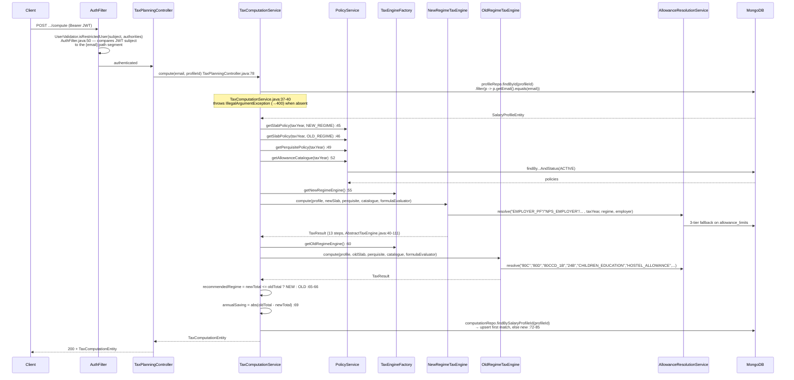
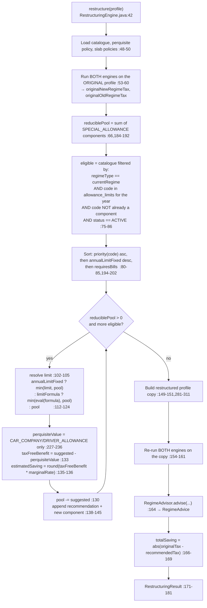

# 01 — Overview: stack, file tree, dependencies

Discovery pass over the `taxplanning` module at commit `55024ad`, 2026-09-18. Read-only: nothing in
the source tree was modified. Every statement below carries a `path:line` reference.

Scope of this pass: CTC/salary breakup, Form 16, deductions and exemptions, regime choice, and
income heads other than capital gains. STCG/LTCG are out of scope and are recorded only where the
module touches them (§6).

---

## 1. Stack actually used

| Concern | What | Evidence |
|---|---|---|
| Language | Java 25 | `pom.xml:22` — `<java.version>25</java.version>` |
| Framework | Spring Boot 4.1.0 | `pom.xml:9-10` — `spring-boot-starter-parent` `4.1.0` |
| Module system | Spring Modulith | `backend/pom.xml:76` `spring-modulith-starter-core`; `taxplanning/package-info.java:1` |
| Build | Maven, multi-module (`backend`, `test-report`) | `pom.xml:16-17` `<packaging>pom</packaging>` |
| Database | MongoDB (Spring Data) | `backend/pom.xml:22` `spring-boot-starter-data-mongodb` |
| Web | Spring MVC | `backend/pom.xml:26` `spring-boot-starter-webmvc` |
| Security | Spring Security + JJWT | `backend/pom.xml:30,44,48,53` |
| PDF (used by this module) | Flying Saucer `ITextRenderer` + Thymeleaf | `taxplanning/document/DocumentGenerationService.java:14,40`; `backend/pom.xml:66,70,38` |
| Excel | Apache POI — **present in the build, not used by this module** | `backend/pom.xml:60`; no POI import under `taxplanning` (grep for `POI\|Workbook` returned nothing) |
| Expression evaluation | Spring SpEL, sandboxed | `taxplanning/engine/FormulaEvaluator.java:7,29,43` |
| JSON (seeding) | `tools.jackson.databind.ObjectMapper` | `taxplanning/policy/service/PolicySeederService.java:22-23` |
| Tests | JUnit 5, Mockito, Testcontainers Mongo, RestAssured/RestTemplate | `backend/pom.xml:92,97,102,112` |

**No PDF or Excel *parsing* library is used anywhere in this module.** `ITextRenderer` is
write-only — it renders HTML to PDF (`DocumentGenerationService.java:40-43`). See §5 of
`02-domain-and-api.md` for what this means for Form 16 intake.

---

## 2. File tree — 56 Java files, all under `backend/src/main/java/com/thiru/wealthlens/taxplanning/`

```
taxplanning/
├── package-info.java                    @ApplicationModule(OPEN, allowedDependencies={"shared","auth"})
│
├── controller/
│   ├── TaxPlanningController.java       9 authenticated endpoints under /tax-planning (4 are SUPER_USER admin)
│   └── TaxPlanningPublicController.java 2 unauthenticated endpoints under /tax-planning/public
│
├── service/
│   └── TaxComputationService.java       Orchestrates: load profile+policies → run BOTH engines → pick regime → upsert
│
├── engine/
│   ├── TaxEngine.java                   Interface: getRegime, getSupportedTaxYear, compute(...)
│   ├── TaxEngineFactory.java            Dispatch NEW_REGIME/OLD_REGIME; throws on NOT_DECIDED
│   ├── AbstractTaxEngine.java           Template Method — the 13-step computation skeleton
│   ├── NewRegimeTaxEngine.java          New-regime hooks: PF/NPS/meal/gift exemptions, zero Chapter VI-A
│   ├── OldRegimeTaxEngine.java          Old-regime hooks: HRA, LTA, 80C/80D/80CCD(1B)/24(b), prof. tax
│   ├── HraExemptionCalculator.java      3-way HRA minimum; also 2 unused legacy methods
│   ├── MarginalReliefCalculator.java    Marginal relief — NOT WIRED into any engine (see 04 Observations)
│   ├── PerquisiteValuationService.java  Car / driver / meal / gift perquisite valuation
│   ├── FormulaEvaluator.java            Sandboxed SpEL evaluation of policy-supplied formulas
│   ├── FbpOptimizer.java                Component-lookup helpers — NO production caller
│   └── ItrFormAdvisor.java              ITR-1 vs ITR-2 recommendation — NO production caller
│
├── enums/                               9 enums (verbatim values in 02-domain-and-api.md §1)
│   ├── AllowanceCategory.java  AvailabilityPath.java  CarEngineSize.java  CarOwnership.java
│   ├── CityTier.java  EmployerType.java  HrSupportLikelihood.java  ProfileType.java
│   └── RegimeType.java
│
├── parsing/
│   └── ParsedCtcDto.java                45-field CTC-parse result DTO — NO producer, NO consumer
│
├── policy/
│   ├── dto/ResolvedAllowance.java       {metadata: AllowanceCatalogueEntity, limit: AllowanceLimitEntity}
│   ├── entity/
│   │   ├── AllowanceCatalogueEntity.java   allowance_catalogue — descriptive metadata + HR guidance
│   │   ├── AllowanceLimitEntity.java       allowance_limits — the numeric limits the engines read
│   │   ├── PerquisitePolicyEntity.java     perquisite_policies — car/driver/meal/gift/accommodation rates
│   │   ├── TaxSlabPolicyEntity.java        tax_slab_policies — slabs, surcharge slabs, cess, 87A, std ded.
│   │   └── TaxYearRegistryEntity.java      tax_year_registry — NEVER read or written (see 04 Observations)
│   ├── repository/                      5 Spring Data interfaces, one per entity above
│   └── service/
│       ├── PolicyService.java           Read + admin write of slab/perquisite/catalogue policies
│       ├── AllowanceResolutionService.java  3-tier fallback resolution of an allowance limit
│       └── PolicySeederService.java     @PostConstruct seeding from resources/data/tax-policies/*.json
│
├── salary/
│   ├── dto/SalaryComponentDto.java      {allowanceCode, annualAmount, isCurrent, notes}
│   ├── dto/SalaryProfileRequest.java    26 fields — the create/update request
│   ├── dto/SalaryProfileResponse.java   Adds derived annualCtc + isMetroCity; holds METRO_CITIES list
│   ├── entity/SalaryComponentEntity.java  Embedded document inside salary_profiles
│   ├── entity/SalaryProfileEntity.java    salary_profiles — 32 fields
│   ├── entity/TaxComputationEntity.java   tax_computations — two TaxResult blocks + recommendation
│   ├── repository/SalaryProfileRepository.java   findByEmailOrderByAuditMetadata_CreatedAtDesc
│   ├── repository/TaxComputationRepository.java  findBySalaryProfileId
│   └── service/SalaryProfileService.java  CRUD + validation + computation-cache invalidation
│
├── recommendation/
│   ├── RestructuringEngine.java         Moves SPECIAL_ALLOWANCE into exempt components, re-runs engines
│   ├── RegimeAdvisor.java               Picks a regime and builds "switch trigger" strings
│   ├── AllowanceRecommendation.java     One recommendation + nested ItrPortalPath, FaqEntry
│   ├── RegimeAdvice.java                {recommendedRegime, annualSaving, both taxes, switchTriggers}
│   ├── RestructuringResult.java         Full restructure response
│   └── HrLetterContentBuilder.java      Builds an HR request letter — NO production caller
│
└── document/
    ├── DocumentGenerationService.java   Thymeleaf → HTML → ITextRenderer → PDF bytes
    └── TaxComparisonReportGenerator.java  One-line delegation to the above
```

### Non-Java files belonging to the module

| File | Purpose | Evidence |
|---|---|---|
| `backend/src/main/resources/data/tax-policies/slab-policy-2025-26-new.json` | New-regime slabs, surcharge, cess, 87A | 26 lines |
| `.../slab-policy-2025-26-old.json` | Old-regime equivalents | 23 lines |
| `.../perquisite-policy-2025-26.json` | Car/driver/meal/gift/accommodation rates | 20 lines |
| `.../allowance-limits-2025-26.json` | 14 numeric limit rows the engines actually read | 16 lines |
| `.../allowance-catalogue-2025-26.json` | 39 descriptive catalogue entries | 58,703 bytes |
| `backend/src/main/resources/templates/taxplanning/tax-comparison-report.html` | The PDF template | 179 lines |

### Test files

| File | Lines | `@Test` count |
|---|---|---|
| `backend/src/test/java/com/thiru/wealthlens/integration/TaxPlanningControllerIntegrationTest.java` | 513 | 14 |
| `backend/src/test/java/com/thiru/wealthlens/taxplanning/engine/NewRegimeTaxEngineTest.java` | 381 | 12 |
| `.../engine/OldRegimeTaxEngineTest.java` | 271 | 8 |
| `.../engine/PerquisiteValuationServiceTest.java` | 175 | 10 |
| `.../engine/MarginalReliefCalculatorTest.java` | 165 | 7 |
| `.../engine/HraExemptionCalculatorTest.java` | 152 | 5 |
| `.../engine/FormulaEvaluatorSandboxTest.java` | 57 | 3 (one parameterized, 3 values) |

**Total files scanned: 56 Java (main) + 7 test + 6 resource = 69.**

---

## 3. Module dependencies

### Declared

`taxplanning/package-info.java:1`:

```java
@org.springframework.modulith.ApplicationModule(type = org.springframework.modulith.ApplicationModule.Type.OPEN, allowedDependencies = {"shared", "auth"})
```

### Outbound — what `taxplanning` imports from other modules

Counted across all 56 files (`grep -rhn "^import com.thiru.wealthlens"`, excluding self-imports):

| Import | Count | Used for |
|---|---|---|
| `shared.dto.enums.EntityStatus` | 17 | ACTIVE/INACTIVE/SUPERSEDED on every entity |
| `shared.entity.model.AuditableEntity` | 7 | Marker interface on each entity |
| `shared.entity.helper.AuditMetadata` | 7 | `audit_metadata` sub-document |
| `shared.util.expression.SafeExpressions` | 1 | `FormulaEvaluator.java:3` — SpEL sandbox |

**`taxplanning` imports nothing from `auth`**, despite `auth` being in `allowedDependencies`. It
imports nothing from `portfolio`, `corporate`, `brokercharges`, `helper`, `insurance`, or `finance`.

### Inbound — what uses `taxplanning`

`grep -rn "com.thiru.wealthlens.taxplanning"` across `backend/src`, excluding the module itself,
returns **only test code** — 8 imports, all in
`backend/src/test/java/com/thiru/wealthlens/integration/TaxPlanningControllerIntegrationTest.java`.

**No production code outside the module references it.** `taxplanning` is a leaf: it is reachable
only through its two HTTP controllers.

### Indirect coupling that is not an import

| Coupling | Evidence |
|---|---|
| Security — `/tax-planning/public/**` is `permitAll`, `/tax-planning/**` is `authenticated` | `auth/config/AuthConfig.java:37,39` |
| Security — the `/user/{email}` path segment is matched against the JWT subject by `AuthFilter` | `auth/filter/AuthFilter.java:50-52` → `auth/service/UserValidator.java:25-32,42-53` |
| Response wrapping — every JSON body is wrapped in `ApiResponse<T>` except under the `integration-test` profile | `shared/advice/ResponseWrapperAdvice` (per CLAUDE.md; not re-verified in this pass) |
| Error mapping — `IllegalArgumentException` → 400, all else → 500 | `shared/exception/ControllerAdviser` (per CLAUDE.md) |
| Test DB lifecycle — five `taxplanning` collections are treated as seeded reference data and survive per-test cleanup | `backend/src/test/java/com/thiru/wealthlens/integration/AbstractIntegrationTest.java:44-48` |
| Mutation testing — `taxplanning.engine.*` is a PIT target | `pom.xml:399`, `pom.xml:403` |
| JaCoCo — **`taxplanning` is NOT covered by any coverage gate** (both rules scope to `brokercharges`) | `pom.xml:250`, `pom.xml:268` |

---

## 4. Architecture diagram

```mermaid
graph TB
    subgraph clients["HTTP"]
        PUB["/tax-planning/public/**<br/>permitAll"]
        AUTH["/tax-planning/**<br/>authenticated"]
        ADMIN["/tax-planning/admin/**<br/>@PreAuthorize SUPER_USER"]
    end

    subgraph ctrl["controller/"]
        TPC[TaxPlanningController]
        TPPC[TaxPlanningPublicController]
    end

    subgraph svc["service layer"]
        SPS[SalaryProfileService]
        TCS[TaxComputationService]
        PS[PolicyService]
        ARS[AllowanceResolutionService]
        SEED["PolicySeederService<br/>@PostConstruct"]
    end

    subgraph eng["engine/"]
        TEF[TaxEngineFactory]
        ATE[AbstractTaxEngine<br/>13-step template]
        NRE[NewRegimeTaxEngine]
        ORE[OldRegimeTaxEngine]
        HRA[HraExemptionCalculator]
        PVS[PerquisiteValuationService]
        FE[FormulaEvaluator]
    end

    subgraph rec["recommendation/"]
        RE[RestructuringEngine]
        RA[RegimeAdvisor]
    end

    subgraph doc["document/"]
        TCRG[TaxComparisonReportGenerator]
        DGS["DocumentGenerationService<br/>Thymeleaf + ITextRenderer"]
    end

    subgraph db[("MongoDB")]
        C1[(salary_profiles)]
        C2[(tax_computations)]
        C3[(tax_slab_policies)]
        C4[(perquisite_policies)]
        C5[(allowance_catalogue)]
        C6[(allowance_limits)]
        C7[("tax_year_registry<br/>NEVER READ OR WRITTEN")]
    end

    JSON["resources/data/tax-policies/*.json"]

    subgraph orphan["No production caller"]
        FBP[FbpOptimizer]
        IFA[ItrFormAdvisor]
        MRC[MarginalReliefCalculator]
        HLB[HrLetterContentBuilder]
        PCD[ParsedCtcDto]
    end

    PUB --> TPPC
    AUTH --> TPC
    ADMIN --> TPC
    TPPC --> PS
    TPC --> SPS
    TPC --> TCS
    TPC --> RE
    TPC --> PS
    TPC --> TCRG

    TCS --> PS
    TCS --> TEF
    TEF --> NRE
    TEF --> ORE
    NRE --> ATE
    ORE --> ATE
    ATE --> PVS
    ATE --> ARS
    ORE --> HRA
    ORE --> FE
    NRE --> FE

    RE --> TEF
    RE --> RA
    RE --> ARS
    RE --> PS
    RE --> FE
    RE --> PVS

    TCRG --> DGS

    SPS --> C1
    SPS --> C2
    TCS --> C1
    TCS --> C2
    PS --> C3
    PS --> C4
    PS --> C5
    ARS --> C5
    ARS --> C6
    JSON --> SEED
    SEED --> C3
    SEED --> C4
    SEED --> C5
    SEED --> C6

    style C7 fill:#faa,stroke:#a00
    style orphan fill:#eee,stroke:#999
```

## 5. Main flow — `POST /tax-planning/user/{email}/profile/{profileId}/compute`



## 6. Restructure flow — `POST .../profile/{profileId}/restructure`



Note: the restructured profile is **never persisted** — `copyProfile` returns a detached entity with
no id (`RestructuringEngine.java:281-311`), and nothing calls `save` on it.

---

## 7. Plain-English summary of what the module does today

A salaried user creates one or more **salary profiles** — a name, employer, tax year, city, chosen
regime, a flat list of `{allowanceCode, annualAmount}` components making up the CTC, plus a handful
of scalar planning inputs (80C/80D/80CCD(1B) investment totals, home-loan interest, monthly rent,
number of children, and car/driver facts). Asking to *compute* runs the profile through **both** tax
engines simultaneously — never just the chosen one — each sharing a thirteen-step template
(gross → standard deduction → regime exemptions → regime deductions → taxable income → progressive
slab tax → 87A rebate → marginal relief → surcharge → cess → total → net take-home → warnings),
and stores both results plus whichever regime produced the lower total tax. All slab rates,
exemption caps, rebate limits and perquisite rates are **data**: they live in MongoDB, seeded once
at application start from five JSON files that today describe only tax year `2025-26`. Asking to
*restructure* takes whatever sits in `SPECIAL_ALLOWANCE`, spends it down across catalogue allowances
the user does not yet have — in a fixed priority order — re-runs both engines on the hypothetical
profile, and returns the recommendations with an estimated saving and HR-facing guidance text. A
Thymeleaf template rendered to PDF via Flying Saucer produces a side-by-side old-vs-new comparison
report. **There is no Form 16 handling, no payslip or PDF ingestion, no TDS computation, no
employer-side projection, and no income head other than salary** — every figure is typed in by the
caller or derived from the profile's components. Capital gains touch the module in exactly two
inert places: an untyped `capital_gains_result` field on `TaxComputationEntity` that nothing writes
(`salary/entity/TaxComputationEntity.java:47-48`), and `ItrFormAdvisor`, which takes a
`hasCapitalGains` boolean but has no production caller (`engine/ItrFormAdvisor.java:18`).
