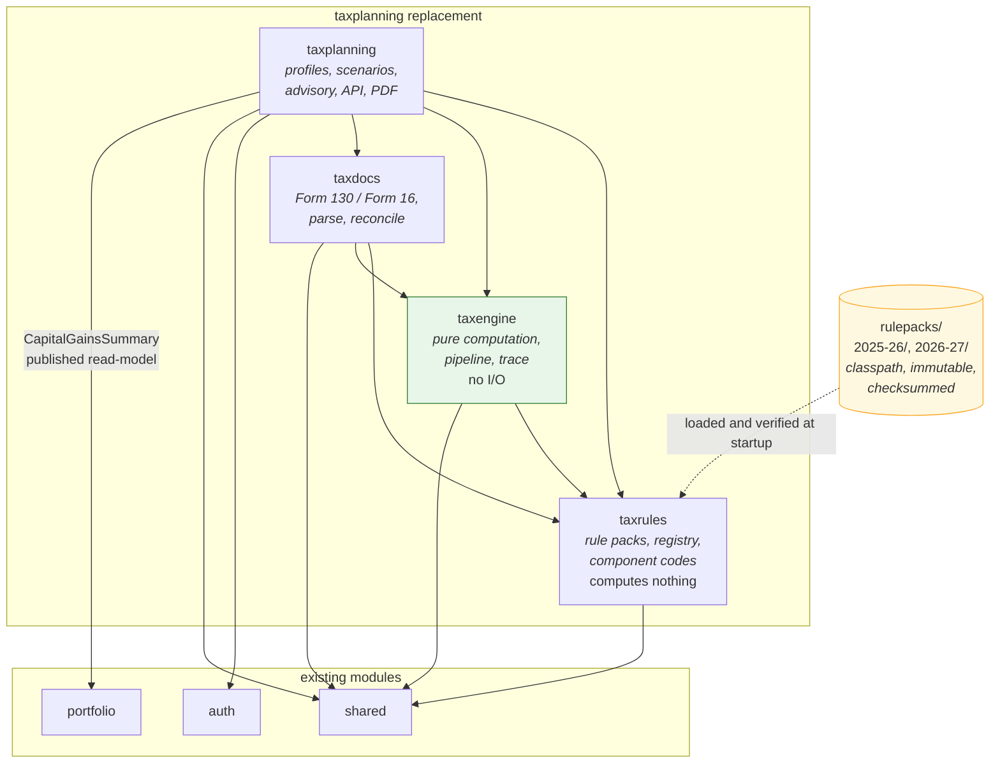
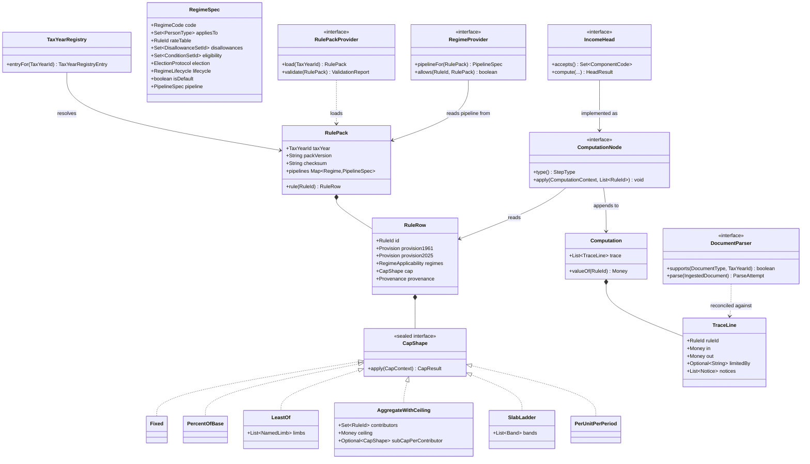
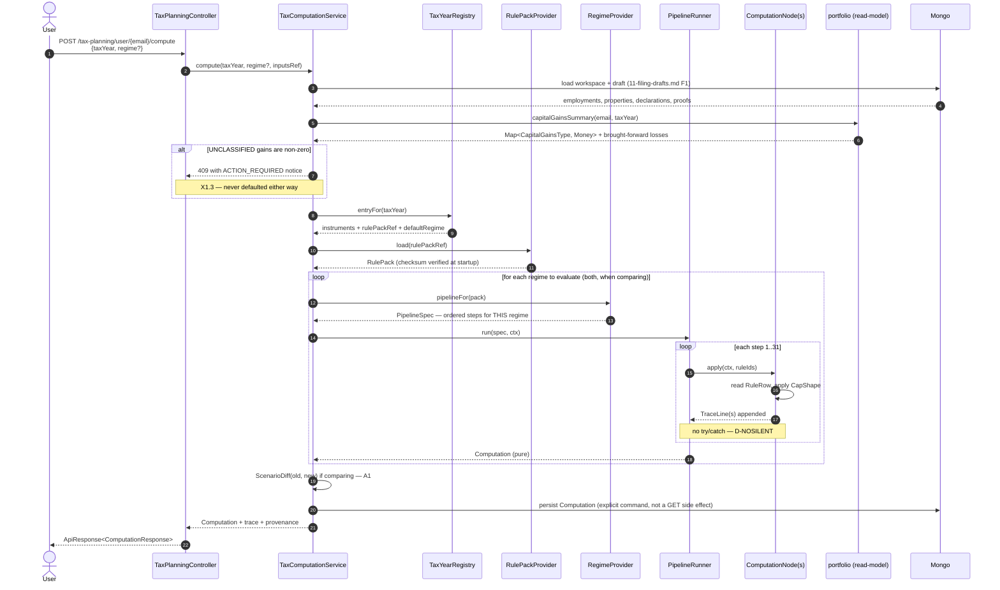

# 07 — Architecture

Constraint from the brief: **a new tax year, a Budget change, a new allowance or deduction, or a new
income head must be data or a new class — never an edit to existing logic.** Everything below is
shaped by that.

Code facts carry `path:line` from files read this session. Everything else is `RECOMMENDATION`.

---

## X1 — Modulith split, allowed dependencies and events

### X1.1 Today

`FACT (backend/src/main/java/com/thiru/wealthlens/taxplanning/package-info.java:1, read this session)`:

```java
@ApplicationModule(type = Type.OPEN, allowedDependencies = {"shared", "auth"})
```

`FACT (backend/src/main/java/com/thiru/wealthlens/portfolio/package-info.java:1-4, read this session)`:
`portfolio` allows `{"shared", "auth", "corporate", "brokercharges", "helper"}` — it does **not**
depend on `taxplanning`, and nothing outside `taxplanning` imports it.

### X1.2 The split

`RECOMMENDATION`: **four modules**, not one. The boundary that matters is between **rules** (which
change annually, by data) and **computation** (which must not).

| Module | Responsibility | `allowedDependencies` |
|---|---|---|
| `taxrules` | `TaxYearRegistry`, `RulePack`, `RuleId`, `CapShape`, `ComponentCode`, provenance. **Loads and validates packs. Computes nothing.** | `{"shared"}` |
| `taxengine` | `ComputationNode` implementations, the pipeline runner, `Computation`, `TraceLine`, `Money`. **Pure.** No repositories, no controllers. | `{"shared", "taxrules"}` |
| `taxdocs` | `DocumentParser` SPI, Form No. 130 / Form 16 parsing, `ParseAttempt`, reconciliation | `{"shared", "taxrules", "taxengine"}` |
| `taxplanning` | Profiles, contexts, employments, declarations, scenarios, advisory, controllers, PDF. The application layer | `{"shared", "auth", "taxrules", "taxengine", "taxdocs", "portfolio"}` |

`INFERENCE`: `taxengine` depending on `taxrules` but **not** on `taxplanning` is what makes the
Open/Closed requirement enforceable rather than aspirational. The engine cannot reach a repository, so
it cannot acquire a hidden year-dependent branch. `ApplicationModules.verify()` fails the build if it
tries — the same mechanism CLAUDE.md already relies on.

### X1.3 The one new dependency, and why it is a read-model

D3 requires capital gains from `portfolio`. Two options:

| Option | Verdict |
|---|---|
| Add `portfolio` to `taxplanning`'s `allowedDependencies` and read its entities | **Rejected.** `FACT (backend/src/main/java/com/thiru/wealthlens/portfolio/entity/model/RealisedProfits.java:16-54, read this session)`: `RealisedProfits` carries two legacy fields (`shortTermCapitalGains`, `longTermCapitalGains`) **beside** `gainsByClassification`, with a Javadoc saying the pair goes when V1 goes. Binding a tax computation to a mid-cutover entity is binding it to a shape that is documented as temporary |
| Add `portfolio` to `allowedDependencies` and consume a **published read-model** | **Chosen** |

```java
// published by portfolio, consumed by taxplanning
public record CapitalGainsSummary(
        String email,
        TaxYearId taxYear,
        Map<CapitalGainsType, Money> realisedByClassification,
        Money broughtForwardShortTermLoss,
        Money broughtForwardLongTermLoss,
        Instant asOf,
        String portfolioComputationRef) {}
```

Three properties, each forced by something read this session:

- `FACT (backend/src/main/java/com/thiru/wealthlens/portfolio/dto/enums/CapitalGainsType.java:39-44)`:
  `countsAsCapitalGains()` returns true only for `SHORT_TERM` and `LONG_TERM`. The read-model keeps the
  **full five-way partition** so `taxplanning` can apply that method rather than re-deciding.
- `FACT (same file:21-24)`: `SPECULATIVE` is *"Intraday equity. Speculative business income taxed at
  slab rate, not capital gains at all"*. So a non-zero `SPECULATIVE` means the user has **business
  income**, which is outside D3 and routes to ITR-3 (`ITR-SPEC-001`). The read-model must surface it,
  not hide it.
- `FACT (RealisedProfits.java:47-52)`: *"Do not sum this map."* `UNCLASSIFIED` is a data-quality state.
  `RECOMMENDATION`: a non-zero `UNCLASSIFIED` **blocks** the computation with an
  `ACTION_REQUIRED` notice. Defaulting it either way is O-1's silent zero wearing a different hat.

### X1.4 Events

`FACT`: `grep -rln "ApplicationEventPublisher|@ApplicationModuleListener|@EventListener"` over
`backend/src/main/java/com/thiru/wealthlens` returned **nothing** this session — the codebase uses no
Spring events today.

`RECOMMENDATION`: **do not introduce events for the portfolio feed.** A synchronous published-interface
call is simpler, is what the codebase already does everywhere, and gives the user a deterministic
answer at request time. Events are right when the consumer can lag; a tax computation cannot.

Two events *are* worth it later, both within `taxplanning`:

| Event | Publisher | Consumer | Why an event |
|---|---|---|---|
| `DocumentConfirmed` | `taxdocs` | `taxplanning` | ingestion → recomputation is genuinely asynchronous, and the user is watching a progress state anyway |
| `ComputationCompleted` | `taxplanning` | PDF generation | D6's PDF can lag the JSON without harm |

### X1.5 Module diagram



---

## X2 — Service provider interfaces

Five SPIs. Each is the extension point for one of the four things that change (`M0`).

### X2.1 `ComputationNode` — a new step, or a new income head

> **Amended by `15-review-findings.md` Part B and `23-architecture-consolidation.md` A4.** The linear
> `ComputationNode` is **withdrawn**; a node declares `requires()`/`produces()` and the order is derived.

```java
public interface ComputationNode {
    StepType type();                                  // matched against the pack's pipeline spec
    void apply(ComputationContext ctx, List<RuleId> rules);   // void: nothing to zero out
}
```

`void` is deliberate (`D-NOSILENT`): there is no return value a caller could substitute a zero for,
and the runner has no `try/catch`. A step that cannot evaluate throws, and the computation fails.

**Adding an income head** = a new `ComputationNode` implementation + a line in the pack's node set
spec. The runner does not change.

### X2.2 `IncomeHead`

```java
public interface IncomeHead {
    HeadCode code();                                  // SALARIES | HOUSE_PROPERTY | PGBP | CAPITAL_GAINS | OTHER_SOURCES
    Set<ComponentCode> accepts();                     // D-CLOSEDSUM: the declared partition
    HeadResult compute(HeadInputs in, RulePack pack, Regime regime);
    SetOffRules setOffRules(RulePack pack, Regime regime);   // SETOFF-*, incl. SETOFF-NEW-001
}
```

`FACT (S2, s.13)`: the 2025 Act lists exactly five heads. `RECOMMENDATION`: the enum is closed, but the
implementations are pluggable — D3 ships three of five, and `PGBP` exists as a **detector** that routes
to ITR-3 (`ITR-SPEC-001`) rather than computing.

### X2.3 `RegimeProvider`

> **Amended by `10-extensibility.md` E3.** `Regime` is not a Java enum; it is a `RegimeCode` resolved
> against the pack's `RegimeSpec` map, and a pack may declare any number of them.

```java
public interface RegimeProvider {
    List<RegimeSpec> eligibleFor(TaxYearId year, Taxpayer t, Inputs in, RulePack pack);
    RegimeSpec       byCode(RegimeCode code, RulePack pack);
    PipelineSpec     pipelineFor(RegimeCode code, RulePack pack);   // D-REGIMESTEP
    boolean          allows(RuleId rule, RegimeCode regime, RulePack pack);
}
```

`D-REGIMESTEP`. The old-regime pipeline **does not contain** the rebate-marginal-relief step, so O-11
cannot recur by construction. `allows()` exists for explanation — `A1.2` needs to say *"this deduction
is unavailable in the new regime under `s.202(2)(a)(i)`"*, which requires the rule to be knowable as
disallowed rather than merely absent.

### X2.4 `RulePackProvider`

```java
public interface RulePackProvider {
    Set<TaxYearId> availableYears();
    RulePack load(TaxYearId year);                    // throws; never returns a partial pack
    ValidationReport validate(RulePack pack);         // M1.2 invariants I1..I4 + slab continuity
}
```

One implementation at launch: `ClasspathRulePackProvider`. `D-IMMUTABLE` — no Mongo-backed provider,
no admin write path (O-16). The SPI exists so a future provider (a signed remote pack, say) is a new
class.

### X2.5 `DocumentParser`

```java
public interface DocumentParser {
    boolean supports(DocumentType type, TaxYearId year);
    ParseAttempt parse(IngestedDocument doc);         // never throws on bad input; records outcome
}
```

`RECOMMENDATION`: `supports(type, year)` takes the **year**, because Form 16 (TY 2025-26) and Form
No. 130 (TY 2026-27) are different documents with different row structures (`DOC-F130-ROWS-001` vs an
unverified Form 16 Part B). Two parsers, selected by year — the same `D-YEARKEY` discipline as the
rules.

### X2.6 Class diagram



### X2.7 Compute sequence



---

## X3 — API contract

Following the repo's conventions: lowercase-hyphenated paths, user-scoped under
`/{resource}/user/{email}`, dates `yyyy-MM-dd`, DTOs only (`D-DTO`), `@Valid` on every body
(`D-VALIDATE`).

### X3.1 Endpoints

| Method | Path | Purpose | Notes |
|---|---|---|---|
| `GET` | `/tax-planning/tax-years` | list supported years with their instruments and statuses | public; drives `A4.2` |
| `GET` | `/tax-planning/user/{email}/context/{taxYear}` | the stored inputs for a year | |
| `PUT` | `/tax-planning/user/{email}/context/{taxYear}` | replace the year's inputs | `D-ONEWRITE`: one write path, whole-document (O-17, O-26) |
| `POST` | `/tax-planning/user/{email}/context/{taxYear}/compute` | compute and persist | **`POST`, because it writes** (O-8) |
| `GET` | `/tax-planning/user/{email}/computations/{computationId}` | read a stored computation with its trace | pure read; 404 if absent |
| `POST` | `/tax-planning/user/{email}/context/{taxYear}/compare-regimes` | both regimes plus the driver diff | `A1` |
| `GET` | `/tax-planning/user/{email}/context/{taxYear}/break-even` | break-even deduction level and its plateau | `A1.3` |
| `POST` | `/tax-planning/user/{email}/context/{taxYear}/optimise` | structuring recommendations | `A2` |
| `GET` | `/tax-planning/user/{email}/context/{taxYear}/gaps` | deduction headroom and ranked actions | `A3` |
| `GET` | `/tax-planning/user/{email}/context/{taxYear}/tds-projection` | monthly projection | `G4` |
| `POST` | `/tax-planning/user/{email}/documents` | upload a Form 16 / Form No. 130 | multipart; idempotent on SHA-256 |
| `GET` | `/tax-planning/user/{email}/documents/{documentId}/parse` | latest parse attempt with confidences | |
| `POST` | `/tax-planning/user/{email}/documents/{documentId}/confirm` | user confirms or corrects fields | **nothing is used before this** (`M4`) |
| `GET` | `/tax-planning/user/{email}/context/{taxYear}/reconciliation` | document versus computation | `M4.2` |
| `GET` | `/tax-planning/user/{email}/context/{taxYear}/itr-suggestion` | form plus schedule-ready figures | `F8`, D6 |
| `GET` | `/tax-planning/user/{email}/context/{taxYear}/advance-tax` | instalment schedule | `F16` |
| `GET` | `/tax-planning/user/{email}/computations/{computationId}/report.pdf` | the PDF | D6 |
| `GET`/`POST`/`DELETE` | `/tax-planning/user/{email}/scenarios...` | scenario CRUD | `F18` |

**Endpoints that deliberately do not exist:** anything that writes a slab policy, an allowance limit
or a perquisite policy (`D-IMMUTABLE`, O-16).

### X3.2 Errors

`shared/exception/ControllerAdviser` maps `IllegalArgumentException` → 400 and everything else → 500,
with human-readable messages. Three module-specific types, all extending `BadRequestException`:

| Type | Status | When |
|---|---|---|
| `UnsupportedTaxYearException` | 400 | no registry entry — names the supported years |
| `UnknownComponentCodeException` | 400 | a code outside the enum (O-15) |
| `IncompleteInputsException` | 400 | a required input for a requested rule is missing — names the rule ID |
| `BlockingDataQualityException` | 409 | non-zero `UNCLASSIFIED` capital gains (`X1.3`) |
| `MissingRulePackException` | 500 | should be impossible — startup validation failed open |

`RECOMMENDATION`: `MissingRulePackException` must be **unreachable**, because `D-FAILFAST` means the
application does not start without valid packs. It exists so that if it is ever thrown, it is loud.

### X3.3 Response shape

`shared/advice/ResponseWrapperAdvice` wraps everything in `ApiResponse<T>` except under the
`integration-test` profile — integration tests assert unwrapped payloads, as CLAUDE.md records.

```json
{
  "taxYear": "2026-27",
  "regime": "NEW",
  "rulePack": { "version": "2026-27.1", "checksum": "sha256:…" },
  "totalIncome": "2339600.00",
  "taxPayable": "534960.00",
  "trace": [
    { "sequence": 7, "ruleId": "SAL-HRA-001", "label": "House rent allowance exemption",
      "kind": "EXEMPTION", "in": "600000.00", "out": "228000.00",
      "limitedBy": "rent less 10% of salary",
      "provenance": { "instrument": "Income-tax Act, 2025 (30 of 2025)",
                      "reference": "Schedule III Table Sl. No. 11 r/w Income-tax Rules 2026 r.279(1)",
                      "status": "VERIFIED", "draftOrFinal": "FINAL",
                      "sourceUrl": "https://egazette.gov.in/WriteReadData/2026/271092.pdf" },
      "notices": [ { "severity": "ACTION_REQUIRED",
                     "message": "Landlord PAN is required: annual rent exceeds the threshold",
                     "relatedRules": ["SAL-HRA-006", "TDS-SAL-12BB-002"] } ] }
  ]
}
```

Provenance on **every** line, not a footer (`A4.2`, `D-PROVENANCE`).

### X3.4 Authorisation, including the advisor path D1 defers

`auth/filter/AuthFilter` validates the JWT before `UsernamePasswordAuthenticationFilter`; public paths
are listed in `auth/config/AuthConfig`.

| Rule | Now | Reserved for D1's advisor |
|---|---|---|
| `/tax-planning/**` is **authenticated** | yes | yes |
| `{email}` must equal the JWT subject | **enforced** | relaxed to "subject **or** a principal holding an active `AdvisorMandate` for that email" |
| `AdvisorMandate` | **not built** | `{advisorEmail, clientEmail, grantedAt, revokedAt, scopes}` |
| Reads and writes | same check | split: an advisor may hold `READ` without `WRITE` |
| Audit | `AuditableEntity` as elsewhere | every access records the acting principal, not only the owning email |

`RECOMMENDATION`: implement the check as `AccessPolicy.canAccess(principal, email, Action)` from day
one, with the trivial "principal.email equals email" body. D1's later work then adds a clause, not a
refactor of every controller.

---

## X4 — Rule-pack authoring and year rollover

### X4.1 Adding a tax year — the whole process

```
1.  cp -r resources/rulepacks/2026-27 resources/rulepacks/2027-28
2.  Edit manifest.json:
      taxYear, packVersion, and the three instruments
      (Act, Finance Act, Rules) with gazette refs, source URLs and accessedOn
3.  For each changed value: edit the row. Set status = NEEDS_VERIFICATION and
      whatToCheck until a primary source has been opened; then VERIFIED with the URL
4.  Add the year to the TaxYearRegistry data file
5.  Add golden tests for the new year (T1..T9 templates)
6.  Run: the build recomputes the checksum and fails if any M1.2 invariant breaks
7.  Deploy
```

**No Java changes.** `RECOMMENDATION`: that is the acceptance test for this architecture, and it should
be exercised deliberately — see `X5`'s "synthetic year" test.

### X4.2 When a value changes shape, not just magnitude

`INFERENCE (from the R1–R24 diff)`: this is the case the architecture actually has to survive, because
19 of 24 differences between TY 2025-26 and TY 2026-27 were re-identification. Three sub-cases:

| Sub-case | Example from the diff | Handled by |
|---|---|---|
| Same idea, different provision number | 80C → s.123; Form 16 → Form No. 130; s.89 → s.157 | `RuleRow` carries **both** `provision1961` and `provision2025`. The rule ID is stable; the provision is data |
| A rule disappears | `SAL-ENTMT-001` — entertainment allowance has no 2025-Act counterpart | `Provision.presence = ABSENT_IN_THIS_ACT`, and the rule is simply not in that year's pipeline |
| A cap's **shape** changes | `HP-CAP-SELFOCC-002` — FA 2026 s.38 brought pre-construction interest inside the ₹2,00,000 cap | The 2026-27 pack's `AggregateWithCeiling.contributors` gains a member. Still data |

The only case requiring code is a cap the six `CapShape` implementations cannot express — and then it
is a **new** sealed implementation, never an edit to an existing one (`M0`).

### X4.3 Provenance discipline

Every row's `Provenance` is mandatory and `status != VERIFIED` requires a non-blank `whatToCheck`
(invariant I1). `RECOMMENDATION`: a build task emits `docs/taxplanning-design/UNVERIFIED.md` from the
packs, so the outstanding-verification list is generated rather than maintained by hand — and so it
cannot silently stop matching the shipped rules.

### X4.4 Budget day

A Finance Act changes values inside an existing year. `RECOMMENDATION`: **bump `packVersion`, never
mutate in place.** `tax_computations` stores the pack version and checksum it used (`M7`), so a
computation made before Budget day remains explainable after it, and a recomputation is visibly a
different pack rather than a mysteriously different number.

---

## X5 — Testing strategy

Fitting the repo's existing tiers: `-Punit` (no Docker, the fast loop), `-Pintegration`
(Testcontainers Mongo, `@Isolated`), and the `-Pmutation` PIT profile scoped to calculation engines.

### X5.1 Golden files, per tax year and per regime

`D-GOLDEN`: **expected values come from rulebook arithmetic shown step by step, never from running
the code.** O-3 is the cautionary case — two tests asserting `0` with comments acknowledging the value
was wrong.

```
backend/src/test/resources/taxplanning/golden/
  2025-26/old/*.json      2025-26/new/*.json
  2026-27/old/*.json      2026-27/new/*.json
```

Each file: inputs, expected trace lines by rule ID, expected totals, the rule IDs relied on, and
**`provisional: true`** where any relied-on rule is `NEEDS VERIFICATION` (`08-golden-tests.md`). A
`PROVISIONAL` case runs and asserts, but a failure is reported distinctly from a `VERIFIED` failure —
so an unverified TY 2025-26 HRA value breaking does not look like an engine regression.

`RECOMMENDATION`: a test enumerates the golden directories and **fails if a (year × regime) cell is
empty**. That is the structural guard against O-11 and `H-2` — a rule tested in only one regime or
only one year is exactly how both were born.

### X5.2 Property tests

| Property | Guards |
|---|---|
| Slab-walk continuity: `Σ per-band tax == tax(totalIncome)` exactly, for random incomes | `H-5` first limb, O-14 |
| Rounding happens exactly twice: trace contains exactly two `ROUNDING` lines | `RATE-ROUND-003`, O-14 |
| Monotonicity: `income₁ < income₂ ⟹ tax(income₁) ≤ tax(income₂)` under both reliefs | `REBATE-NEW-MR-001`, `RATE-SUR-MR-001` — this is the property a missing marginal relief **violates** |
| Marginal rate never exceeds 100% outside the rebate-relief band | `REBATE-NEW-MR-001` |
| No rule yields zero by exception: fault-inject into each `CapShape` and assert the computation **fails** | `D-NOSILENT`, O-1, O-18 |
| Aggregate never exceeds its ceiling, for random contributor vectors | `DED-80C-001`, `DED-80D-006`, `PF-AGGCAP-001` |
| `takeHome` is unchanged by any non-cash component | `D-CASHFLAG`, `H-15`, O-13 |
| Old-regime pipeline contains no rebate-marginal-relief step | `H-3`, O-11 |
| Every `RuleId` in every pack is reachable from some pipeline | I3, O-19 |
| Every persisted field has a writer | `D-NOORPHAN`, O-6 |

### X5.3 Architecture tests

Extending the existing `ArchitectureTest` (which CLAUDE.md records as enforcing no field injection,
controllers not reaching repositories, snake_case `@Field` names, no console printing):

| Rule | Prevents |
|---|---|
| `taxengine` has no dependency on Spring Data, Mongo or any repository type | the engine acquiring hidden state |
| No class in `taxengine` catches `Exception` or `RuntimeException` | O-1, O-18 (`D-NOSILENT`) |
| Every `ComputationNode` implementation is referenced by at least one pack pipeline | O-2, O-19 (`D-ONEIMPL`) |
| No `Long`, `long`, `Double` or `double` field named `*amount*`, `*tax*` or `*income*` | O-9, O-12 (`D-MONEY`) |
| Every `@RequestBody` parameter carries `@Valid` | O-29 |
| No controller returns an `@Document`-annotated type | O-30 |
| No rule lookup overload omits `TaxYearId` | O-33 (`D-YEARKEY`) |

### X5.4 The synthetic-year test

`RECOMMENDATION`: the strongest single test of the Open/Closed claim. A test resource pack for a
fictional **TY 2099-00** with deliberately different values in every dimension — different slabs, a
different metro list, a different aggregate cap, an extra allowance, one rule marked
`ABSENT_IN_THIS_ACT`.

```
assert: the pack loads, both pipelines run, results match the hand-computed expectations,
        and no production source file was touched to make it pass
```

`INFERENCE`: if that test needs a single line of engine code to pass, the architecture has not met the
brief, and it will be discovered in CI rather than next Budget day.

### X5.5 Coverage and mutation gates

Following the repo's precedent of scoping gates where they are meant to bite rather than failing
globally:

| Gate | Scope | Threshold |
|---|---|---|
| JaCoCo `check` | `com.thiru.wealthlens.taxengine..` | **95% line, 90% branch** |
| JaCoCo `check` | `com.thiru.wealthlens.taxrules..` | 90% line, 85% branch |
| PIT `mutationCoverage` | `taxengine` `CapShape` implementations and the marginal-relief functions | **90% mutation score** |

`RECOMMENDATION`: the mutation gate is set higher for `taxengine` than the repo's existing 90/85 line
gate because `D-GOLDEN` means the expected values are hand-derived, which is exactly the condition
under which a mutation score is meaningful — a surviving mutant is a real gap, not a test that memorised
the implementation.

### X5.6 Integration tests

Extend `AbstractIntegrationTest` (shared Testcontainers Mongo, `generateToken(email, role)`,
per-test collection drops in `cleanDatabase()`). **Every collection in `M7` is added to
`cleanDatabase()`**, as CLAUDE.md requires.

`INFERENCE`: because `D-IMMUTABLE` puts no rule data in Mongo, **none** of the new collections belongs
in `SEEDED_REFERENCE_COLLECTIONS` — which removes the mechanism by which O-16's test corrupted
reference data for every test that ran after it. Keep `@Isolated` on `AbstractIntegrationTest`.
