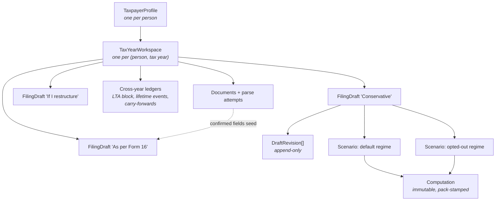
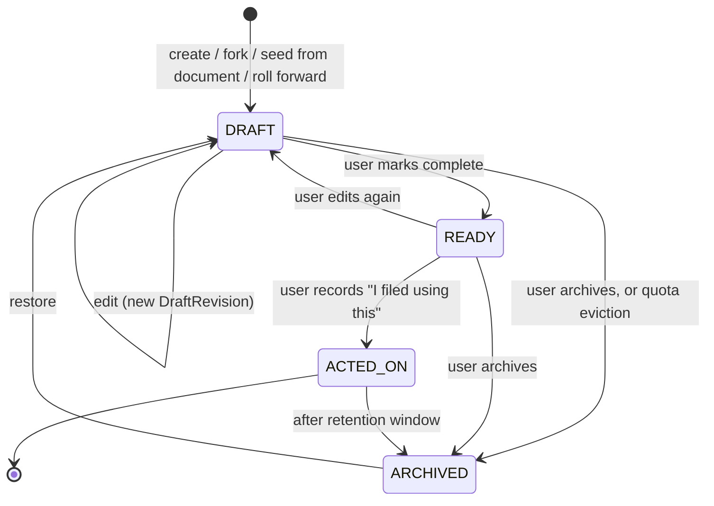

# 11 — Stored entries and filing drafts

**Amends `05-domain-model.md` M3, M5 and M7.** Where this disagrees with them, this wins.

## Why the first draft was wrong

`05-domain-model.md` M7 gave `tax_year_contexts` a **unique index on `{email, tax_year}`** — one
input set per person per year. That forecloses the requirement outright: a person may keep **any
number of drafts** for the same tax year, and the entries they type must persist between sessions.

`INFERENCE`: the mistake was treating "the person's tax position for a year" as a singleton. It is
not. It is a **workspace containing many candidate positions**, of which at most one is eventually
acted on. The singleton is the *tax year*, not the *entry set*.

---

## F1 — The three levels, and why they are three

The first draft had two concepts (`TaxYearContext`, `Scenario`) doing three jobs badly. Separate them:

| Level | What it is | Cardinality | Mutability |
|---|---|---|---|
| **`TaxYearWorkspace`** | Everything a person has for one tax year: their drafts, their documents, their cross-year ledgers | exactly **1** per `(profile, taxYear)` | mutable container, owns nothing computational |
| **`FilingDraft`** | One candidate filing — a complete, named, independently editable input set | **0..N** per workspace | mutable through revisions; **frozen** once acted on |
| **`Scenario`** | A what-if **on a draft** — "same facts, but if I invested ₹50,000 more" | 0..N per draft | immutable once computed |

`INFERENCE (from `03-advisory.md` A1 and `10-extensibility.md` E6.1)`: regime comparison produces N
scenarios from **one** draft — the user is not choosing between drafts when they choose a regime.
Collapsing drafts and scenarios into one type would make "compare regimes across two different sets
of facts" indistinguishable from "compare regimes on the same facts", and only the second is
meaningful.



**The cross-year ledgers hang off the workspace, not the draft.** `INFERENCE (from `M3.4`)`: the LTA
calendar block, the once-in-a-lifetime VRS deduction and the carry-forward balances are **facts about
the person**, not candidate positions. Two drafts of the same year must not each be able to consume
the same VRS deduction.

---

## F2 — The aggregates

```java
TaxYearWorkspace
    workspaceId, profileId, taxYear
    primaryDraftId              // Optional — the one the user considers current
    draftCount                  // denormalised, for quota enforcement without a count query
    createdAt, lastActivityAt

FilingDraft
    draftId, workspaceId, profileId, taxYear
    label                       // user-supplied, e.g. "As per Form 16", "If I switch"
    origin                      // BLANK | FORKED_FROM(draftId) | SEEDED_FROM_DOCUMENT(attemptId)
                                //       | ROLLED_FORWARD_FROM(taxYear)
    status                      // DRAFT | READY | ACTED_ON | ARCHIVED        (F3)
    currentRevision             // int, monotonic — optimistic-lock token
    inputs                      // DraftInputs — the whole entry set (F4)
    regimeElection              // Optional<RegimeCode> — null means "compare all eligible"
    lastComputationId           // Optional
    createdAt, updatedAt, actedOnAt, archivedAt

DraftRevision                   // APPEND-ONLY. One row per accepted save.
    revisionId, draftId, revisionNumber
    changeSet                   // JSON Patch against the previous revision — not a full copy
    changedBy                   // principal, not just email — X3.4's AccessPolicy
    changedAt
    source                      // USER_EDIT | DOCUMENT_IMPORT | ROLLOVER | SYSTEM_CORRECTION
    inputsFingerprint           // hash of the resulting inputs, after applying the patch
```

### Why revisions are patches, not snapshots

`INFERENCE`: a salary profile with 30 components, 3 properties and 20 declarations is a few KB.
Autosave on every keystroke-debounce would write thousands of near-identical copies per draft per
year. A JSON Patch change-set is tens of bytes, and the full state at any revision is replayable.

`RECOMMENDATION`: **materialise a full snapshot every 50 revisions** and on every status transition,
so replay is bounded. Store snapshots in the same collection with `changeSet = null` and a
`fullState` field. This is the standard event-sourcing compaction trade and it is worth it here
because the replay target — reproducing exactly what a user saw when they computed — is a real
audit requirement (`14-operational-design.md` O4).

---

## F3 — Lifecycle



| Status | Editable | Counts to quota | Notes |
|---|---|---|---|
| `DRAFT` | yes | yes | the working state |
| `READY` | yes, but re-entering `DRAFT` is recorded | yes | a soft "I think this is done" marker |
| `ACTED_ON` | **no — frozen** | no | the user has told us they filed on this. `D6`: **we never file.** This is a user assertion, and it must be labelled as one everywhere it appears |
| `ARCHIVED` | no | no | hidden by default, restorable, purged on the retention schedule |

`ACTED_ON` freezing is not fussiness. `INFERENCE (from `ADV-COMPUTE-001` and R19)`: a later tax year's
computation reads this year's carry-forwards, and s.157 relief reads **prior years' computed tax**. If
the draft a user filed on can still be edited, the prior-year figures that feed a future year are not
reproducible, and `F20`'s arrears relief becomes unimplementable.

---

## F4 — `DraftInputs` — what "entries" actually are

Everything `M3.2` put on `TaxYearContext` moves here, **except** the cross-year ledgers:

```java
DraftInputs
    employments            // List<Employment> — M3.2, incl. periods and revisions
    houseProperties        // List<HouseProperty>
    otherSources           // List<OtherSourceItem>
    capitalGainsOverride   // Optional<CapitalGainsSummary> — see F4.1
    declarations           // List<DeclaredClaim>
    proofs                 // List<ProofOfClaim>
    personalFacts          // age proxy, residential status, disability, senior-citizen dependants
    entryProvenance        // Map<fieldPath, EntryProvenance>          (F4.2)
```

### F4.1 Capital gains: snapshot, not live read

`INFERENCE`: `07-architecture.md` X1.3 had `taxplanning` calling `portfolio` synchronously at compute
time. With drafts that is wrong — a draft computed in September and reopened in January would silently
change because the portfolio moved. `RECOMMENDATION`:

- the workspace holds the **latest** `CapitalGainsSummary` fetched from `portfolio`, with its `asOf`;
- a draft **pins** the summary it was last computed against, in `capitalGainsOverride`;
- when the live summary's `asOf` is newer than the pinned one, the draft shows **"portfolio has
  changed since you last computed — refresh?"** rather than recomputing silently.

This is the same discipline as `packVersion` stamping (`X4.4`): a stored result must be explainable
later, which means every input it consumed must be pinned, including the ones from another module.

### F4.2 Entry provenance — per field

```java
EntryProvenance
    source          // USER_TYPED | DOCUMENT_PARSE(attemptId, fieldPath) | PORTFOLIO | ROLLED_FORWARD | DEFAULTED
    confidence      // Optional<double> — present for DOCUMENT_PARSE
    enteredAt
    supersededValue // Optional — what it was before, when a user overrode a parsed value
```

`INFERENCE (from `M4.1` and `G5`)`: the confidence banding in document ingestion is worthless if the
value loses its origin the moment it lands in an input set. A user must be able to see *"this ₹75,000
came from your Form 16 page 3, confidence 0.97"* versus *"you typed this"* — and
`12-claim-integrity.md` C3 needs exactly this distinction to tell a documented claim from an
undocumented one.

`DEFAULTED` is deliberately in the enum and deliberately rare. `D-NOSILENT`: if the engine ever needs
a value nobody supplied, the field records that it was defaulted and the trace carries a notice.

---

## F5 — Concurrency and autosave

`RECOMMENDATION`: optimistic concurrency on `currentRevision`, with a three-way merge, not last-write-wins.

```
PATCH /…/drafts/{draftId}
  If-Match: "rev-47"
  body: JSON Patch

  revision == 47  → apply, return rev-48
  revision  > 47  → 409 Conflict, body carries:
                      { serverRevision, yourBase, conflictingPaths[], serverChangeSets[] }
                    the client merges non-overlapping paths automatically and prompts only
                    on genuine field-level collisions
```

| Concern | Decision |
|---|---|
| Two tabs open | Detected by revision mismatch; non-overlapping paths auto-merge |
| Two devices | Same |
| Autosave cadence | Debounce 2 s, and force a save on blur, on navigation and on compute |
| Lost connectivity | Client buffers patches with a client-generated `idempotencyKey` per patch; replay is safe because applying the same patch at the same base revision twice is a no-op |
| An advisor and the client both editing (`X3.4`, D1's later work) | `changedBy` records the principal; the conflict body names who holds the conflicting change |

`INFERENCE`: last-write-wins is tempting and wrong here. The two most likely concurrent editors are
the **user** and the **document-import path** (`SEEDED_FROM_DOCUMENT`), and silently discarding a
user's typed correction because a parse landed a millisecond later is the worst possible failure.

---

## F6 — Unlimited drafts, bounded cost

"Any number of drafts" is the product requirement; unbounded storage is not an acceptable reading of
it. `RECOMMENDATION`:

| Control | Value | Rationale |
|---|---|---|
| Soft cap per `(profile, taxYear)` | **25 active** (`DRAFT` + `READY`) | Beyond this the user is not comparing, they are accumulating. Prompt to archive; do not block |
| Hard cap per `(profile, taxYear)` | **100 active** | 400 with a message naming the oldest archivable drafts |
| `ACTED_ON` drafts | **never** counted, **never** auto-evicted | they are the record |
| Revisions per draft | **5,000**, then compact — collapse revisions older than the last snapshot into it | bounds replay cost |
| Auto-archive | `DRAFT` untouched for **18 months** and not `primary` | keeps the list usable; reversible |

`INFERENCE`: 25 is chosen because it comfortably exceeds any real comparison exercise — the product's
own optimiser (`A2`) produces a handful of candidate structures, and regime comparison produces
scenarios, not drafts.

---

## F7 — Year rollover

`RECOMMENDATION`: at the start of a tax year, offer to create a draft with `origin = ROLLED_FORWARD_FROM`.

What rolls forward, and what must not:

| Rolls forward | Does not |
|---|---|
| Employment structure and component **codes** | component **amounts** — a new year's figures are unknown |
| House properties, their occupancy, their loans | rent and interest **amounts** |
| Recurring deductions' *kinds* (LIC policy exists, education loan exists) | the **amounts** |
| Personal facts | derived facts — age is recomputed, never copied |
| Landlord details, lender details | — |
| **Regime election: NOT rolled forward** where the election is free | a **bound** election (`BindingSpec.bindsSubsequentYears`, and `bindingAppliesWhen` holds) **is** carried and explained — `17-regime-lifecycle.md` L3 |

`REG-OPTOUT-YEARLY-001` is the reason for the last row: for a salaried person the regime is a fresh
annual decision, and the default may itself have changed between the years. Pre-selecting last year's
choice would quietly make the product's central recommendation into a rubber stamp.

`RECOMMENDATION`: everything rolled forward is marked `EntryProvenance.source = ROLLED_FORWARD` and
rendered as *"from last year — confirm"*, never as an entered value.

### The rollover trap this design must survive

`INFERENCE (from `SETOFF-NEW-001` and `SETOFF-NEW-002`)`: **switching regime destroys carried-forward
house-property losses.** s.202(3) says such loss *"shall be deemed to have been given full effect to
and no further deduction for such loss ... shall be allowed for any subsequent year."* So a user who
carried a ₹3,00,000 HP loss out of TY 2025-26 and then computes TY 2026-27 in the default regime
**loses it permanently** — not for one year, forever.

That must be a **first-class alert at rollover**, sourced from the workspace's carry-forward ledger,
not a footnote inside a regime comparison. It is one of the few places where this year's choice has
an irreversible multi-year cost, and `03-advisory.md` A1.4 flagged it as a trap without saying it was
permanent. It is.

---

## F8 — Storage

Replacing `M7`'s `tax_year_contexts` row:

| Collection | Key | Indexes | Notes |
|---|---|---|---|
| `tax_year_workspaces` | `workspace_id` | **unique** `{email, tax_year}`; `{email, last_activity_at desc}` | the singleton, correctly scoped |
| `tax_filing_drafts` | `draft_id` | `{workspace_id, status, updated_at desc}`; `{email, tax_year, status}`; **partial unique** `{workspace_id}` where `is_primary = true` | **no unique constraint on `{email, tax_year}`** — that was the bug |
| `tax_draft_revisions` | `revision_id` | **unique** `{draft_id, revision_number}`; `{draft_id, revision_number desc}` | append-only; never updated, never deleted before compaction |
| `tax_scenarios` | `scenario_id` | `{draft_id, created_at desc}` | now keyed on the **draft**, not on `(email, taxYear)` |
| `tax_computations` | `computation_id` | `{draft_id, computed_at desc}`; `{email, tax_year, inputs_fingerprint, rule_pack_version}` | gains `draft_id` |

| `tax_regime_election_history` | `{profile_id, regime_code}` | unique `{profile_id, regime_code}`; `{profile_id}` | **New — `17-regime-lifecycle.md` L3.** Append-only election events across years. **Workspace-independent**: s.202(4)(a)(ii)'s "applies to subsequent tax years" and s.202(4)(a)(iv)'s permanent ineligibility span years by nature |

Everything in `M7` that hung off `(email, tax_year)` and is a **fact about the person** —
`tax_lta_block_state`, `tax_lifetime_events`, `tax_carry_forwards`, `tax_documents`,
`tax_parse_attempts` — stays keyed as it was and now hangs off the **workspace**, not the draft.

### The invariant that makes this safe

```
I8 : a cross-year ledger entry may be consumed by at most one ACTED_ON draft per tax year.
     A DRAFT or READY draft may *provisionally* consume it; the consumption becomes
     binding only on the transition to ACTED_ON, and the transition fails if another
     ACTED_ON draft for the same tax year has already consumed it.
```

`INFERENCE`: without I8, three drafts of TY 2026-27 could each claim the once-in-a-lifetime VRS
deduction (`RET-VRS-002`) and the product would have told the user three different, individually
plausible, mutually exclusive answers with no warning.

---

## F9 — API delta

Replacing the `context` endpoints in `07-architecture.md` X3.1:

| Method | Path | Notes |
|---|---|---|
| `GET` | `/tax-planning/user/{email}/workspaces/{taxYear}` | workspace + draft list (labels, status, updatedAt, last computed tax) |
| `POST` | `/tax-planning/user/{email}/workspaces/{taxYear}/drafts` | create; body carries `origin` |
| `GET` | `…/drafts/{draftId}` | full inputs + `ETag: "rev-N"` |
| `PATCH` | `…/drafts/{draftId}` | JSON Patch; requires `If-Match`; 409 with a merge body on conflict |
| `POST` | `…/drafts/{draftId}/fork` | new draft, `origin = FORKED_FROM` |
| `POST` | `…/drafts/{draftId}/status` | `READY` / `ACTED_ON` / `ARCHIVED` / restore — validates I8 on `ACTED_ON` |
| `POST` | `…/drafts/{draftId}/primary` | set `primaryDraftId` |
| `GET` | `…/drafts/{draftId}/revisions` | paged history with `changedBy`, `changedAt`, `source` |
| `GET` | `…/drafts/{draftId}/revisions/{n}` | the full input state at revision `n`, by replay |
| `POST` | `…/drafts/{draftId}/compute` | pins the pack version and the portfolio `asOf`; returns a `Computation` |
| `POST` | `…/drafts/{draftId}/compare-regimes` | N scenarios on **this** draft (`10-extensibility.md` E6.1) |
| `GET` | `/tax-planning/user/{email}/workspaces/{taxYear}/diff?a={draftId}&b={draftId}` | **draft-to-draft** diff — a different operation from scenario diff |

`INFERENCE`: `diff?a=&b=` is worth having as its own endpoint. "What is different between my
conservative draft and my optimistic one" is a question about **inputs**, whereas `ScenarioDiff` is a
question about **outputs under different rules**. Conflating them is how O-21 happened.

---

## F10 — Tests

| ID | Case | Expected |
|---|---|---|
| **T11-1** | Create 5 drafts for one `(email, taxYear)` | all 5 persist; no unique-index violation |
| **T11-2** | Two concurrent `PATCH`es at the same `If-Match` | first 200, second **409** with `conflictingPaths` |
| **T11-3** | Concurrent patches touching disjoint paths | both apply after client merge; revision advances by 2 |
| **T11-4** | Replay draft to revision `n` | byte-identical to the state captured at revision `n` |
| **T11-5** | Compaction at 50 revisions | snapshot written; replay from revision 1 still correct |
| **T11-6** | `ACTED_ON` draft receives a `PATCH` | **409**, draft unchanged |
| **T11-7** | Two drafts both claim the VRS deduction; mark both `ACTED_ON` | first succeeds, second **409** citing **I8** and `RET-VRS-002` |
| **T11-8** | Compute, then portfolio's `asOf` advances, then reopen | draft shows **stale-portfolio** notice; figures unchanged until refresh |
| **T11-9** | Rollover from TY 2025-26 with a carried-forward HP loss, into the default regime | draft created; a **first-class alert** that the loss is destroyed permanently (`SETOFF-NEW-002`) |
| **T11-10** | Rollover | regime election is **empty**, not copied (`REG-OPTOUT-YEARLY-001`) |
| **T11-11** | 101st active draft | **400** naming the oldest archivable drafts |
| **T11-12** | Document import onto a draft the user is editing | conflict surfaced per field, user's typed value never silently replaced |
