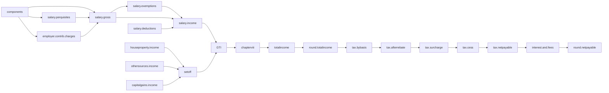

# 15 — Third pass: defects, new engines, and the architecture change

A third adversarial pass over `01`–`14`. **Part A** is what is wrong or missing. **Part B** is the one
architectural change worth making. **Parts C–G** are the new engines, entities and types, with code.

Where this disagrees with an earlier document, this wins.

---

# Part A — Defect register

| # | Defect | Severity | Fixed in |
|---|---|---|---|
| **D-1** | **`TaxpayerProfile` has no PAN.** `13-edge-cases.md` B9-73 specifies "reject a Form 16 whose PAN differs from the profile PAN" — against a field that does not exist. PAN is also needed for landlord-PAN self-reference checks and for document matching | **B** | F1 |
| **D-2** | **No interest or fee engine at all.** ss.423, 424, 425, 426 and 428 were never designed for. A user asking "what do I owe" gets tax without interest, which is not what they owe | **B** | C1 |
| **D-3** | **`Condition` was never specified.** `M1.2` declares `List<Condition> conditions` on every rule row and nothing defines the type. `D-NOFORMULA` forbids a string DSL, so this needs an answer, not a placeholder | **B** | E |
| **D-4** | **The pipeline is modelled as a linear list; the computation is a DAG.** Inserting a step means knowing where in 31 positions it goes, which is exactly the "edit existing logic" the brief forbids | **B** | B |
| **D-5** | **No proration primitive**, though at least eight rules prorate — and each differently (completed months, calendar months, days, occupation periods). Prose says "per period" in five places with no shared mechanism | **B** | C3 |
| **D-6** | **No family or dependant entity.** 80D needs parents and their senior-citizen status; 80DD needs a disabled dependant and severity; CEA and hostel need "up to two children"; LTA needs "two surviving children" with the pre-1 Oct 1998 exception. All of it is scattered across prose | **B** | F2 |
| **D-7** | **Elections are scattered and unmodelled.** Which two houses (`R-6`), which two children, set-off absorption order (`R-7`), which gratuity against the aggregate limit, and the regime itself are all *choices the assessee makes*. Each was handled ad hoc | **B** | C2 |
| **D-8** | **No reference entities for employer, landlord or lender.** Each is retyped per year per draft; a landlord PAN correction in one draft does not reach another | **W** | F3 |
| **D-9** | **`inputsFingerprint` does not cover everything that changes the answer** — cross-year ledgers and family facts are outside `DraftInputs`, so the compute cache (`O3`) can serve a stale result after a ledger changes | **B** | F6 |
| **D-10** | **No path for a taxpayer with no employer.** A pensioner with family pension and interest has zero `Employment` rows; the whole model is employment-centric and the pipeline was never checked against an empty salary head | **W** | B3 |
| **D-11** | **`Rate` is not a type.** Percentages are raw `BigDecimal`, so "30" and "0.30" are the same type and the compiler cannot help | **W** | G |
| **D-12** | **`TraceLine.in/out` is scalar**, so it cannot carry `13-edge-cases.md` R-5's tax-by-rate-basis partition without a side channel | **B** | B4 |
| **D-13** | **No rule-pack lint or diff.** `X4` says adding a year is `cp -r` and edit. Nothing catches a value that was copied forward and should not have been — which is precisely the H-2 defect class, at authoring time | **B** | C4 |
| **D-14** | **Boundary golden cases are hand-written** though they are derivable from the pack's own ladders and thresholds. `T1` and `T2` were written by hand, and a third regime or a new year needs them written again | **W** | C5 |
| **D-15** | **The optimiser recomputes the whole pipeline** for every candidate. Changing an 80C contribution cannot affect the salary head, yet the salary head is recomputed ~24,000 times | **W** | B5 |
| **D-16** | **No bank-account entity**, though refunds need one, `DED-80TTA-001` needs interest by account type, and `rule 163(1)(g)` keys on aggregate savings deposits | **W** | F4 |
| **D-17** | **Intra-head capital-gains set-off ownership is still ambiguous** — `13-edge-cases.md` R-10 drew the boundary for *rates* but not for s.108(2) set-off | **W** | F5 |
| **D-18** | **No rule-level effective dating.** A pack is versioned as a whole, but `13-edge-cases.md` R-8 showed amendments land mid-year with their own effective dates | **W** | E3 |

`INFERENCE`: D-4 and D-7 are the two that change the architecture. The rest are additions.

---

# Part B — The computation is a DAG, not a list

## B1 — Why the list is wrong

`06-algorithms.md` G1.1 numbers 31 steps. That numbering is a **hand-maintained topological order of a
dependency graph**, and hand-maintaining a topological order is the failure mode the brief is written
against: adding `PERQ-LOAN-2026` means knowing it goes after step 2 and before step 11, and getting it
wrong produces a plausible wrong number rather than an error.

`INFERENCE`: every step already knows what it needs and what it yields. Declare that, and the order is
**derived** — so a new step is a new class plus a pack entry, and its position is computed.

## B2 — The node

```java
package com.thiru.wealthlens.taxengine.pipeline;

/** A named slot in the computation graph. Values flow between nodes by NodeId, never by field. */
public record NodeId(String value) {                       // ^[a-z][a-z0-9.]{2,63}$
    public static final NodeId GROSS_SALARY      = new NodeId("salary.gross");
    public static final NodeId SALARY_EXEMPTIONS = new NodeId("salary.exemptions");
    public static final NodeId SALARY_INCOME     = new NodeId("salary.income");
    public static final NodeId HP_INCOME         = new NodeId("houseproperty.income");
    public static final NodeId OS_INCOME         = new NodeId("othersources.income");
    public static final NodeId CG_INCOME         = new NodeId("capitalgains.income");
    public static final NodeId GTI               = new NodeId("gti");
    public static final NodeId TOTAL_INCOME      = new NodeId("totalincome");
    public static final NodeId TAX_BY_BASIS      = new NodeId("tax.bybasis");
    public static final NodeId TAX_AFTER_REBATE  = new NodeId("tax.afterrebate");
    public static final NodeId SURCHARGE         = new NodeId("tax.surcharge");
    public static final NodeId CESS              = new NodeId("tax.cess");
    public static final NodeId NET_PAYABLE       = new NodeId("tax.netpayable");
    // … the full set is declared in the pack, not here; these are the well-known anchors
}

public interface ComputationNode {

    NodeId       produces();
    Set<NodeId>  requires();          // the edges. Order is derived from these, never declared.
    Set<RuleId>  rules();             // for provenance and for the unreachable-rule check (I3)

    /**
     * Pure. Reads only what {@link #requires()} named; writes only {@link #produces()}.
     * Throws on any condition it cannot evaluate — D-NOSILENT.
     */
    NodeResult evaluate(NodeContext ctx);
}

public record NodeResult(NodeValue value, List<TraceLine> trace) {}
```

`NodeContext.get(NodeId)` **throws** if the node was not declared in `requires()`. That single check
makes an undeclared dependency a test failure rather than an ordering bug, which is what a hand-kept
list can never give you.

> **Erratum (W-039, 2026-09-21):** this property is right and **B3's runner cannot deliver it**. B3
> builds one context for the whole run — `var ctx = new NodeContext(pack, regime, inputs)` — and
> passes the same instance to every node, so it cannot know which node is asking and cannot make
> the check at all. **Correction: a context is created per node**, carrying that node's
> `requires()` and `rules()`, over a value store shared across the run —
> `NodeContext.forRun(...)` once, `ctx.forNode(node)` per node. The same scoping applies to
> `rule(RuleId)`: a node may not evaluate a rule it did not declare, or the rule would look
> unreachable to **I3** while being applied.
> Verified by: `./mvnw test -pl backend -Dtest=NodeRegistryTest` —
> `aNodeMayNotReadWhatItDidNotDeclare`, `aNodeMayNotEvaluateARuleItDidNotDeclare`.

## B3 — The runner

```java
public final class PipelineRunner {

    private final NodeRegistry registry;

    public Computation run(RulePack pack, RegimeSpec regime, Inputs inputs) {

        List<ComputationNode> nodes = registry.resolveAll(regime.pipeline().nodeRefs());
        List<ComputationNode> order = TopologicalSort.of(nodes);      // fails on a cycle, at load

        var ctx = new NodeContext(pack, regime, inputs);
        for (ComputationNode node : order) {
            NodeResult r = node.evaluate(ctx);                        // no try/catch — D-NOSILENT
            ctx.put(node.produces(), r.value());
            ctx.trace().addAll(r.trace());
        }
        return ctx.toComputation();
    }
}
```

Three things fall out for free:

| | |
|---|---|
| **D-10, the pensioner** | A taxpayer with no employment simply yields `GROSS_SALARY = Money.ZERO`. Downstream nodes are unaffected because they depend on the **node**, not on the existence of an employment. The list version had 11 salary steps that each had to tolerate emptiness |
| **Parallelism** | Independent branches — the salary head, the house-property head, other sources — are independent subgraphs and can be evaluated in parallel. Not needed at 50 ms, useful at 24,000 evaluations |
| **Explanation** | The graph *is* the "why" — `A1.2`'s driver attribution becomes a graph diff rather than a line-sequence diff |



## B4 — `NodeValue` fixes D-12

```java
public sealed interface NodeValue
        permits MoneyValue, TaxByBasis, HeadResult, ComponentSet, ElectionOutcome, InterestBreakdown {

    Money asMoney();          // the single summary figure, for the trace's `out` column
}

/** 13-edge-cases.md R-5: the rebate cap needs slab-rate tax alone, the surcharge split needs both. */
public record TaxByBasis(Money atSlabRates, Map<SpecialRateId, Money> atSpecialRates)
        implements NodeValue {

    @Override public Money asMoney() {
        return atSpecialRates.values().stream().reduce(atSlabRates, Money::plus);
    }
}
```

`TraceLine` gains `NodeValue in` / `NodeValue out` in place of `Money`, and keeps `asMoney()` for
rendering. The R-5 partition then travels through the pipeline as a first-class value rather than as a
side channel.

## B5 — Incremental recomputation fixes D-15

```java
/** Re-evaluates only the nodes downstream of what actually changed. */
public final class IncrementalRunner {

    private final Computation baseline;
    private final Map<NodeId, NodeValue> memo;
    private final Map<NodeId, Set<NodeId>> dependents;   // reverse edges, computed once per pack

    public Computation recomputeWith(InputDelta delta) {
        Set<NodeId> dirty = new HashSet<>();
        for (NodeId seed : delta.affectedNodes()) {      // e.g. a change to EMPLOYEE_NPS seeds chapterviii
            collectDownstream(seed, dirty);
        }
        // every clean node keeps its memoised value; only `dirty` is re-evaluated, in topological order
        ...
    }
}
```

`INFERENCE`: `A2`'s optimiser perturbs one component at a time. A change to an 80C contribution dirties
`chapterviii → totalincome → round → tax.* → interest` — roughly **8 of 31 nodes**. The salary head,
the perquisite valuations, the house-property head and other sources are all clean and memoised.
That is a **3–4× reduction** in evaluated nodes for the same exact answer, and it is exact, not
approximate — the memo is only reused where the graph proves nothing upstream moved.

`RECOMMENDATION`: `G6.2`'s ~24,000 evaluations at N = 5 regimes become roughly 6,000 node-equivalents,
which moves the optimiser comfortably inside `O8`'s 3-second budget with the exhaustive breadth
**raised**, not lowered.

---

# Part C — New engines

## C1 — Interest and fee engine (D-2)

All five provisions were read this session from S2.

| Rule ID | Provision | Substance |
|---|---|---|
| `INT-LATEFILE-001` | **s.423(1)** | `I = 1% × A × T` where `T` is months from the s.263(1) due date to the date of furnishing, and `A` is the tax on which interest is payable per the s.423(2) Table |
| `INT-ADVSHORT-001` | **s.424(1)** | Interest where advance tax paid is **less than 90% of the assessed tax**, or not paid at all |
| `INT-DEFER-001` | **s.425(1)** | Interest on the shortfall at each of the four instalment dates against 15 / 45 / 75 / 100% of tax due on returned income |
| `INT-DEFER-CARVEOUT-001` | **s.425(4)** | **No** interest where the shortfall is due to under-estimating **capital gains, s.2(49)(n) income, first-time business income, or dividend income**, provided the tax on it is paid in full in any remaining instalment **or by 31 March** |
| `INT-EXCESSREFUND-001` | **s.426(1)** | Interest where a refund granted under s.270(1) turns out not to be due |
| `FEE-LATEFILE-001` | **s.428** | Fee for late return: **not exceeding ₹1,000** where total income does not exceed ₹5,00,000; **₹5,000** in any other case |

```java
package com.thiru.wealthlens.taxengine.node;

/** Runs after tax.netpayable, before the final rounding. */
public final class InterestAndFeeNode implements ComputationNode {

    @Override public NodeId      produces() { return NodeId.INTEREST_AND_FEES; }
    @Override public Set<NodeId> requires() {
        return Set.of(NodeId.NET_PAYABLE, NodeId.TOTAL_INCOME, NodeId.ADVANCE_TAX_PAID,
                      NodeId.TDS_CREDIT, NodeId.FILING_FACTS);
    }

    @Override public NodeResult evaluate(NodeContext ctx) {
        var facts     = ctx.get(NodeId.FILING_FACTS, FilingFacts.class);
        var assessed  = ctx.get(NodeId.NET_PAYABLE,  MoneyValue.class).asMoney();
        var breakdown = InterestBreakdown.builder();

        // s.423 — late or non-furnishing of the return
        if (facts.furnishedAfterDueDate()) {
            int months = TaxMonths.between(facts.dueDate(), facts.furnishedOn());   // C3
            breakdown.add(ctx.rule(RuleIds.INT_LATEFILE_001)
                             .as(SimpleInterest.class)
                             .compute(assessed, months));
        }

        // s.424 — advance tax below 90% of assessed tax
        Money advancePaid = ctx.get(NodeId.ADVANCE_TAX_PAID, MoneyValue.class).asMoney();
        Rate  ninety      = ctx.rule(RuleIds.INT_ADVSHORT_001).as(ThresholdRate.class).threshold();
        if (advancePaid.isLessThan(ninety.of(assessed))) {
            breakdown.add(...);
        }

        // s.425 — deferment, instalment by instalment, WITH the s.425(4) carve-out
        for (Instalment i : ctx.rule(RuleIds.ADV_INSTAL_001).as(InstalmentLadder.class).instalments()) {
            Money due       = i.cumulativePercent().of(assessed);
            Money paidByDue = facts.advanceTaxPaidOnOrBefore(i.dueDate());
            Money shortfall = due.minus(paidByDue).floorAtZero();

            // INT-DEFER-CARVEOUT-001 — s.425(4)
            Money carvedOut = facts.shortfallAttributableTo(
                    CarveOutHead.CAPITAL_GAINS, CarveOutHead.DIVIDEND,
                    CarveOutHead.FIRST_TIME_BUSINESS, CarveOutHead.SECTION_2_49_N);
            if (facts.paidInFullByRemainingInstalmentOrMarch31(carvedOut)) {
                shortfall = shortfall.minus(carvedOut).floorAtZero();
            }
            breakdown.add(...);
        }

        // s.428 — late-filing FEE (a fee, not interest: it does not accrue and is not pro-rated)
        if (facts.furnishedAfterDueDate()) {
            breakdown.addFee(ctx.rule(RuleIds.FEE_LATEFILE_001)
                                .as(TieredFee.class)
                                .feeFor(ctx.get(NodeId.TOTAL_INCOME, MoneyValue.class).asMoney()));
        }
        return breakdown.build().asNodeResult();
    }
}
```

### Why this matters more than it looks

`INFERENCE`: `INT-DEFER-CARVEOUT-001` is the rule the D3 persona actually needs. *"I sold shares in
December — have I already missed an instalment?"* has the answer **no, provided you pay by the next
instalment or by 31 March**, and without this engine the product either says nothing or frightens the
user with a ladder that does not bind. `04-product-spec.md` F16 is half a feature without it.

`RECOMMENDATION`: model **fee** and **interest** as different types. A fee (s.428) is a step function
of total income and does not accrue; interest accrues by month. Collapsing them into one "penalty"
number loses the only actionable distinction — interest grows while you wait, the fee does not.

## C2 — Election engine (D-7)

Five distinct choices, all previously handled ad hoc:

| Election | Statutory basis | Options |
|---|---|---|
| Which **two houses** are self-occupied | `FACT (S2, s.21(7)(a))` — *"two of such houses **as specified by the assessee**"* | `C(k,2)` |
| Which **regime** | `REG-OPTOUT-SAL-001` | the eligible set |
| Which **two children** for CEA and hostel, where amounts differ | `SAL-ALW-CEA-2026` | `C(n,2)` |
| **Set-off absorption order** | `SETOFF-HP-001` — the Act prescribes no order (`13-edge-cases.md` R-7) | permutations of heads |
| Which **gratuity** against the cross-year aggregate | `RET-GRAT-AGG-001` | subsets |

```java
public sealed interface Election<T> permits HouseElection, RegimeElection, ChildElection,
                                            SetOffOrderElection, AggregateAllocationElection {

    ElectionId    id();
    RuleId        basis();                       // the provision that grants the choice
    List<T>       candidates(Inputs in, RulePack pack);
    ElectionMode  mode();                        // USER_SPECIFIED | AUTO_OPTIMISE | STATUTORY_DEFAULT
}

public final class ElectionResolver {

    /** D-MARGINAL: elections are priced by recomputation, never by a heuristic. */
    public <T> ElectionOutcome<T> resolve(Election<T> e, Inputs in, RulePack pack, RegimeSpec regime) {

        if (e.mode() == ElectionMode.USER_SPECIFIED) {
            return ElectionOutcome.of(in.userChoiceFor(e.id()), Basis.USER);
        }
        List<T> candidates = e.candidates(in, pack);

        // IncrementalRunner (B5) — only the nodes the election touches are re-evaluated
        var priced = candidates.stream()
                .map(c -> Map.entry(c, incremental.recomputeWith(e.deltaFor(c)).netPayable()))
                .toList();

        var best = priced.stream().min(Map.Entry.comparingByValue()).orElseThrow();
        return ElectionOutcome.of(best.getKey(), Basis.OPTIMISED, priced);   // priced list → the trace
    }
}
```

`RECOMMENDATION`: **every election records all priced alternatives in the trace**, not only the
winner. A user who was told "we made these two houses self-occupied" deserves to see the other
combination and its cost — and an auditor needs to see that the choice was made on price, not by
accident.

## C3 — Proration engine (D-5)

At least eight rules prorate, and each prorates differently. Writing that eight times is how the HRA
per-period bug (`13-edge-cases.md` R-11) survived the first two passes.

```java
public sealed interface ProrationBasis permits CompletedMonths, CalendarMonths, Days, OccupationPeriods {

    /** The fraction of a full tax year that `window` represents on this basis. */
    Fraction fractionOf(TaxYearId year, DateRange window);
}

/** PerUnitPerPeriod caps (CEA ₹3,000/month/child; car ₹5,000 "per calendar month"). */
public record CompletedMonths() implements ProrationBasis { ... }

/** The Rules say "per calendar month" for motor car — a part month counts as one. */
public record CalendarMonths() implements ProrationBasis { ... }

/** SAL-HRA-003 "the period during which the said accommodation was occupied". */
public record Days() implements ProrationBasis { ... }
```

Each rule row **names its basis**, so the choice is data and is visible:

```json
{ "ruleId": "SAL-ALW-CEA-2026",
  "cap": { "type": "PerUnitPerPeriod", "amount": "3000",
           "unit": "CHILD", "maxUnits": 2,
           "period": "MONTH", "prorationBasis": "COMPLETED_MONTHS" },
  "prorationStatus": "NEEDS VERIFICATION",
  "whatToCheck": "whether a part month counts as one for r.280(2) Sl.7. Completed months assumed." }
```

`INFERENCE`: `13-edge-cases.md` B2-20 flagged "a child in hostel for 20 days is one month or zero, not
0.65" as an open decision. With a named basis the decision is made **once, in data, visibly** — and
the `NEEDS VERIFICATION` marker rides along to the user via `A4.2`.


> **Erratum (W-066, 2026-09-27, D-097):** `fractionOf` returning a `Fraction` is the wrong output. The month-based
> caps multiply a whole count (`PerUnitPerPeriod` reads `CapContext.count`, and `Money.times` takes only an
> `int`), and HRA's salary for a period is one division that must round once. As built, `ProrationBasis` answers
> `units(year, window)` and `apportion(forTheYear, year, window)`. `CompletedMonths` counts calendar months lying
> wholly within the window. `OccupationPeriods` has no declaration here and is not a basis: HRA's occupied
> windows are `W-067`'s input, each measured by `Days`.
>
> Verified by: `PerUnitPerPeriod`, `Money.times(int)`, `13-edge-cases.md` B2-20.

## C4 — Rule-pack lint and diff (D-13)

`X4.1` says adding a year is `cp -r` and edit. That is exactly how H-2 happened in the placeholder: a
Rules-2026 value sitting under a TY 2025-26 label. Nothing in the design catches it.

```java
public record PackDiff(TaxYearId from, TaxYearId to, List<Finding> findings) {

    public sealed interface Finding {
        record ValueChanged(RuleId r, String field, String before, String after, Magnitude m) implements Finding {}
        record RuleAdded(RuleId r)                                          implements Finding {}
        record RuleRemoved(RuleId r)                                        implements Finding {}
        record ProvisionRenumbered(RuleId r, String before, String after)   implements Finding {}
        record CarriedForwardUnverified(RuleId r, String whatToCheck)       implements Finding {}
        record SuspiciousCopy(RuleId r, String reason)                      implements Finding {}
    }
}
```

The lint rules that earn their place:

| Lint | Catches |
|---|---|
| A value changed by **more than 10×** or by an exact power of ten | a decimal-point typo |
| A value is **identical** across years **and** its provenance `sourceUrl` still points at the **older** year's instrument | **the H-2 defect, at authoring time** |
| `status = VERIFIED` but `accessedOn` predates the new year's instrument | a stale verification carried forward |
| A rule present in year N and absent in N+1 with no `Presence.ABSENT_IN_THIS_ACT` | a silent drop |
| A rule reachable from no pipeline in the new pack | invariant I3, per year |
| A `SlabLadder` whose bands are not contiguous | `H-5`, before any test runs |
| A `RegimeSpec` referencing a `DisallowanceSetId` that does not exist | invariant I6 |
| Aggregate contributors naming a `ComponentCode` absent from `components.json` | invariant I7 |

`RECOMMENDATION`: run the diff as a **build step** that writes a human-readable review file, and make
the year-rollover pull request **require a reviewer to sign that file off**. A rollover is a legal
change wearing the clothes of a copy-paste; it should read like a legal change in review.

## C5 — Golden-case generator (D-14)

`T1` and `T2`'s boundary cases — at the threshold, one rounding step above, at the crossover where a
relief stops binding — are **derivable from the pack itself**.

```java
public final class BoundaryCaseGenerator {

    public List<GoldenCase> generate(RulePack pack, RegimeSpec regime) {
        List<GoldenCase> out = new ArrayList<>();

        for (Band b : pack.rule(regime.rateTable()).as(SlabLadder.class).bands()) {
            out.add(caseAt(b.upperInclusive()));                       // at the ceiling
            out.add(caseAt(b.upperInclusive().plus(Money.TEN)));       // one rounding step above
        }
        for (Threshold t : pack.surchargeLadder(regime).thresholds()) {
            out.add(caseAt(t.amount()));
            out.add(caseAt(t.amount().plus(Money.TEN)));
            out.add(caseAt(solveReliefCrossover(t, pack, regime)));    // where marginal relief stops
        }
        for (RuleRow r : pack.rulesWithShape(CapShape.Fixed.class)) {
            out.add(caseAtCap(r));                                     // exactly at the cap
            out.add(caseJustOverCap(r));
        }
        return out;
    }
}
```

The **expected values** still come from the rulebook, not from the engine — the generator produces
**inputs and the arithmetic to be shown**, and a human or a separately-derived oracle supplies the
answer. `D-GOLDEN` is not weakened; what is automated is *which* boundaries exist, which is the part
that silently goes stale when a pack changes.

`INFERENCE`: `T1-N4`'s crossover at ₹12,70,580 / ₹12,70,590 took manual algebra. `solveReliefCrossover`
is that algebra, written once, and it re-derives itself for a new year or a third regime.

---

# Part D — Revised node inventory

Replacing `06-algorithms.md` G1.1's numbered list. Order is **derived**; this table is documentation,
not configuration.

| Node | Requires | Produces | Rules |
|---|---|---|---|
| `inputs.components` | — | partitioned component set | `D-CLOSEDSUM` |
| `salary.perquisites` | `inputs.components` | `MoneyValue` | `PERQ-*` |
| `employer.contrib.charges` | `inputs.components` | `MoneyValue` | `PF-AGGCAP-*`, `PF-RPF12-001` |
| `salary.gross` | components, perquisites, charges | `MoneyValue` | `SAL-CHARGE-001`, `SAL-DEF-001` |
| `salary.base` | components | `Map<RuleId, Money>` | `SAL-DEF-HRA-001`, `-GRAT-`, `-NPS-` |
| `salary.exemptions` | gross, base, `elections.children` | `MoneyValue` | `SAL-HRA-*`, `SAL-LTA-*`, `SAL-ALW-*` |
| `salary.retirement` | components, `ledger.lifetime` | `MoneyValue` | `RET-*` |
| `salary.deductions` | gross | `MoneyValue` | `SAL-STDDED-*`, `SAL-PTAX-*` |
| `salary.income` | gross, exemptions, retirement, deductions | `MoneyValue` | — |
| `elections.houses` | `inputs.properties` | `ElectionOutcome` | `HP-SELFOCC-002` |
| `houseproperty.income` | properties, `elections.houses` | `HeadResult` | `HP-*` |
| `othersources.income` | `inputs.othersources` | `HeadResult` | `OS-*` |
| `capitalgains.income` | `inputs.portfolio` | `HeadResult` + rate hints | D3, `13-edge-cases.md` R-10 |
| `setoff` | all head results, `ledger.carryforward`, `elections.setofforder` | `Map<Head, Money>` | `SETOFF-*` |
| `gti` | setoff | `MoneyValue` | `DED-GTI-DEF-001` |
| `chapterviii` | gti, components, `inputs.family` | `MoneyValue` | R15, `G2` |
| `totalincome` | gti, chapterviii | `MoneyValue` | `DED-GTI-CAP-001` |
| `round.totalincome` | totalincome | `MoneyValue` | `RATE-ROUND-002` |
| `tax.bybasis` | `round.totalincome`, capital-gains rate hints | **`TaxByBasis`** | `RATE-SLAB-*` |
| `tax.afterrebate` | `tax.bybasis` | `TaxByBasis` | `REBATE-*` — reads `atSlabRates` **only** |
| `tax.surcharge` | `tax.afterrebate`, `round.totalincome` | `MoneyValue` | `RATE-SUR-*`, `-MR-001`, `-SPLIT-001` |
| `tax.cess` | `tax.afterrebate`, `tax.surcharge` | `MoneyValue` | `RATE-CESS-001` |
| `relief.arrears` | `tax.cess`, prior-year packs | `MoneyValue` | `REL-ARREARS-001` (`Later`) |
| `credits` | `inputs.tds`, `inputs.advancetax` | `MoneyValue` | `TDS-CREDIT-001` |
| `tax.netpayable` | cess, relief, credits | `MoneyValue` | — |
| **`interest.and.fees`** | netpayable, totalincome, credits, `inputs.filingfacts` | **`InterestBreakdown`** | **`INT-*`, `FEE-*`** — new |
| `round.netpayable` | netpayable, interest | `MoneyValue` | `RATE-ROUND-002`, `ROUND-NEG-001` |

> **Erratum (W-062, 2026-09-27, D-092):** `salary.base` as `Map<RuleId, Money>` loses the employer. HRA and
> gratuity are measured per employer (and HRA per period, `SAL-HRA-003`), so a base summed across
> employments is wrong for anyone with two. As built: `SalaryBases` — per rule, per employment — with the
> rules `SAL-SALARY-FOR-HRA`, `-GRATUITY`, `-EMPLOYER-PENSION`, `-EMPLOYEE-PENSION` (the rulebook's
> `SAL-DEF-HRA-001`, `-GRAT-`, `-NPS-`, `-80C-NPS-`; D-035 names). Per-period apportionment is the
> consumer's (`W-066`/`W-067`).
>
> Verified by: `01-rulebook.md` R7, R9 `SAL-HRA-003`; `ComponentSet.Line.employment`.

---

# Part E — `Condition`, resolved (D-3, D-18)

`M1.2` declared `List<Condition>` and never defined it. `D-NOFORMULA` forbids a string expression
language. The resolution is a **small sealed algebra of typed predicates**, closed by design:

```java
public sealed interface Condition {

    boolean holds(ConditionContext ctx);

    // --- person facts ---
    record IsResident()                                   implements Condition {}
    record AgeAtLeast(int years)                          implements Condition {}   // RATE-SLAB-AGE-001
    record HasPersonType(Set<PersonType> types)           implements Condition {}
    record IsCertifiedDisabled(DisabilitySeverity min)    implements Condition {}

    // --- amounts ---
    record IncomeAtMost(NodeId node, Money limit)         implements Condition {}
    record IncomeAtLeast(NodeId node, Money limit)        implements Condition {}

    // --- structure ---
    record HasIncomeUnderHead(HeadCode head)              implements Condition {}   // s.202(4)(a) lock-in
    record ComponentPresent(ComponentCode code)           implements Condition {}
    record EvidenceRecorded(EvidenceType type)            implements Condition {}   // 12-claim-integrity C3.2
    record PaidOtherThanInCash()                          implements Condition {}   // s.126(9), s.133(5)

    // --- temporal: WITHDRAWN by 18-temporal-versioning.md V-2 ---
    //   Validity belongs on the RuleVersion, not in the predicate algebra: a rule whose
    //   LIMIT changes mid-year must keep ONE rule ID (the contract), not become two.
    //   record EffectiveBetween(LocalDate from, LocalDate to) implements Condition {}

    // --- composition ---
    record AllOf(List<Condition> all)                     implements Condition {}
    record AnyOf(List<Condition> any)                     implements Condition {}
    record Not(Condition c)                               implements Condition {}
}
```

> **Erratum (W-021, 2026-09-19):** `AgeAtLeast` as declared cannot express the rule this section's
> own pack example uses. The JSON below reads `{"type":"AgeAtLeast","years":60,"subject":"SELF"}`
> and `"subject":"INSURED_PERSON"`, and `19-engineering-foundations.md:199` writes
> `anyOf(ageAtLeast(60, SELF), ageAtLeast(60, INSURED_PERSON))` — but the record carries only
> `years`, so both limbs of that `AnyOf` are the same predicate and `DED-80D-007` collapses to a
> single test of the taxpayer's own age. Corrected to `AgeAtLeast(int years, AgeSubject subject)`.
>
> This list also holds **13** records, not the 16 the backlog claimed (14 counting the withdrawn
> `EffectiveBetween`).
> Verified by: `15-review-findings.md:533-534`; `19-engineering-foundations.md:199`;
> `grep -rh "record .*implements Condition" docs/taxplanning-design/`.

In a pack:

```json
{ "ruleId": "DED-80D-007",
  "conditions": [
    { "type": "AnyOf", "any": [
        { "type": "AgeAtLeast", "years": 60, "subject": "SELF" },
        { "type": "AgeAtLeast", "years": 60, "subject": "INSURED_PERSON" } ] } ],
  "cap": { "type": "Fixed", "amount": "50000" } }
```

| Property | Why it holds |
|---|---|
| **Closed** | a condition the algebra cannot express is a **new record** — a new class, which the brief permits — not a new syntax |
| **Inspectable** | `A1.2` can say *"unavailable because you are not a resident"*, because the failing condition is an object with a name |
| **Testable** | each record is unit-testable in isolation; O-1's "evaluator throws, caller substitutes zero" has no analogue |
| **Effective-dated** | superseded — see `18-temporal-versioning.md` V4. Dating moved to `RuleVersion.validity`, so a mid-year amendment is a second **version** of the same rule, keeping the rule ID stable |

---

# Part F — New and changed entities

## F1 — `TaxpayerProfile` gains identity (D-1)

```java
public record Pan(String value) {                       // ^[A-Z]{5}[0-9]{4}[A-Z]$
    public Pan { if (!PATTERN.matcher(value).matches()) throw new InvalidPanException(value); }
    public String masked() { return value.substring(0, 3) + "XXXXX" + value.substring(8); }
}

public record TaxpayerProfile(
        ProfileId      profileId,        // opaque UUID — 14-operational-design.md O1.2
        String         email,
        Pan            pan,              // *** D-1: was missing entirely ***
        LocalDate      dateOfBirth,
        ResidentialStatus residentialStatus,
        Optional<DisabilityCertificate> disability,
        Optional<LocalDate> dateOfDeath, // 13-edge-cases.md B1-8: present, not yet used
        Set<PersonType> personTypes) {}  // 10-extensibility.md E3.2 — drives regime eligibility
```

`Pan.masked()` exists so the type makes the `O1.1` logging rule the default rather than a convention.

## F2 — `FamilyMember` (D-6)

Six rules need per-person facts that were scattered across prose:

```java
public record FamilyMember(
        FamilyMemberId id,
        Relationship   relationship,     // SPOUSE | CHILD | PARENT | SIBLING | DEPENDANT_OTHER
        LocalDate      dateOfBirth,      // → senior-citizen status for DED-80D-007
        boolean        isDependant,      // DED-80DD-001's "dependant wholly or mainly"
        Optional<DisabilityCertificate> disability,      // DED-80DD-001 severity
        Optional<LocalDate> dateOfDeath,                 // SAL-LTA-CHILD-001 "surviving children"
        boolean        bornBeforeOct1998,                // SAL-LTA-CHILD-001's exception
        boolean        isMultipleBirthAfterFirstChild,   // the other exception
        Optional<Pan>  pan) {

    public boolean isSeniorCitizenIn(TaxYearId y, RulePack pack) { ... }   // "at any time during"
}
```

| Rule | Field it needs |
|---|---|
| `DED-80D-001` / `-002` | `relationship` — self/family versus parents are separate ₹50,000 ceilings |
| `DED-80D-007` | `dateOfBirth` — the ₹25,000 → ₹50,000 senior substitution |
| `DED-80D-008` | whether a premium was paid **for that person** |
| `DED-80DD-001` | `disability.severity` — ₹75,000 versus ₹1,25,000 |
| `DED-80DD-001` (s.127(8)) | the dependant must not have claimed `DED-80U-001` themselves |
| `SAL-ALW-CEA-2026` | count of children, and **which two** where amounts differ |
| `SAL-LTA-CHILD-001` | surviving children, the pre-1 Oct 1998 exception, multiple births |

`INFERENCE`: without this entity, `DED-80D-008` — *"medical expenditure on a senior citizen is allowed
only if no amount has been paid to keep health insurance in force for **that person**"* — is not
expressible at all. It is a per-person rule and there were no persons.

## F3 — Reference entities (D-8)

```java
public record Employer(EmployerId id, String name, Tan tan, Optional<Pan> pan,
                       EmployerType type,                      // GOVERNMENT | OTHER — DED-NPS-EMP-001
                       Address address) {}

public record Landlord(LandlordId id, String name, Address address, Optional<Pan> pan,
                       Optional<Relationship> relationshipToTaxpayer) {}   // SAL-HRA-006

public record Lender(LenderId id, String name, Optional<Pan> pan, LenderKind kind) {}
```

Each is **workspace-scoped and year-independent**, referenced by id from `DraftInputs`. Three benefits:

1. correcting a landlord's PAN fixes it in every draft and every year at once;
2. `EmployerType` drives `DED-NPS-EMP-001`'s 14%-versus-10% and is a property of the employer, not of
   the employment;
3. `13-edge-cases.md` B4-28 (rejoining the same employer) becomes two `Employment` rows pointing at
   **one** `Employer`, which is what it actually is.

**Third-party PII caveat**: `Landlord` and `Lender` hold data about people who are not the user. They
carry the shortest retention in `14-operational-design.md` O5 and are excluded from any user-shared
export.

## F4 — `BankAccount` (D-16)

```java
public record BankAccount(BankAccountId id, String bankName, String ifsc, String maskedNumber,
                          AccountKind kind,        // SAVINGS | TIME_DEPOSIT | CURRENT | POST_OFFICE
                          boolean nominatedForRefund) {}
```

`AccountKind` is load-bearing, not decorative: `DED-80TTA-001` is savings-account interest **excluding
time deposits**, while `DED-80TTB-001` is **any** account **including** time deposits. Interest that
does not know which kind of account it came from cannot be routed to the right rule.

## F5 — Capital-gains boundary, completed (D-17)

`13-edge-cases.md` R-10 settled rates; it left s.108(2) intra-head set-off unassigned.

```java
public record CapitalGainsSummary(
        ProfileId profileId, TaxYearId taxYear,
        List<CapitalGainsBucket> buckets,        // gross, per classification, per rate basis
        List<BroughtForwardLoss> broughtForward, // per origin year, per term — NOT pre-netted
        Instant asOf, String portfolioComputationRef) {}
```

`RECOMMENDATION`: `portfolio` supplies **gross buckets and un-netted brought-forward balances**;
`taxplanning` applies s.108(2) and s.111. Reason: s.108(2)'s asymmetry (a short-term loss may be set
against **any** capital gain; a long-term loss **only** against long-term) is a *tax* rule that lives
in the rule pack, and it interacts with `SETOFF-NEW-001`'s regime-dependent treatment. `portfolio` has
neither the pack nor the regime.

> **Erratum (W-085, 2026-10-18):** `portfolio` cannot supply brought-forward balances, and the sketch's
> `broughtForward` field is dropped — `portfolio` holds no capital-loss carry-forward at all, and the balance a year
> brings forward is what earlier *returns* left after their own set-off (s.108(2), s.111), a tax figure: it is the
> tax ledger's, built with S2 s.111 by `W-088` (coverage `PLANNED`, D-219 C3a), as the house-property loss is
> (`W-081b`). `ProfileId` and `TaxYearId` are not visible to `portfolio`; the read-model is
> `CapitalGainsSummary(email, financialYear, buckets, asOf, portfolioComputationRef)`, each bucket
> `(CapitalGainsType, AssetType, Optional<String> instrumentSubClass, double gainRupees)` (D-237).
> Verified by: `grep -rln "BroughtForward\|broughtForward\|carriedForward" backend/src/main/java/com/thiru/wealthlens/portfolio`
> → nothing; `coverage.json:114`.

## F6 — Fingerprint, corrected (D-9)

```java
public record InputsFingerprint(String sha256) {

    public static InputsFingerprint of(DraftInputs in, LedgerSnapshot ledgers,
                                       FamilySnapshot family, CapitalGainsSummary cg,
                                       RulePackRef pack, RegimeCode regime) {
        // EVERY input that can change the answer. Omitting one is a wrong cache hit,
        // which is indistinguishable from a wrong computation.
        // 17-regime-lifecycle.md L6: the election HISTORY is an input — a withdrawal
        // recorded in a prior year changes this year's eligible set.
        return new InputsFingerprint(Hashing.sha256()
                .of(in).and(ledgers).and(family).and(cg)
                .and(electionHistory).and(pack).and(regime).hex());
    }
}
```

`INFERENCE`: `14-operational-design.md` O3 made compute idempotent on a four-part key that **excluded**
the cross-year ledgers and family facts. A user who corrects a child's date of birth would have been
served the pre-correction result from cache. The fix is to derive the key from everything the pipeline
can read — and the DAG makes that checkable, because `requires()` enumerates exactly that.

> **Erratum (W-038, 2026-09-21):** **F6's `of(...)` is wrong in four ways, and the fourth is that it
> does not compile** — its body hashes `.and(electionHistory)`, which is not one of its parameters.
> The list also **omits the taxpayer's own facts**, including the date of birth whose correction the
> INFERENCE above cites as the motivating bug (it fixes `family` and forgets `taxpayer`); omits
> `TemporalContext`, `FilingFacts` and `taxYear`; and names `DraftInputs` and
> `CapitalGainsSummary`, which `taxengine` may not depend on (**B-003**). A hand-maintained list
> that failed to stay complete *inside the paragraph arguing for completeness* is the case for not
> maintaining one.
>
> **Correction: `InputsFingerprint.of(EngineInputs)` — one argument, walked structurally** by
> reflection over record components, all the way down, per `DR 23` A3: *"a field added to
> `EngineInputs` is in the key automatically, which is the only way that invariant survives."*
> Demonstrated rather than asserted: adding a component to the nested `EnteredFacts` and touching
> nothing else changed the canonical form to `entered=T:EnteredFacts{probeField=V:String:probe}`.
>
> **`RulePackRef` is deliberately not included.** F6 predates the pack layering.
> `RulePack.computationCacheKey()` (`W-027`) already covers the pack side — tax year plus the `LAW`
> and `EXEC` refs, readable so a miss is diagnosable, and excluding editorial layers so catalogue
> revisions invalidate nothing (**G-11**). The full key is that composed with this fingerprint;
> folding the pack in here would duplicate half of it inside an opaque digest and undo G-11.
> Verified by: `./mvnw test -pl backend -Dtest=InputsFingerprintTest` — 26 tests, including a
> 14-case perturbation suite over every `EngineInputs` component.

---

# Part G — `Rate`, and the money types (D-11)

```java
/** A statutory rate. Never a bare BigDecimal: "30" and "0.30" must not be the same type. */
public record Rate(BigDecimal fraction) implements Comparable<Rate> {

    private static final MathContext CALC = new MathContext(12, RoundingMode.HALF_UP);

    public static Rate percent(String p) {          // Rate.percent("30") → 0.30
        return new Rate(new BigDecimal(p).divide(BigDecimal.valueOf(100), CALC));
    }

    /** Applies the rate and rounds to the money scale ONCE, at the boundary. */
    public Money of(Money base) {
        return Money.ofExact(base.amount().multiply(fraction, CALC));
    }

    public String asPercentLabel() { ... }          // "30%" for the trace
}
```

`Money` gains the two operations the engine actually needs:

```java
public record Money(BigDecimal amountInRupees) implements Comparable<Money> {

    /** M6: scale 2 for storage; intermediates computed at scale 12 and rounded here. */
    public static Money ofExact(BigDecimal raw) {
        return new Money(raw.setScale(2, RoundingMode.HALF_UP));
    }

    /** s.516, applied to the magnitude with the sign restored — 13-edge-cases.md R-9. */
    public Money roundToNearestTenPerSection516() {
        BigDecimal whole = amountInRupees.abs().setScale(0, RoundingMode.DOWN);   // ignore paise
        BigDecimal rem   = whole.remainder(BigDecimal.TEN);
        BigDecimal out   = rem.compareTo(BigDecimal.valueOf(5)) >= 0
                ? whole.subtract(rem).add(BigDecimal.TEN)
                : whole.subtract(rem);
        return new Money(amountInRupees.signum() < 0 ? out.negate() : out);
    }

    public Money floorAtZero() { return amountInRupees.signum() < 0 ? ZERO : this; }
}
```

`RECOMMENDATION`: add an ArchUnit rule to `X5.3` — **no `BigDecimal` field or parameter in
`taxengine` outside `Money` and `Rate`**. It is the mechanical version of `D-MONEY`, and it is what
stops a percentage being stored as `30` in one pack and `0.30` in another.

---

# Part H — Revised collections

Changes to `05-domain-model.md` M7 and `11-filing-drafts.md` F8:

| Collection | Change |
|---|---|
| `tax_profiles` | **+ `pan`** (encrypted, unique index), `profile_id`, `date_of_death` |
| `tax_family_members` | **new** — `{profile_id}`; workspace-independent, year-independent |
| `tax_employers` | **new** — unique `{tan}` |
| `tax_landlords` | **new** — `{profile_id}`; short retention (`O5`) |
| `tax_lenders` | **new** — `{profile_id}` |
| `tax_bank_accounts` | **new** — `{profile_id}` |
| `tax_elections` | **new** — `{draft_id, election_id}`; records the choice, the basis, and the priced alternatives |
| `tax_interest_computations` | **new** — `{computation_id}`; the `InterestBreakdown`, stored separately because filing facts change after the tax does |
| `tax_rulepack_reviews` | **new** — `{pack_version, rule_id}`; who verified a `NEEDS VERIFICATION` row, when, against which URL. Closes the loop `X4.3` opened |
| `tax_computations` | **+ `inputs_fingerprint` recomputed per F6**; **+ `node_values`** for the memo (`B5`) |

---

# Part I — Effect on the plan

| | |
|---|---|
| **Slice order** | unchanged |
| **Slice 1** | **+** `Condition` algebra (E), `Rate` and `Money` (G), the pack linter (C4) |
| **Slice 2** | **+** the DAG runner (B2, B3), `NodeValue` and `TaxByBasis` (B4) — instead of a linear runner |
| **Slice 3** | **+** `FamilyMember`, `Employer`, reference entities (F2, F3) |
| **New slice 7.5** | **Interest and fee engine** (C1) — after set-off, before the advisory tier. It is what makes `F16` a whole feature |
| **Slice 9** | **+** the election engine (C2), which the self-occupied optimisation needs |
| **Cross-cutting** | the proration engine (C3) lands with Slice 4; the boundary generator (C5) with Slice 2 |

`INFERENCE`: none of this reorders the plan, because every addition attaches to a slice that already
existed. The DAG change is the only one that is cheaper now than later — a linear runner with 31
hand-ordered steps and a retrofitted dependency graph is two pieces of work, and the graph alone is one.
