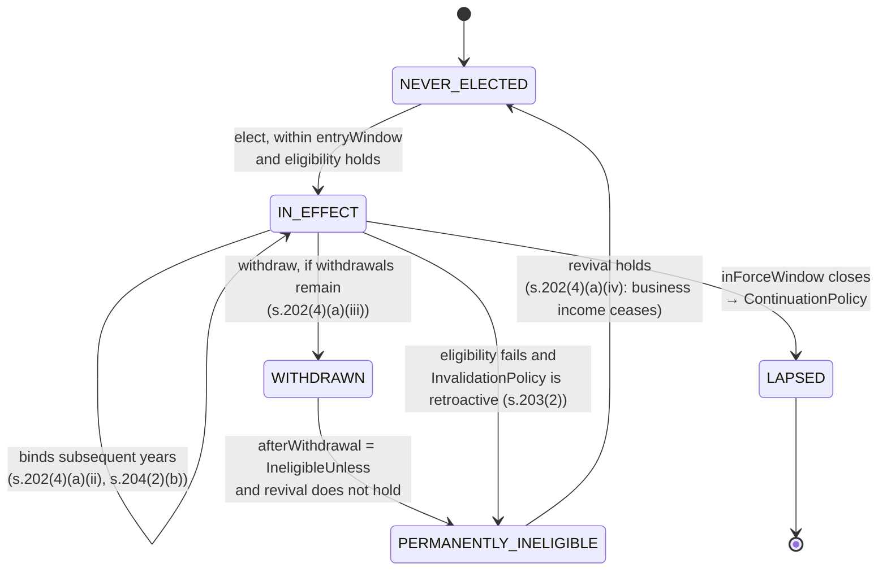

# 17 — Regime lifecycle, governance and per-regime behaviour

**Amends `10-extensibility.md` E3.** That document made the regime *count* data. It left the regime
*lifetime* implicit, and that was a real gap: `RegimeSpec` had no validity window, no sunset, no
grandfathering, and no per-taxpayer election history. All four are needed, and all four are **already
exercised by the Income-tax Act 2025** — this is not future-proofing.

---

## L1 — The four lifecycle shapes the Act already uses

| Shape | Provision | Verified text |
|---|---|---|
| **Closed entry window, incumbents continue** | **s.201(2)** — new manufacturing domestic company | the company must have *"been set-up and registered **on or after the 1st October, 2019**"* and *"commenced manufacturing or production of an article or thing **on or before the 31st March, 2024**"* |
| **Same, for co-operatives** | **s.204** | set up *"after the 1st April, 2023"*, commenced manufacturing *"on or before the 31st March, 2024"* |
| **Invalidation on condition failure — retroactive and permanent** | **s.203(2)** | *"Where a person fails to satisfy the requirements contained in sub-section (1) in any tax year, **the option shall become invalid in respect of the said tax year and subsequent tax years** and other provisions of the Act shall apply, **as if the option had not been exercised**"* |
| **One-shot entry, binding forward** | **s.204(2)** | *"it shall be exercised on or before the due date … for furnishing **the first of the returns** of income for any tax year"* and *"such option, once exercised, **shall apply to subsequent tax years**"* |
| **Withdrawal with permanent ineligibility — and a revival edge** | **s.202(4)(a)(iii)–(iv)** | *"may be withdrawn **only once**"*; after withdrawal *"the person shall **never** be eligible to exercise the option … **except where such person ceases to have any income from business or profession**, and in such a case the option under clause (b) shall be available"* |

`FACT`: all five read this session from S2 (gazette CG-DL-E-22082025-265620).

`INFERENCE`: **s.201 is, as of TY 2026-27, a regime that is closed to new entrants and still in force
for those already in it.** That is the grandfathering case, live, today, in the statute this product
computes against. A `RegimeSpec` with no validity window cannot say it.

`INFERENCE`: s.202(4)(a)(iv) is a **state machine with a revival edge**, not a flag.
`ElectionMechanics.lockIn` in `10-extensibility.md` E3.2 was a three-valued enum, and it cannot
express "permanently ineligible, unless business income ceases, in which case a *different* election
route opens".

---

## L2 — Two windows, not one

The grandfathering shape needs **two** independent intervals. Collapsing them is the mistake.

```java
package com.thiru.wealthlens.taxrules.regime;

public record RegimeLifecycle(

        /** When a taxpayer may FIRST elect into this regime. s.201(2)'s "on or before 31-03-2024". */
        DateRange entryWindow,

        /** When the regime may be APPLIED by someone already in it. Outlives entryWindow. */
        DateRange inForceWindow,

        /** What happens to an incumbent when inForceWindow closes. */
        ContinuationPolicy onSunset,

        /** What happens when eligibility later fails. s.203(2). */
        InvalidationPolicy onConditionFailure,

        Provenance provenance) {

    public RegimeLifecycle {
        if (!inForceWindow.contains(entryWindow)) {
            throw new PackValidationException(
                "entryWindow must lie within inForceWindow: a regime cannot be entered "
              + "in a year it does not apply");
        }
    }

    public boolean openToNewEntrants(TaxYearId y) { return entryWindow.coversTaxYear(y); }
    public boolean applicable(TaxYearId y)        { return inForceWindow.coversTaxYear(y); }
    public boolean grandfatheredOnly(TaxYearId y) { return applicable(y) && !openToNewEntrants(y); }
}
```

```java
public sealed interface ContinuationPolicy {

    /** The regime simply ends; incumbents fall to the default for their person type. */
    record FallToDefault(RuleId basis) implements ContinuationPolicy {}

    /** Incumbents move to a named successor, carrying their election date. */
    record MigrateTo(RegimeCode successor, RuleId basis) implements ContinuationPolicy {}

    /** Incumbents keep applying it indefinitely — entry closed, application open. s.201 today. */
    record ContinueIndefinitely() implements ContinuationPolicy {}
}

public sealed interface InvalidationPolicy {

    /** s.203(2): invalid for THAT year and all subsequent years, as if never exercised. */
    record RetroactiveFromFailureYear(RuleId basis) implements InvalidationPolicy {}

    /** Invalid prospectively only. */
    record ProspectiveOnly(RuleId basis) implements InvalidationPolicy {}

    /** Failure does not invalidate; it merely disallows a deduction. */
    record NoInvalidation() implements InvalidationPolicy {}
}
```

`RECOMMENDATION`: `RetroactiveFromFailureYear` **must** trigger a recomputation of every affected
prior year, not just the current one. `FACT (S2, s.203(2))`: the option becomes invalid *"in respect
of the said tax year and subsequent tax years"* and the Act applies *"as if the option had not been
exercised"*. That is a multi-year restatement, and `11-filing-drafts.md` F3's `ACTED_ON` freeze is what
makes it detectable — the frozen drafts are exactly the set that needs re-examining.

### `RegimeSpec`, revised

```java
public record RegimeSpec(
        RegimeCode           code,
        String               displayName,
        Provision            provision1961,
        Provision            provision2025,
        Set<PersonType>      appliesTo,
        RuleId               rateTable,
        Set<DisallowanceSetId> disallowances,
        Set<ConditionSetId>  eligibility,
        ElectionProtocol     election,        // L3 — replaces ElectionMechanics
        RegimeLifecycle      lifecycle,       // *** new ***
        boolean              isDefault,
        PipelineSpec         pipeline,
        Optional<BehaviourId> behaviour,      // L5 — normally empty
        Provenance           provenance) {}
```

---

## L3 — Election as a state machine, per taxpayer, across years

`ElectionMechanics`'s three-valued `lockIn` is replaced by an explicit protocol plus per-taxpayer
history.

```java
public record ElectionProtocol(
        ElectionKind    kind,            // DEFAULT_NO_ACTION | OPT_IN | OPT_OUT
        ElectionVehicle vehicle,         // IN_THE_RETURN | PRESCRIBED_FORM | NONE
        Optional<FormRef> form,
        DeadlineSpec    deadline,        // s.263(1) due date, or "with the return"
        BindingSpec     binding,         // below — replaces the lockIn enum
        Provenance      provenance) {}

public record BindingSpec(
        boolean bindsSubsequentYears,        // s.202(4)(a)(ii), s.204(2)(b)
        int     maxWithdrawals,              // s.202(4)(a)(iii): 1.  0 = irrevocable.  -1 = unlimited
        AfterWithdrawal afterWithdrawal,     // below
        boolean firstReturnOnly,             // s.204(2)(a): only with the FIRST return ever filed
        List<Condition> bindingAppliesWhen) {}   // s.202(4): only for a person WITH business income

public sealed interface AfterWithdrawal {
    record MayReElect()                                     implements AfterWithdrawal {}
    record PermanentlyIneligible()                          implements AfterWithdrawal {}
    /** s.202(4)(a)(iv): permanently ineligible UNLESS a condition later holds, which reopens
     *  a DIFFERENT election route. The revival edge. */
    record IneligibleUnless(Condition revival, ElectionRoute thenUse) implements AfterWithdrawal {}
}
```

The s.202(4) case, entirely in data:

```json
{ "code": "S202_OPTED_OUT",
  "election": {
    "kind": "OPT_OUT",
    "vehicle": "IN_THE_RETURN",
    "deadline": { "type": "DueDateUnder", "section": "263(1)" },
    "binding": {
      "bindsSubsequentYears": true,
      "maxWithdrawals": 1,
      "afterWithdrawal": {
        "type": "IneligibleUnless",
        "revival": { "type": "Not", "c": { "type": "HasIncomeUnderHead", "head": "PGBP" } },
        "thenUse": "S202_4_B"
      },
      "firstReturnOnly": false,
      "bindingAppliesWhen": [ { "type": "HasIncomeUnderHead", "head": "PGBP" } ]
    },
    "provenance": { "sourceDescription": "s.202(4)(a)(ii)-(iv) and (4)(b)", "status": "VERIFIED" } } }
```

`INFERENCE`: `bindingAppliesWhen` is what makes one `RegimeSpec` serve both s.202(4)(a) and
s.202(4)(b). The **same regime** has lock-in for a person with business income and a free annual
choice for a person without — which is exactly what the section says, and which the previous enum
forced into a footnote.

### The history, and the eligibility evaluation

```java
/** Per (profile, regime). APPEND-ONLY — the same discipline as M3.4's cross-year ledgers. */
public record RegimeElectionHistory(
        ProfileId profileId,
        RegimeCode regime,
        List<ElectionEvent> events) {

    public record ElectionEvent(
            TaxYearId taxYear,
            EventKind kind,            // ELECTED | WITHDRAWN | INVALIDATED | REVIVED | LAPSED_ON_SUNSET
            RuleId    basis,
            Instant   recordedAt,
            Optional<DraftId> sourceDraft) {}   // which ACTED_ON draft asserted it

    public ElectionState stateAsAt(TaxYearId y) { ... }
}

public enum ElectionState { NEVER_ELECTED, IN_EFFECT, WITHDRAWN, PERMANENTLY_INELIGIBLE, LAPSED }
```



`eligibleRegimes` from `10-extensibility.md` E3.4 is then **history-aware**:

```java
public List<RegimeOffer> eligibleRegimes(TaxYearId year, Taxpayer t, Inputs in, RulePack pack) {
    return pack.regimes().values().stream()
        .filter(r -> r.appliesTo().contains(t.personType()))
        .filter(r -> r.lifecycle().applicable(year))                      // L2
        .map(r -> {
            ElectionState st = history.of(t.profileId(), r.code()).stateAsAt(year);
            return switch (st) {
                case IN_EFFECT               -> RegimeOffer.continuing(r);
                case PERMANENTLY_INELIGIBLE  -> RegimeOffer.barred(r, RuleIds.of("REG-BAR-WITHDRAWN"));
                case LAPSED                  -> RegimeOffer.lapsed(r, r.lifecycle().onSunset());
                case NEVER_ELECTED, WITHDRAWN -> r.lifecycle().openToNewEntrants(year)
                        && r.eligibility().allSatisfiedBy(t, in, pack)
                        ? RegimeOffer.available(r)
                        : RegimeOffer.barred(r, RuleIds.of("REG-BAR-ENTRY-CLOSED"));
            };
        })
        .toList();
}
```

`RECOMMENDATION`: return **`RegimeOffer`, not a filtered list**. A barred regime with a stated reason
is far more useful than a silently absent one — *"the s.201 regime is closed to new entrants: entry
required manufacturing to have commenced on or before 31 March 2024"* is an answer; an empty list is
not. This is `A4.2`'s provenance principle applied to availability.

---

## L4 — Sunset and introduction playbooks

### Playbook A — a new regime is announced in the Budget

| Step | Change | Code? |
|---|---|---|
| 1 | Add a `RegimeSpec` to the new year's `regimes.json` — code, rate table, lifecycle, election protocol, `isDefault` | no |
| 2 | Add its rate table to `rates.json` (a `SlabLadder`, `FlatRate` or `RateByIncomeClass`) | no |
| 3 | Add or **reuse** a `DisallowanceSet`. `FACT (S2, s.205(1))`: the Act itself shares one list across five regimes — reuse is the statutory norm | no |
| 4 | Add or reuse a `ConditionSet` for eligibility | no |
| 5 | List its `pipeline.nodeRefs` — usually a permutation of nodes that already exist | no |
| 6 | If it needs arithmetic no `CapShape` expresses → **a new sealed `CapShape`** | one class |
| 7 | If it needs a computation step no node performs → **a new `ComputationNode`** | one class |
| 8 | If it needs cross-cutting machinery neither covers → **a `RegimeBehaviour`** (L5) | one class |
| 9 | Golden cells for the new regime are **generated**, not written (`15-review-findings.md` C5) | no |
| 10 | The pack linter diffs it against the prior year and a reviewer signs off (`15` C4) | no |

`INFERENCE`: steps 6–8 are the escape hatches, and all three are **new classes**, which the brief
permits. Steps 1–5 and 9–10 are the normal path and are entirely data. A regime that is "old slabs
with a different rebate" is ten minutes of JSON.

### Playbook B — a regime is withdrawn

| Step | Change |
|---|---|
| 1 | In the **last** pack where it applies, set `lifecycle.inForceWindow` to end, and set `onSunset` |
| 2 | Do **not** delete it from earlier packs. Prior-year computation (`REL-ARREARS-001`, `13-edge-cases.md` R-15, reassessment) needs them |
| 3 | The staleness sweep (`13-edge-cases.md` R-8) finds every `ACTED_ON` draft in that regime |
| 4 | Each affected taxpayer's history gets a `LAPSED_ON_SUNSET` event |
| 5 | `onSunset` decides the next year: `FallToDefault`, `MigrateTo`, or `ContinueIndefinitely` |
| 6 | **Advisory:** at rollover, the user is told the regime ended and what they are now in — alongside the `SETOFF-NEW-002` warning if the move destroys a carried-forward loss |

### Playbook C — entry closes but the regime continues (today, s.201)

Set `entryWindow` to end while `inForceWindow` stays open, and `onSunset = ContinueIndefinitely`.
No other change. Incumbents compute exactly as before; new users see a **barred** offer with the
reason. This is the case the one-window model could not express at all.

### Playbook D — the default flips

`FACT`: the 1961 Act's default flipped to the new regime for AY 2024-25. It will happen again.

One `isDefault` flag moves between two `RegimeSpec`s in the new year's pack. Invariant **I5** — exactly
one default per `(taxYear, PersonType)` — makes a half-done flip a **load error**, not a silent
double default. `11-filing-drafts.md` F7 already forbids rolling the election forward, so a user who
did nothing last year is correctly re-evaluated rather than inheriting a stale choice.

---

## L5 — "A manager per regime": the honest answer

The instinct behind the question is right — a genuinely novel regime may need behaviour, not just
numbers. The answer is a **three-tier escalation**, where the normal case costs no code at all:

| Tier | When | Cost |
|---|---|---|
| **1 — pure data** | the regime differs in rates, disallowances, eligibility, election mechanics or step order | a JSON entry. **This covers all five regimes in the 2025 Act** |
| **2 — a new node or cap shape** | it needs arithmetic or a computation step that does not yet exist | one class, registered by `NodeId`. No existing node changes |
| **3 — a `RegimeBehaviour`** | it needs cross-cutting behaviour that is neither a node nor a value — a novel election protocol, a bespoke eligibility evaluation, a special interaction with set-off | one class, bound by `BehaviourId` |

```java
/** Tier 3. Optional per regime; the vast majority of regimes never declare one. */
public interface RegimeBehaviour {

    BehaviourId id();

    /** Override eligibility when the Condition algebra genuinely cannot express it. */
    default EligibilityVerdict evaluateEligibility(Taxpayer t, Inputs in, RulePack p, RegimeSpec r) {
        return EligibilityVerdict.fromConditions(r.eligibility(), t, in, p);
    }

    /** Override the election protocol for a regime with genuinely novel mechanics. */
    default ElectionVerdict evaluateElection(RegimeElectionHistory h, TaxYearId y, RegimeSpec r) {
        return ElectionVerdict.fromProtocol(r.election(), h, y);
    }

    /** Last-resort hook to adjust the assembled pipeline. Use is a review trigger. */
    default PipelineSpec adjustPipeline(PipelineSpec declared, Inputs in) { return declared; }
}
```

```java
/** The default, used whenever RegimeSpec.behaviour() is empty. */
public final class DataDrivenRegimeBehaviour implements RegimeBehaviour { /* all defaults */ }
```

Three guard rails, because this is the tier that can rot:

| Guard | Mechanism |
|---|---|
| A `BehaviourId` in a pack with no registered implementation | **load error** (invariant I9) |
| A registered behaviour no pack references | **load error** — the `D-ONEIMPL` reachability rule, extended to behaviours |
| `adjustPipeline` overridden | an ArchUnit test **lists** every such class, and the list is a reviewed file. Overriding it is allowed; doing so invisibly is not |

`RECOMMENDATION`: ship with **zero** `RegimeBehaviour` implementations other than the default. If the
first real one is needed and cannot be avoided, that is the signal to ask whether the Condition algebra
(`15-review-findings.md` Part E) is missing a predicate — adding a predicate serves every future
regime; adding a behaviour serves one.

---

## L6 — What this changes elsewhere

| Document | Change |
|---|---|
| `10-extensibility.md` E3.2 | `ElectionMechanics` → `ElectionProtocol` + `BindingSpec`; `RegimeSpec` gains `lifecycle` and `behaviour` |
| `10-extensibility.md` E3.4 | `eligibleRegimes` returns `RegimeOffer`, is lifecycle- and history-aware |
| `11-filing-drafts.md` F8 | **new** `tax_regime_election_history`, keyed `{profile_id, regime_code}`, append-only, **workspace-independent** — it spans years by nature |
| `11-filing-drafts.md` F7 | rollover consults `stateAsAt(nextYear)`: a **bound** election is pre-applied and explained; a **free** one is left empty |
| `13-edge-cases.md` R-8 | the staleness sweep also fires on a sunset and on a retroactive invalidation |
| `15-review-findings.md` F6 | `inputsFingerprint` must include the **election history**, or a withdrawal would not invalidate the compute cache |
| `16-getting-started.md` | PR 4 gains `RegimeLifecycle` and `ElectionProtocol`; a new **PR 4b** adds the history and the state machine |

### New invariants

| | Invariant |
|---|---|
| **I9** | every `BehaviourId` referenced by a pack resolves to a registered implementation |
| **I10** | `entryWindow ⊆ inForceWindow` for every regime |
| **I11** | exactly one `isDefault = true` per `(taxYear, PersonType)` **among regimes applicable in that year** — strengthens I5, which did not account for lapsed regimes |
| **I12** | a `MigrateTo` successor exists and is applicable in the year the predecessor lapses |

### New tests

| ID | Case | Expected |
|---|---|---|
| **T17-1** | Regime with a closed `entryWindow`, open `inForceWindow`; incumbent computes | `RegimeOffer.continuing`; tax computed normally |
| **T17-2** | Same regime, a new taxpayer | `RegimeOffer.barred` with reason `REG-BAR-ENTRY-CLOSED` and the entry-window dates in the message |
| **T17-3** | s.202(4)-shaped: elect, withdraw, attempt to re-elect **with** business income | barred, `PERMANENTLY_INELIGIBLE` |
| **T17-4** | Same, then business income **ceases**, then re-elect | **permitted** via the revival edge, using route `S202_4_B` |
| **T17-5** | Person **without** business income elects, then switches the next year | permitted — `bindingAppliesWhen` does not hold |
| **T17-6** | Eligibility fails in year 3 of a `RetroactiveFromFailureYear` regime | years 3+ recomputed as if never elected; the staleness sweep flags the frozen drafts |
| **T17-7** | `MigrateTo` successor missing from the successor year's pack | **load error**, invariant I12 |
| **T17-8** | Two regimes both `isDefault` for `INDIVIDUAL` in one year | **load error**, invariant I11 |
| **T17-9** | Default flips between two adjacent years; a user who elected nothing in either | year 1 and year 2 resolve to **different** regimes, both explained |
| **T17-10** | Pack declares `behaviour: "X"` with no registered `X` | **load error**, invariant I9 |
| **T17-11** | Synthetic pack: a regime introduced in TY 2099-00 and sunset in TY 2101-02, with an incumbent | all three years compute; `LAPSED_ON_SUNSET` recorded; `onSunset` applied — **and no production source file changed** |

`T17-11` is the acceptance test for this document, and it extends `10-extensibility.md` E8's
three-regime synthetic pack across **time** rather than only across count.
