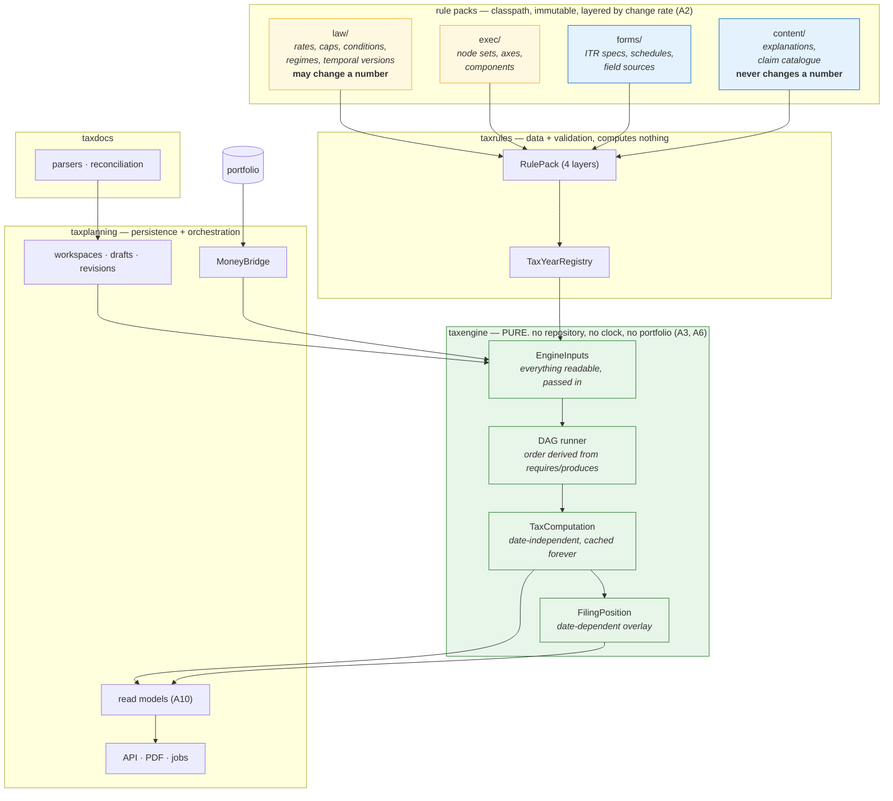

# 23 — Architecture consolidation

Nine passes added a great deal and never went back to check that it still fits together. This one adds
almost nothing new; it **resolves what drifted**. Where it disagrees with an earlier document, this
wins.

---

## A1 — The audit

| # | Gap | Evidence | Fixed in |
|---|---|---|---|
| **G-1** | **Two vocabularies for the same concept.** `15` replaced the linear `ComputationStep` with the DAG `ComputationNode`; `ComputationStep` survives in **ten** documents | `grep -rln ComputationStep docs/taxplanning-design/` → 10 files | A4, and a sweep |
| **G-2** | **The engine reaches a repository.** `17` L3 calls `history.of(t.profileId(), r.code())` inside regime resolution, which `X1.2` says is pure and repository-free | `17-regime-lifecycle.md:224` | **A3** |
| **G-3** | **The pack does four unrelated jobs** — legal rules, execution wiring, editorial content, form mappings — in one artefact with one version and one reviewer | 18 file types, one `packVersion` | **A2** |
| **G-4** | **"Disallowed in this regime" is modelled two ways**: a node absent from the regime's pipeline, *and* a rule whose `RegimeApplicability` excludes it | `10` E3.3 vs `15` Part D | **A4** |
| **G-5** | **Computation is no longer a pure function of its inputs.** `18` introduced `FILING_DATE`-keyed rules and `21` made form selection depend on when you file. The idempotency key in `19` E3 has no date | `TemporalContext.asOfDate` | **A6** |
| **G-6** | **No mapping from engine exceptions to the error catalogue.** Six typed exceptions exist; `19` E5's `TaxError` enum does not know about them | `MissingTemporalCoordinateException`, `NoRuleVersionException`, `UndeterminedApportionmentException`, … | **A7** |
| **G-7** | **`TraceLine` is carrying four unrelated concerns** — computation values, provenance, advisory notices, and now election alternatives and catalogue links | `M5.1` + `15` C2 + `22` | **A8** |
| **G-8** | **Fourteen sealed families and eight SPIs, with no stated rule** for when to add which | the inventory | **A5** |
| **G-9** | **`IncomeHead` and `ComputationNode` overlap.** `X2.2` has heads computing; `15` Part D has nodes computing. A head is now just a subgraph | `07` X2.2 vs `15` Part D | A4 |
| **G-10** | **Four read-heavy features (F29, F30, F33, F35) have no read model.** Each would recompute the world on every page load | `20-product-gaps.md` | **A10** |
| **G-11** | **The claim catalogue can change a number.** It sits in the pack with rules, so an editorial fix bumps `packVersion` and invalidates every cached computation | `22` C4 | A2 |
| **G-12** | **No way to test one node in isolation** | — | A11 |

`INFERENCE`: G-1 is the one worth dwelling on. I spent `02-lessons.md` L1 warning that two vocabularies
for one concept is how the placeholder's O-7 happened, and then produced exactly that across my own
documents. It is evidence for the discipline, not against it: the fix is a rename sweep plus a lint,
not a judgement call.

---

## A2 — Layer the pack by change rate and authority

One artefact, one version, one reviewer — for four things that change for different reasons, at
different times, reviewed by different people.

| Layer | Contents | Who authors | When it changes | Can it change a number? |
|---|---|---|---|---|
| **`law/`** | rates, caps, conditions, regimes, disallowance sets, temporal versions | whoever reads the gazette | Budget, notification, amendment | **Yes — this is the only layer that may** |
| **`exec/`** | pipelines, node sets, temporal-axis bindings, mid-year combination rules | engineers | when the engine changes | Yes, but only by selecting which law applies |
| **`forms/`** | ITR form specs, schedules, `FieldSource` mappings | whoever reads the form notification | **form notification — a different date from the Finance Act** | No — presentation of computed values |
| **`content/`** | `displayName`, `plainName`, `whatItIs`, claim steps, counterparties, mistakes | content and CA review | editorially, any time | **No, and this is enforced** |

```
resources/rulepacks/2026-27/
  manifest.json              # versions each layer separately
  law/      rates.json  salary.json  perquisites.json  retirement.json
            deductions.json  houseproperty.json  othersources.json  setoff.json
            tds.json  filing.json  regimes.json  disallowances.json  conditions.json
  exec/     pipelines.json  components.json  axes.json
  forms/    itr-forms.json  itr-schedules.json
  content/  claim-catalogue.json  explanations.json
```

```json
// manifest.json
{ "taxYear": "2026-27",
  "layers": { "law":     { "version": "2026-27.law.3",     "checksum": "sha256:…" },
              "exec":    { "version": "2026-27.exec.1",    "checksum": "sha256:…" },
              "forms":   { "version": "2026-27.forms.2",   "checksum": "sha256:…" },
              "content": { "version": "2026-27.content.7", "checksum": "sha256:…" } } }
```

Three consequences, each solving a stated gap:

| | |
|---|---|
| **G-11 solved** | the **compute cache keys on `law` + `exec` only**. Seven editorial revisions to the catalogue do not invalidate a single cached computation |
| **Review is proportionate** | a `law` change needs the gazette reviewer `19` E2 names; a `content` typo does not |
| **The no-numbers property is testable** | **`I27`**: for a fixed `law` and `exec`, perturbing **every** value in `content` and `forms` leaves every `Computation.netPayable()` byte-identical. A property test, not a convention |

`INFERENCE`: `forms/` deserves its own version because CBDT notifies ITR forms on a **different date**
from the Finance Act, and revises them again mid-year (`FACT (S6)`: G.S.R. 822(E) substituted Forms 169
and 171 in September). Tying form versions to the Finance Act's cadence would have been wrong.

---

## A3 — The engine input boundary (G-2)

`X1.2` says `taxengine` is pure and cannot reach a repository. `17` L3 then called
`history.of(profileId, regimeCode)` inside regime resolution. Both cannot be true.

**The resolution: the engine never fetches. Everything it can read is passed in.**

```java
package com.thiru.wealthlens.taxengine;

/**
 * The COMPLETE input to a computation. Assembled by taxplanning from persistence;
 * consumed by taxengine, which fetches nothing.
 *
 * This is deliberately NOT DraftInputs (11 F4). DraftInputs is what a user typed;
 * EngineInputs is that PLUS every cross-cutting fact the rules can read.
 */
public record EngineInputs(
        TaxYearId              taxYear,
        RegimeCode             regime,
        TemporalContext        temporal,            // A6 — includes asOf, explicitly

        DraftInputs            entered,             // what the user typed          (11 F4)
        TaxpayerFacts          taxpayer,            // PAN, DOB, residence          (15 F1)
        FamilySnapshot         family,              // per-person facts             (15 F2)
        LedgerSnapshot         ledgers,             // LTA block, lifetime, carry-forwards (M3.4)
        RegimeElectionSnapshot elections,           // *** G-2: history, PASSED IN, not fetched ***
        CapitalGainsSummary    capitalGains,        // pinned snapshot              (11 F4.1)
        FilingFacts            filing) {            // due date, furnished date, advance tax paid

    /** A6: the cache key. Derived from everything above, and nothing ambient. */
    public InputsFingerprint fingerprint() { ... }
}
```

```java
/** An immutable projection of RegimeElectionHistory, at a point in time. */
public record RegimeElectionSnapshot(Map<RegimeCode, ElectionState> stateByRegime,
                                     Map<RegimeCode, Integer> withdrawalsUsed) {

    public ElectionState stateOf(RegimeCode r) {
        return stateByRegime.getOrDefault(r, ElectionState.NEVER_ELECTED);
    }
}
```

`eligibleRegimes` (`17` L3) becomes pure:

```java
public List<RegimeOffer> eligibleRegimes(EngineInputs in, RulePack pack) {
    return pack.regimes().values().stream()
        .filter(r -> r.appliesTo().contains(in.taxpayer().personType()))
        .filter(r -> r.lifecycle().applicable(in.taxYear()))
        .map(r -> offerFor(r, in.elections().stateOf(r.code()), in, pack))   // no I/O
        .toList();
}
```

`RECOMMENDATION`: enforce it structurally, not by discipline —

```java
static final ArchRule taxengine_fetches_nothing =
        noClasses().that().resideInAPackage("..taxengine..")
            .should().dependOnClassesThat().resideInAnyPackage(
                "..repository..", "org.springframework.data..", "..taxplanning..")
            .because("D-PURE: everything the engine can read arrives in EngineInputs.");
```

`INFERENCE`: this also finally justifies `15` F6's fingerprint. The fingerprint is *"a hash of
`EngineInputs`"* — one object — rather than a hand-maintained list of six things to remember. A field
added to `EngineInputs` is in the key automatically, which is the only way that invariant survives.

---

## A4 — Regime × node: absent, or zero? (G-4, G-1, G-9)

Two mechanisms existed for "this does not apply in this regime", and they mean different things. Both
are needed; the rule for choosing was missing.

| Mechanism | Use when | Effect on the trace |
|---|---|---|
| **Node absent from the regime's node set** (`exec/pipelines.json`) | the whole *step* is meaningless in this regime | **no trace line at all** |
| **Node present, rule's `RegimeApplicability` excludes it** | the step runs and this particular relief is unavailable | **a trace line with `out = 0` and a stated reason** |

**The rule (`D-REGIMEZERO`): prefer the second.** A user in the default regime should see

> House rent allowance exemption — **₹0**. Not available in this regime (Schedule III Sl. 11, disallowed
> by s.202(2)(a)(i)).

and not silence. `D-NOSILENT` applies to *absence of explanation*, not only to swallowed exceptions.

`RECOMMENDATION`: a node is omitted from a regime's set **only** when nothing in that head exists at
all for it. In practice that is almost never — so `exec/pipelines.json` lists the **same node set for
every regime**, and regime differences live entirely in `RegimeApplicability`. That is simpler than
what `10` E3.2 implied and it is strictly more explainable.

### And the naming, settled (G-1, G-9)

| Term | Status |
|---|---|
| **`ComputationNode`** | **the one abstraction.** Declares `requires()` / `produces()`; order derived |
| ~~`ComputationStep`~~ | **withdrawn.** Superseded by `ComputationNode` in `15` Part B. Ten documents still say it; a sweep and a lint fix that |
| `IncomeHead` | **retained, narrowed** — no longer an SPI that computes. It is a **label** grouping a subgraph of nodes for the trace, set-off and `HeadCode` routing |

**`I28`**: no document or source file may reference `ComputationStep`. Enforced by a `grep` gate in CI —
the cheapest possible guard against the exact failure this design was written to prevent.

---

## A5 — The extension taxonomy (G-8)

Fourteen sealed families and eight SPIs, with no stated rule for adding one. The rule:

```
Is it a VALUE the statute states?                     → a row in law/          (data)
Is it a new SHAPE of arithmetic or predicate?         → a sealed variant       (new class, reviewed)
Is it a new STEP in the computation?                  → a ComputationNode      (new class)
Is it a new INTEGRATION with the outside world?       → an SPI                 (new class + registration)
Is it a new WORD for something that exists?           → NOTHING. Use the existing word.
```

| Family | Kind | Add a variant when |
|---|---|---|
| `CapShape` | sealed | the statute states a limit in arithmetic none of the six expresses |
| `ReliefShape` | sealed | a new relief formula |
| `Condition` | sealed | a new predicate over taxpayer facts — **prefer this over a `RegimeBehaviour`** |
| `Validity` | sealed | a new way a rule can be in or out of force |
| `NodeValue` | sealed | a node must produce something other than money |
| `RegimeApplicability` | sealed | — (complete: all / only / except) |
| `ContinuationPolicy`, `InvalidationPolicy`, `AfterWithdrawal` | sealed | new regime lifecycle mechanics |
| `DeprecationPolicy` | sealed | a new way a component can be withdrawn |
| `ProrationBasis` | sealed | a new temporal allocation basis |
| `FieldSource` | sealed | a form cell derives from something new |
| `Election` | sealed | a new statutory choice |
| `Finding` | sealed | a new lint result |
| `ComputationNode` | SPI | a new computation step |
| `DocumentParser` | SPI | a new document type or format |
| `RulePackProvider` | SPI | a new pack source |
| `RegimeBehaviour` | SPI | **last resort** — see `17` L5 |
| `TaxJob` | SPI | a new background job |
| ~~`ComputationStep`~~, ~~`RegimeProvider`~~, ~~`IncomeHead` (as SPI)~~ | withdrawn | A4 |

`RECOMMENDATION`: a pull request adding a **sealed variant** needs a one-line justification naming the
provision that forced it. A PR adding an **SPI** needs a reviewer. That is the whole governance, and it
is proportionate: variants are cheap and local; SPIs are a new seam forever.

---

## A6 — Determinism and `asOf` (G-5)

`18` introduced `FILING_DATE`-keyed rules; `21` made form selection depend on when you file; `C1` made
late-filing interest accrue by month. **So the same inputs legitimately produce different answers on
different days** — and `19` E3's idempotency key has no date in it.

### The fix: split the computation

```java
/** Date-INDEPENDENT. Everything the statute computes from the year's facts alone. */
public record TaxComputation(
        ComputationId id, TaxYearId taxYear, RegimeCode regime,
        RulePackRef lawAndExec,            // A2 — content/forms deliberately excluded
        InputsFingerprint inputs,
        List<TraceLine> trace,
        Money totalIncome, TaxByBasis taxByBasis, Money netPayableBeforeFilingEffects) {}

/** Date-DEPENDENT. Thin, cheap, recomputed freely. */
public record FilingPosition(
        ComputationId basedOn,
        LocalDate asOf,
        ItrSelection form,                 // 21 — FILING_DATE axis
        InterestBreakdown interestAndFees, // C1 — accrues by month
        List<CalendarEntry> calendar,      // F30
        Money netPayable) {}               // the core, plus filing effects
```

> **Erratum (W-043, 2026-09-21):** two corrections to the records above.
>
> **1. `TaxComputation.lawAndExec` cannot be a single `RulePackRef`.** A6's own comment says
> *"content/forms deliberately excluded"*, which is plural: the layers that affect a computation are
> `LAW` **and** `EXEC`, and `RulePack.computationCacheKey()` (`W-027`) joins both. One ref cannot
> hold two layers. Corrected to `Map<RulePackLayer, RulePackRef>`, and the constructor refuses a
> layer whose `affectsComputation()` is false — admitting an editorial layer would silently undo
> G-11, invalidating every cached figure on a wording change.
>
> **2. Three of `FilingPosition`'s six components name types that do not exist**, so it ships with
> the other three (decision **D-032**, the shape D-026 used for `EnteredFacts`).
> `InterestBreakdown` belongs to `W-112` (Phase 12, via Appendix B); **`ItrSelection` and
> `CalendarEntry` are named here and nowhere else in the design or the backlog** — no item produces
> either. Each arrives with the item that owns its type. What ships is enough to carry A6's point:
> `asOf` is the date-dependent field, and `TaxComputation` has none — asserted structurally against
> every JDK date type, not by inspection.
> Verified by: `./mvnw test -pl backend -Dtest=TaxComputationTest` — 21 tests;
> `grep -rc 'ItrSelection\|CalendarEntry' docs/` → this file only.

| | |
|---|---|
| **Cache key for `TaxComputation`** | `EngineInputs.fingerprint()` + `law` + `exec` version. **No date.** Cached indefinitely |
| **Cache key for `FilingPosition`** | that, plus `asOf` truncated to the **day** |
| **Cost** | the overlay is a handful of nodes, not 31. `F29`'s forecast and `F30`'s calendar become nearly free |

`INFERENCE`: this is why `F29` and `F30` can be MVP. Recomputing the whole pipeline on every page load
to show a countdown would not have been affordable; recomputing an overlay is.

### `asOf` is an input, never ambient

```java
static final ArchRule taxengine_has_no_clock =
        noClasses().that().resideInAPackage("..taxengine..")
            .should().callMethod(LocalDate.class, "now")
            .orShould().callMethod(Instant.class, "now")
            .orShould().accessClassesThat().belongToAnyOf(Clock.class)
            .because("A6: the engine is a pure function of EngineInputs, and asOf is one of them. "
                   + "A clock inside makes a golden test time-dependent and an audit irreproducible.");
```

---

## A7 — Error mapping (G-6)

Every engine exception maps to exactly one `TaxError`, declared at the exception, not in a translation
layer that can drift.

```java
public abstract sealed class TaxEngineException extends RuntimeException
        permits MissingRulePackException, NoRuleVersionException, MissingTemporalCoordinateException,
                UndeterminedApportionmentException, UnknownComponentCodeException,
                StatutoryOvershootException, BlockingDataQualityException, NoApplicableItrFormException {

    public abstract TaxError error();
    public abstract List<RuleId> relatedRules();
}
```

| Exception | `TaxError` | Class |
|---|---|---|
| `UnknownComponentCodeException` | `UNKNOWN_COMPONENT_CODE` | user |
| `StatutoryOvershootException` | `STATUTORY_OVERSHOOT` | user |
| `BlockingDataQualityException` | `UNCLASSIFIED_CAPITAL_GAINS` | upstream data |
| `NoApplicableItrFormException` | `NO_APPLICABLE_ITR_FORM` | **pack** |
| `UndeterminedApportionmentException` | `UNDETERMINED_APPORTIONMENT` | **pack** |
| `NoRuleVersionException` | `RULE_VERSION_GAP` | **pack** |
| `MissingTemporalCoordinateException` | `MISSING_TEMPORAL_COORDINATE` | **engine** |
| `MissingRulePackException` | `MISSING_RULE_PACK` | **engine** |

**`I29`**: every `TaxEngineException` subclass declares an `error()`; `ControllerAdviser` switches
**exhaustively** over the sealed hierarchy, so a new exception without a mapping does not compile.

`RECOMMENDATION`: the three classes — *user*, *pack*, *engine* — drive alerting. Pack and engine errors
page someone; user errors never do. That distinction is only possible because the classification lives
on the type.

---

## A8 — Trace layering (G-7)

`TraceLine` accumulated four concerns. Separate the computation from everything said *about* it:

```java
/** The computation. Values and provenance only. Stable, versioned, machine-read. */
public record TraceLine(
        int sequence, NodeId node, RuleId rule, StepKind kind,
        NodeValue in, NodeValue out,
        Optional<String> limitedBy,
        Provenance provenance) {}

/** Everything SAID about a line. Separate lifetime, separate layer, may be absent. */
public record TraceAnnotation(
        int sequence,
        List<Notice> notices,                        // M5.1
        Optional<ExplanationRef> explanation,        // content/ — F37
        Optional<ClaimCatalogueRef> howToClaim,      // content/ — F40
        List<PricedAlternative> electionAlternatives // 15 C2
) {}

public record Computation(..., List<TraceLine> trace, List<TraceAnnotation> annotations) {}
```

> **Erratum (W-036, 2026-09-21):** `TraceAnnotation` names three types that this design **declares
> nowhere** — `ExplanationRef`, `ClaimCatalogueRef` and `PricedAlternative` occur in the block above
> and in no other line of `docs/taxplanning-design/` or `docs/taxplanning-build/`, and are in no
> item's `Produces`. `W-036` therefore ships `TraceAnnotation(int sequence, List<Notice> notices)`;
> the other three components arrive with the items that own their types, the way `CapShape` and
> `NodeValue` grew (**rule B2**). A8's stated objective — the computation separated from everything
> said about it — is met in full by the two records. Note this is a **third** audit blind spot:
> Appendix A covered types the design declares, Appendix B types named in a `permits` clause, and a
> type named only as a **record component in a code block** falls between them. Unlike a sealed
> variant, a record component added later changes every construction site.
> Verified by: `grep -rc 'ExplanationRef\|ClaimCatalogueRef\|PricedAlternative' docs/taxplanning-design/ docs/taxplanning-build/`
> → `23-architecture-consolidation.md:3`, every other file `0`.

> **Erratum (W-036, 2026-09-21):** A8 drops M5.1's `String label` from `TraceLine` and does not move
> it to `TraceAnnotation`, which reads as an elision against `06-algorithms.md` G7.1 (which makes
> "self-describing" a property resting on `label` + `provenance`), G7.2's rendered label column, and
> `16-getting-started.md:313` (`TraceLine.of(row.id(), row.displayName(), StepKind.TAX, ...)`).
> **Taken as deliberate and implemented that way**: pack display text is resolved from `rule()` at
> render time, so re-wording a label must not invalidate a cached `TaxComputation` — the same
> argument A8 makes for moving annotations out. `W-036`'s Verify names rule id and provenance, not
> label. Recorded because four sections still show the field.
> Verified by: `backend/src/main/java/com/thiru/wealthlens/taxengine/trace/TraceLine.java`;
> `./mvnw test -pl backend -Dtest=TraceLineTest` — 19/19.

| | |
|---|---|
| **A6 and A2 both get easier** | annotations are derived from `content/`, so they change without touching the cached `TaxComputation` |
| **`I27` becomes checkable** | the no-numbers property tests that perturbing `content/` changes `annotations` and **never** `trace` |
| **API projections get a natural seam** | `?view=summary` omits annotations; `?view=full` includes them |
| **The trace is versionable** | `19` E7 wanted the trace versioned as a contract; now only `TraceLine` needs to be, and it is small and slow-changing |

---

## A9 — Module boundaries, final

Eight engines now exist across the documents and several had no stated home.

| Component | Module | Why |
|---|---|---|
| Rule packs, registry, `CapShape`, `Condition`, `RegimeSpec`, `ItrFormSpec`, catalogue | **`taxrules`** | data and its validation. Computes nothing |
| DAG runner, nodes, `Money`, `Rate`, trace, marginal reliefs, aggregator, proration | **`taxengine`** | pure. Fetches nothing (A3) |
| **Interest and fee engine** | **`taxengine`** | it is arithmetic over `FilingFacts`, which arrives in `EngineInputs` |
| **Election engine** | **`taxengine`** | pricing is recomputation; history arrives in `EngineInputs` (A3) |
| **ITR form selector** | **`taxengine`** | pure over `Condition`s and the computation |
| **ITR schedule mapping / export** | **`taxengine`** | a fold over `forms/` and the trace |
| Form parsing, reconciliation | **`taxdocs`** | untrusted input, isolated (`O6`) |
| Profiles, workspaces, drafts, scenarios, advisory, API, PDF, jobs, read models | **`taxplanning`** | persistence and orchestration |
| `MoneyBridge` | **`taxplanning.portfolio`** | the one seam (`19` E1) |

```java
// taxengine — note what is absent: auth, portfolio, taxdocs, spring-data
@ApplicationModule(type = CLOSED, allowedDependencies = {"shared", "taxrules"})
```

`INFERENCE`: the surprise is how much lands in `taxengine`. That is the payoff of A3 — once
*everything readable arrives in `EngineInputs`*, "does this need the database?" stops being the
question, and the boundary is drawn on **purity** rather than on subject matter.

---

## A10 — Read models (G-10)

Four features are read-heavy and none had a model. All four are **projections of `TaxComputation` +
`FilingPosition`**, so they materialise cheaply and invalidate on one event.

| Feature | Read model | Refreshed on | Cost |
|---|---|---|---|
| `F29` forecast | `ForecastProjection` — liability, projected TDS, credits, top three drivers | draft change; portfolio `asOf`; month roll | one `FilingPosition` |
| `F30` calendar | `CalendarProjection` — entries with measured cost of inaction | draft change; day roll | overlay only |
| `F33` completeness | `CompletenessProjection` — missing rules ranked by measured worth | draft change | N incremental recomputes (`15` B5) |
| `F35` multi-year | `TimelineProjection` — the six multi-year entitlements | ledger change; year rollover | ledger read, no computation |

`RECOMMENDATION`: materialise on write, in `tax_projections`, keyed `{draft_id, projection_type}`, with
the `TaxComputation` id they were derived from. A projection whose source id is stale is **rebuilt on
read**, not served — the same discipline as `13` R-8's staleness sweep, applied to derived data.

---

## A11 — Invariants and tests

| | Invariant |
|---|---|
| **I27** | for fixed `law` and `exec`, perturbing every value in `content/` and `forms/` leaves every `netPayable()` byte-identical |
| **I28** | no reference to `ComputationStep` anywhere in docs or source |
| **I29** | every `TaxEngineException` declares a `TaxError`; the advice switch is exhaustive over the sealed hierarchy |
| **I30** | `taxengine` depends on no repository, no Spring Data, no `taxplanning` type, and calls no clock |
| **I31** | every node's `requires()` is satisfied by some node's `produces()`, or is a field of `EngineInputs` |
| **I32** | `EngineInputs.fingerprint()` covers every field — a new field without a fingerprint contribution fails a reflection test |

| ID | Case | Expected |
|---|---|---|
| **T23-1** | Perturb every string in `content/`; recompute 50 golden cases | every `netPayable()` identical; only `annotations` differ (**I27**) |
| **T23-2** | Bump `content` version only | **zero** cache invalidations; `TaxComputation` reused |
| **T23-3** | Bump `law` version | every cached `TaxComputation` invalidated; staleness sweep fires |
| **T23-4** | Compute the same `EngineInputs` on two different days | `TaxComputation` **identical**; `FilingPosition` differs in interest and possibly form |
| **T23-5** | A node calls `LocalDate.now()` | **ArchUnit failure** (A6) |
| **T23-6** | A node reads a `NodeId` it did not declare in `requires()` | throws — not a silent null (**I31**) |
| **T23-7** | Add a field to `EngineInputs` without adding it to the fingerprint | reflection test fails (**I32**) |
| **T23-8** | A regime that disallows HRA | trace contains an **HRA line with `out = 0` and a stated reason**, not an absent line (`D-REGIMEZERO`) |
| **T23-9** | New `TaxEngineException` subclass with no `error()` | **does not compile** (**I29**) |
| **T23-10** | `NodeHarness.given(...).run(node)` for each node in isolation | every node unit-testable without a pipeline (**G-12**) |
| **T23-11** | `grep -r ComputationStep` | no matches (**I28**) |

### The node harness (G-12)

```java
var result = NodeHarness.with(pack2026)
        .regime(S202_DEFAULT)
        .given(NodeId.ROUNDED_TOTAL_INCOME, Money.of("1200000"))
        .run(new TaxByBasisNode());

assertThat(result.value()).isEqualTo(new TaxByBasis(Money.of("60000"), Map.of()));
assertThat(result.trace()).hasSize(1).first()
        .extracting(TraceLine::rule).isEqualTo(RuleIds.RATE_SLAB_NEW_2026);
```

`INFERENCE`: this only works because a node declares `requires()`. The harness supplies exactly those
and refuses anything else — so a node that secretly reaches for something is a **test failure at the
node level**, before any pipeline exists.

---

## A12 — The architecture, on one page



### The five properties that hold, and are tested

1. **Purity** — `taxengine` fetches nothing and reads no clock. Everything arrives in `EngineInputs`. *(I30)*
2. **Determinism** — identical `EngineInputs` give a byte-identical `TaxComputation`, forever. *(T23-4)*
3. **Layer isolation** — editorial content cannot change a number. *(I27)*
4. **Derived order** — a new step declares its edges; nothing is hand-ordered. *(I31)*
5. **Explained zeros** — a relief unavailable in a regime produces a line saying so, not silence. *(T23-8)*

`INFERENCE`: the first four are what made the tenth pass find only **drift** rather than **defects**.
Nine passes added capability; this one found that the capability still composed, once two vocabularies
were merged and one boundary violation was repaired. That is the strongest evidence available that the
foundations from passes one and two were right.
